# 投入與技術

<span id="sec-inputs"></span>

長期技術、投入選擇與要素市場。

每一節是一支範例腳本與它畫出的圖。腳本在範例壓縮檔中提供，參數可用 `--help` 查看。

## 等產量線

<span id="sec-ex-isoquants"></span>

柯布－道格拉斯、完全替代與固定比例技術的等產量線，以及 MRTS 與規模報酬。

<!-- api: micro_viz.guides_inputs_1 -->

每種技術都是 `Technology`：給出投入組合下的產量、某產量所需的資本、MRTS 與規模報酬 `Returns`。

<!-- api: micro_viz.guides_inputs_2 -->

`bounds = (L_max, K_max)` 方框內給定 `outputs` 的等產量線。

<!-- api: micro_viz.guides_inputs_3 -->

一條等產量線上在 `labors` 處的點，相鄰兩點間畫弦與 `ΔK`、`ΔL` 的直角三角形，其比值是（平均）MRTS。

<!-- api: micro_viz.guides_inputs_4 -->

每種技術一欄：給定產量的等產量線被一條射線截斷；固定報酬下等距，規模報酬遞增下愈來愈近。

下面是腳本中畫圖的函式，與圖形使用相同的程式碼。

```python
def isoquant_examples(
    output_dir: Path,
    theme: PlotTheme,
    *,
    technology: CobbDouglas,
    outputs: list[float],
    bounds: tuple[float, float],
    steps: list[float],
    triangle: list[float],
    substitutes: PerfectSubstitutes,
    proportions: FixedProportions,
    increasing: CobbDouglas,
    scale_outputs: list[float],
    direction: tuple[float, float],
    title: str | None = None,
) -> list[Path]:
    """Write the isoquant figures into ``output_dir`` and return their paths."""
    output_dir.mkdir(parents=True, exist_ok=True)
    middle = outputs[len(outputs) // 2]
    figures = {
        "isoquant_map.svg": isoquant_map_canvas(
            technology,
            outputs,
            bounds,
            theme=theme,
            title=title,
        ),
        "mrts_steps.svg": mrts_steps_canvas(
            technology,
            middle,
            steps,
            bounds,
            theme=theme,
            title=title,
        ),
        "mrts_triangle.svg": mrts_steps_canvas(
            technology,
            middle,
            triangle,
            bounds,
            delta_labels=True,
            theme=theme,
            title=title,
        ),
        "perfect_substitutes.svg": isoquant_map_canvas(
            substitutes,
            outputs,
            bounds,
            theme=theme,
            title=title,
        ),
        "fixed_proportions.svg": isoquant_map_canvas(
            proportions,
            outputs,
            bounds,
            ray=True,
            theme=theme,
            title=title,
        ),
        "returns_to_scale.svg": returns_to_scale_grid(
            (technology, increasing),
            (scale_outputs, scale_outputs),
            bounds,
            direction,
            theme=theme,
        ),
    }
    paths = []
    for name, figure in figures.items():
        figure.save(output_dir / name)
        paths.append(output_dir / name)
    return paths
```

<span id="fig-isoquants-isoquant-map"></span>

<figure class="ev-fig" markdown>

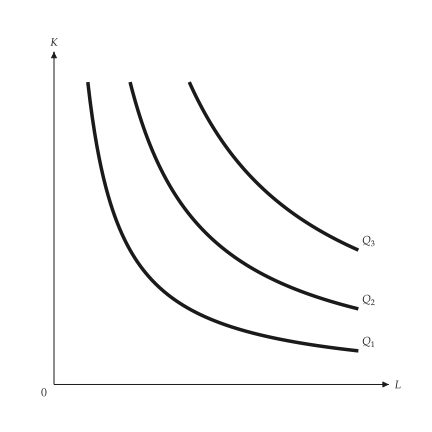{ .ev-figure-sm }

<div class="ev-downloads"><a class="ev-download" href="../../../assets/micro-viz/isoquants/isoquants.py" download aria-label="下載生圖原始檔"><svg viewBox="0 0 24 24" aria-hidden="true"><path d="M12 4v11m0 0-4.5-4.5M12 15l4.5-4.5M5 20h14" fill="none" stroke="currentColor" stroke-width="2" stroke-linecap="round" stroke-linejoin="round"/></svg><span>下載生圖原始檔</span></a></div>

<figcaption markdown>*等產量線圖。* 等產量線圖：愈遠離原點產量愈高。</figcaption>

</figure>

<span id="fig-isoquants-mrts-steps"></span>

<figure class="ev-fig" markdown>

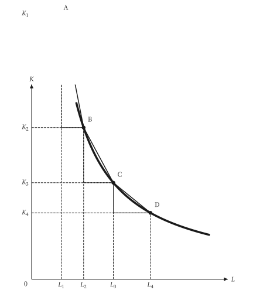{ .ev-figure-sm }

<div class="ev-downloads"><a class="ev-download" href="../../../assets/micro-viz/isoquants/isoquants.py" download aria-label="下載生圖原始檔"><svg viewBox="0 0 24 24" aria-hidden="true"><path d="M12 4v11m0 0-4.5-4.5M12 15l4.5-4.5M5 20h14" fill="none" stroke="currentColor" stroke-width="2" stroke-linecap="round" stroke-linejoin="round"/></svg><span>下載生圖原始檔</span></a></div>

<figcaption markdown>*MRTS 遞減。* 沿等產量線向右，邊際技術替代率遞減。</figcaption>

</figure>

<span id="fig-isoquants-mrts-triangle"></span>

<figure class="ev-fig" markdown>

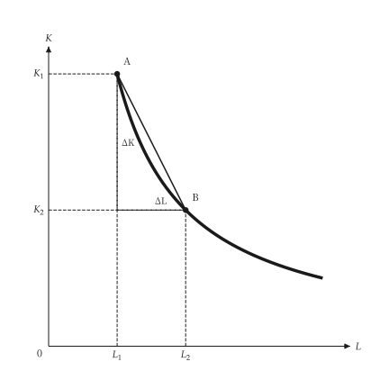{ .ev-figure-sm }

<div class="ev-downloads"><a class="ev-download" href="../../../assets/micro-viz/isoquants/isoquants.py" download aria-label="下載生圖原始檔"><svg viewBox="0 0 24 24" aria-hidden="true"><path d="M12 4v11m0 0-4.5-4.5M12 15l4.5-4.5M5 20h14" fill="none" stroke="currentColor" stroke-width="2" stroke-linecap="round" stroke-linejoin="round"/></svg><span>下載生圖原始檔</span></a></div>

<figcaption markdown>*MRTS 三角形。* 兩點間的 ΔK 與 ΔL 之比定義邊際技術替代率。</figcaption>

</figure>

<span id="fig-isoquants-perfect-substitutes"></span>

<figure class="ev-fig" markdown>

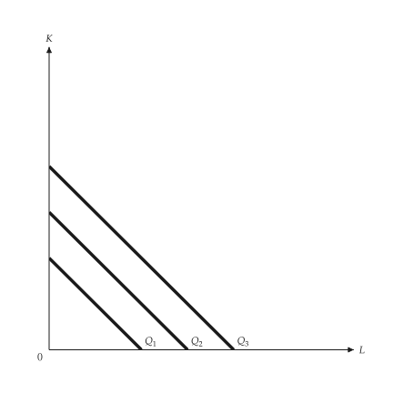{ .ev-figure-sm }

<div class="ev-downloads"><a class="ev-download" href="../../../assets/micro-viz/isoquants/isoquants.py" download aria-label="下載生圖原始檔"><svg viewBox="0 0 24 24" aria-hidden="true"><path d="M12 4v11m0 0-4.5-4.5M12 15l4.5-4.5M5 20h14" fill="none" stroke="currentColor" stroke-width="2" stroke-linecap="round" stroke-linejoin="round"/></svg><span>下載生圖原始檔</span></a></div>

<figcaption markdown>*完全替代。* 完全替代的等產量線為直線，MRTS 為常數。</figcaption>

</figure>

<span id="fig-isoquants-fixed-proportions"></span>

<figure class="ev-fig" markdown>

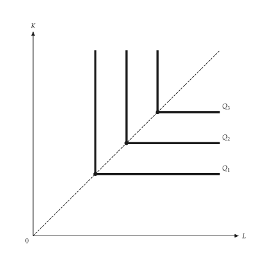{ .ev-figure-sm }

<div class="ev-downloads"><a class="ev-download" href="../../../assets/micro-viz/isoquants/isoquants.py" download aria-label="下載生圖原始檔"><svg viewBox="0 0 24 24" aria-hidden="true"><path d="M12 4v11m0 0-4.5-4.5M12 15l4.5-4.5M5 20h14" fill="none" stroke="currentColor" stroke-width="2" stroke-linecap="round" stroke-linejoin="round"/></svg><span>下載生圖原始檔</span></a></div>

<figcaption markdown>*固定比例。* 固定比例的等產量線呈 L 形，轉折點在同一條射線上。</figcaption>

</figure>

<span id="fig-isoquants-returns-to-scale"></span>

<figure class="ev-fig" markdown>

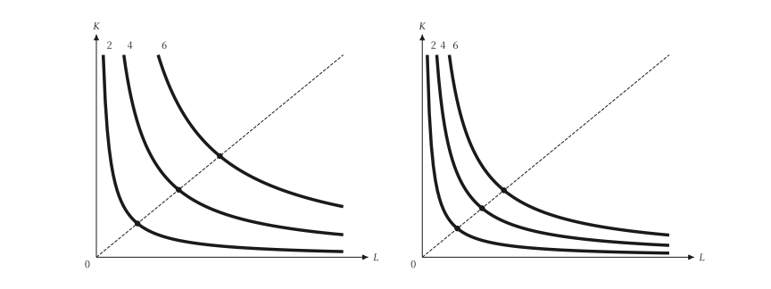{ .ev-figure-sm }

<div class="ev-downloads"><a class="ev-download" href="../../../assets/micro-viz/isoquants/isoquants.py" download aria-label="下載生圖原始檔"><svg viewBox="0 0 24 24" aria-hidden="true"><path d="M12 4v11m0 0-4.5-4.5M12 15l4.5-4.5M5 20h14" fill="none" stroke="currentColor" stroke-width="2" stroke-linecap="round" stroke-linejoin="round"/></svg><span>下載生圖原始檔</span></a></div>

<figcaption markdown>*規模報酬。* 沿射線，固定報酬下等產量線等距，規模報酬遞增則愈來愈近。</figcaption>

</figure>

## 成本最小化

<span id="sec-ex-cost-minimization"></span>

等成本線在成本最低的組合與等產量線相切；圖中改變投入價格、技術與固定資本。

<!-- api: micro_viz.guides_inputs_5 -->

`cost_minimizing_bundle()` 在投入價格下回傳某產量的最低成本 `Bundle`；`expansion_path()` 給出各產量的最低成本組合，其成本即長期總成本。

<!-- api: micro_viz.guides_inputs_6 -->

`output` 的等產量線與在最低成本組合相切的等成本線，另有一條較低與一條較高的等成本線。

<!-- api: micro_viz.guides_inputs_7 -->

上圖是等產量線、相切的等成本線與經過切點的擴張線；下圖是長期總成本 `C` 對產量。

<!-- api: micro_viz.guides_inputs_8 -->

資本固定在 `K_0` 時產量只能沿水平線增加；超過某點後，經過切點的長期擴張線較便宜。

<!-- api: micro_viz.guides_inputs_9 -->

勞動變貴（`new_wage`）：等成本線變陡，新切點用較少勞動、較多資本；`along` 另畫沿等產量線的箭頭。

<!-- api: micro_viz.guides_inputs_10 -->

技術進步：同一 `output` 的等產量線內移（細線 `Q'`），最低成本組合落在較低的等成本線上。

下面是腳本中畫圖的函式，與圖形使用相同的程式碼。

```python
def cost_examples(
    output_dir: Path,
    theme: PlotTheme,
    *,
    technology: CobbDouglas,
    improved: CobbDouglas,
    outputs: list[float],
    output: float,
    wage: float,
    rent: float,
    new_wage: float,
    capital: float,
    bounds: tuple[float, float],
    title: str | None = None,
) -> list[Path]:
    """Write the cost-minimization figures into ``output_dir`` and return their paths."""
    output_dir.mkdir(parents=True, exist_ok=True)
    figures = {
        "cost_minimization.svg": cost_minimization_canvas(
            technology,
            output,
            wage,
            rent,
            bounds,
            theme=theme,
            title=title,
        ),
        "input_price_change.svg": input_price_change_canvas(
            technology,
            output,
            wage,
            rent,
            new_wage,
            bounds,
            along=True,
            theme=theme,
            title=title,
        ),
        "technical_change.svg": technical_change_canvas(
            technology,
            improved,
            output,
            wage,
            rent,
            bounds,
            theme=theme,
            title=title,
        ),
        "expansion_path.svg": expansion_path_canvas(
            technology, outputs, wage, rent, bounds, theme=theme
        ),
        "fixed_capital.svg": fixed_capital_canvas(
            technology,
            outputs,
            capital,
            wage,
            rent,
            bounds,
            theme=theme,
            title=title,
        ),
    }
    paths = []
    for name, figure in figures.items():
        figure.save(output_dir / name)
        paths.append(output_dir / name)
    return paths
```

<span id="fig-cost-minimization-cost-minimization"></span>

<figure class="ev-fig" markdown>

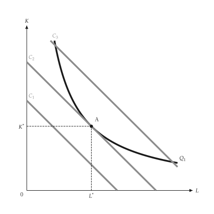{ .ev-figure-sm }

<div class="ev-downloads"><a class="ev-download" href="../../../assets/micro-viz/cost_minimization/cost_minimization.py" download aria-label="下載生圖原始檔"><svg viewBox="0 0 24 24" aria-hidden="true"><path d="M12 4v11m0 0-4.5-4.5M12 15l4.5-4.5M5 20h14" fill="none" stroke="currentColor" stroke-width="2" stroke-linecap="round" stroke-linejoin="round"/></svg><span>下載生圖原始檔</span></a></div>

<figcaption markdown>*成本最小化。* 等成本線與等產量線相切處為成本最低的組合。</figcaption>

</figure>

<span id="fig-cost-minimization-input-price-change"></span>

<figure class="ev-fig" markdown>

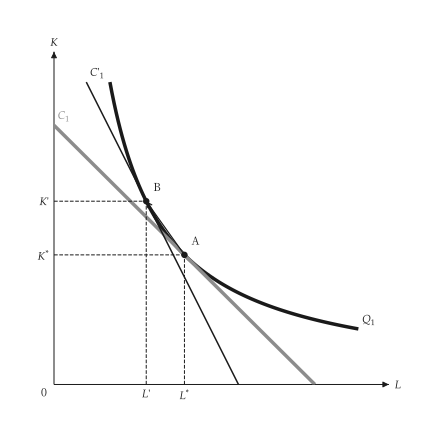{ .ev-figure-sm }

<div class="ev-downloads"><a class="ev-download" href="../../../assets/micro-viz/cost_minimization/cost_minimization.py" download aria-label="下載生圖原始檔"><svg viewBox="0 0 24 24" aria-hidden="true"><path d="M12 4v11m0 0-4.5-4.5M12 15l4.5-4.5M5 20h14" fill="none" stroke="currentColor" stroke-width="2" stroke-linecap="round" stroke-linejoin="round"/></svg><span>下載生圖原始檔</span></a></div>

<figcaption markdown>*工資上升。* 工資上升使等成本線變陡，新切點使用較少勞動。</figcaption>

</figure>

<span id="fig-cost-minimization-technical-change"></span>

<figure class="ev-fig" markdown>

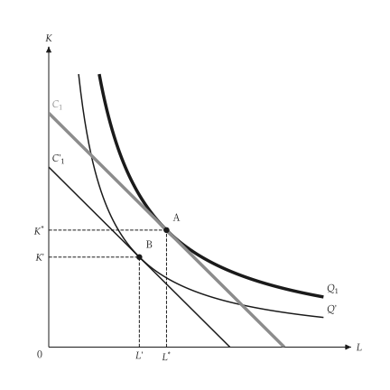{ .ev-figure-sm }

<div class="ev-downloads"><a class="ev-download" href="../../../assets/micro-viz/cost_minimization/cost_minimization.py" download aria-label="下載生圖原始檔"><svg viewBox="0 0 24 24" aria-hidden="true"><path d="M12 4v11m0 0-4.5-4.5M12 15l4.5-4.5M5 20h14" fill="none" stroke="currentColor" stroke-width="2" stroke-linecap="round" stroke-linejoin="round"/></svg><span>下載生圖原始檔</span></a></div>

<figcaption markdown>*技術進步。* 技術進步使等產量線內移，成本降低。</figcaption>

</figure>

<span id="fig-cost-minimization-expansion-path"></span>

<figure class="ev-fig" markdown>

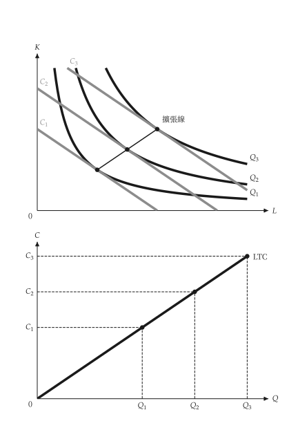{ .ev-figure-sm }

<div class="ev-downloads"><a class="ev-download" href="../../../assets/micro-viz/cost_minimization/cost_minimization.py" download aria-label="下載生圖原始檔"><svg viewBox="0 0 24 24" aria-hidden="true"><path d="M12 4v11m0 0-4.5-4.5M12 15l4.5-4.5M5 20h14" fill="none" stroke="currentColor" stroke-width="2" stroke-linecap="round" stroke-linejoin="round"/></svg><span>下載生圖原始檔</span></a></div>

<figcaption markdown>*擴張線。* 擴張線連接各切點，並推得長期總成本曲線。</figcaption>

</figure>

<span id="fig-cost-minimization-fixed-capital"></span>

<figure class="ev-fig" markdown>

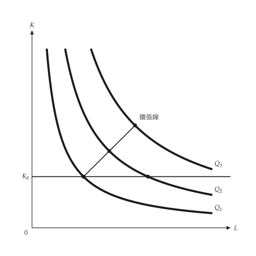{ .ev-figure-sm }

<div class="ev-downloads"><a class="ev-download" href="../../../assets/micro-viz/cost_minimization/cost_minimization.py" download aria-label="下載生圖原始檔"><svg viewBox="0 0 24 24" aria-hidden="true"><path d="M12 4v11m0 0-4.5-4.5M12 15l4.5-4.5M5 20h14" fill="none" stroke="currentColor" stroke-width="2" stroke-linecap="round" stroke-linejoin="round"/></svg><span>下載生圖原始檔</span></a></div>

<figcaption markdown>*資本固定。* 資本固定時產量只能沿水平線擴張，長期擴張線較便宜。</figcaption>

</figure>

## 學習、範疇與生產前緣

<span id="sec-ex-production-extensions"></span>

學習使單位投入隨累積產量下降；範疇、技術進步與生產前緣擴充生產模型。 出處：[Wright (1936)](../project/references.md#wright1936)、[Arrow (1962)](../project/references.md#arrow1962)。

<!-- api: micro_viz.guides_inputs_11 -->

`LearningCurve` 與 `LearningAverageCost` 給出單位投入與成本對累積產量的關係；`ProductTransformation`、`TechnologyShift` 與 `ProductionFrontier` 是對應的模型。

<!-- api: micro_viz.guides_inputs_12 -->

單位產出的投入量對累積產量：向下趨近下限 `A`。

<!-- api: micro_viz.guides_inputs_13 -->

產品轉換曲線 `PT`；`reference` 加上連接兩個最大值的直線（沒有聯合生產的利益），顯示外凸。

<!-- api: micro_viz.guides_inputs_14 -->

邊際報酬遞減的生產前緣；內部的點嚴格在前緣之下（投入使用無效率）；`names` 依序標點。

<!-- api: micro_viz.guides_inputs_15 -->

兩條平均成本曲線：沿 `AC_1` 從 `A` 到 `B` 是規模利益；從 `B` 垂直下移到 `AC_2`（`C`）是學習。

<!-- api: micro_viz.guides_inputs_16 -->

技術進步使總產量曲線上移；基準曲線為粗線，其餘為細實線；`arrow_input` 畫垂直箭頭。

下面是腳本中畫圖的函式，與圖形使用相同的程式碼。

```python
def extension_examples(
    output_dir: Path,
    theme: PlotTheme,
    *,
    learning: LearningCurve,
    cumulative_max: float,
    cost: LearningAverageCost,
    learning_gain: float,
    scale_range: tuple[float, float],
    transformation: ProductTransformation,
    production: ShortRunProductionFunction,
    factors: tuple[float, ...],
    input_max: float,
    frontier: ProductionFrontier,
    point_names: tuple[str, ...],
    title: str | None = None,
) -> list[Path]:
    """Write the production-extension figures into ``output_dir`` and return their paths."""
    output_dir.mkdir(parents=True, exist_ok=True)
    figures = {
        "learning_curve.svg": learning_curve_canvas(
            learning, cumulative_max, theme=theme, title=title
        ),
        "scale_vs_learning.svg": scale_vs_learning_canvas(
            cost,
            learning_gain,
            scale_range[0],
            scale_range[1],
            theme=theme,
            title=title,
        ),
        "product_transformation.svg": product_transformation_canvas(
            transformation, theme=theme, title=title
        ),
        "technology_shift.svg": technology_shift_canvas(
            TechnologyShift(production, factors),
            input_max,
            input_max / 2,
            theme=theme,
            title=title,
        ),
        "production_frontier.svg": production_frontier_canvas(
            frontier,
            input_max,
            point_names,
            theme=theme,
            title=title,
        ),
    }
    paths = []
    for name, figure in figures.items():
        figure.save(output_dir / name)
        paths.append(output_dir / name)
    return paths
```

<span id="fig-production-extensions-learning-curve"></span>

<figure class="ev-fig" markdown>

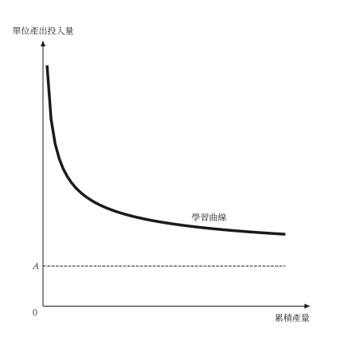{ .ev-figure-sm }

<div class="ev-downloads"><a class="ev-download" href="../../../assets/micro-viz/production_extensions/production_extensions.py" download aria-label="下載生圖原始檔"><svg viewBox="0 0 24 24" aria-hidden="true"><path d="M12 4v11m0 0-4.5-4.5M12 15l4.5-4.5M5 20h14" fill="none" stroke="currentColor" stroke-width="2" stroke-linecap="round" stroke-linejoin="round"/></svg><span>下載生圖原始檔</span></a></div>

<figcaption markdown>*學習曲線。* 單位產出投入量隨累積產量下降並趨近下限。</figcaption>

</figure>

<span id="fig-production-extensions-scale-vs-learning"></span>

<figure class="ev-fig" markdown>

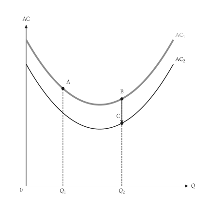{ .ev-figure-sm }

<div class="ev-downloads"><a class="ev-download" href="../../../assets/micro-viz/production_extensions/production_extensions.py" download aria-label="下載生圖原始檔"><svg viewBox="0 0 24 24" aria-hidden="true"><path d="M12 4v11m0 0-4.5-4.5M12 15l4.5-4.5M5 20h14" fill="none" stroke="currentColor" stroke-width="2" stroke-linecap="round" stroke-linejoin="round"/></svg><span>下載生圖原始檔</span></a></div>

<figcaption markdown>*規模與學習。* 沿 AC 移動是規模效果，下移到另一條 AC 是學習效果。</figcaption>

</figure>

<span id="fig-production-extensions-product-transformation"></span>

<figure class="ev-fig" markdown>

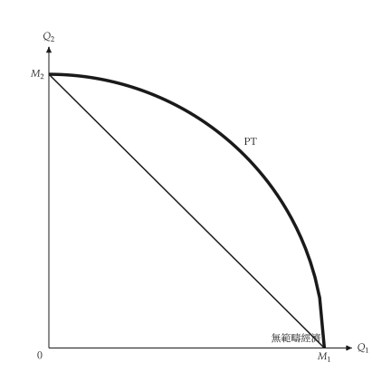{ .ev-figure-sm }

<div class="ev-downloads"><a class="ev-download" href="../../../assets/micro-viz/production_extensions/production_extensions.py" download aria-label="下載生圖原始檔"><svg viewBox="0 0 24 24" aria-hidden="true"><path d="M12 4v11m0 0-4.5-4.5M12 15l4.5-4.5M5 20h14" fill="none" stroke="currentColor" stroke-width="2" stroke-linecap="round" stroke-linejoin="round"/></svg><span>下載生圖原始檔</span></a></div>

<figcaption markdown>*產品轉換曲線。* 向外凸的轉換曲線表示範疇經濟。</figcaption>

</figure>

<span id="fig-production-extensions-technology-shift"></span>

<figure class="ev-fig" markdown>

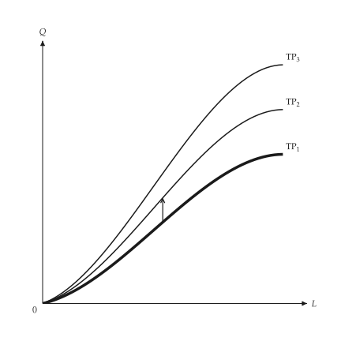{ .ev-figure-sm }

<div class="ev-downloads"><a class="ev-download" href="../../../assets/micro-viz/production_extensions/production_extensions.py" download aria-label="下載生圖原始檔"><svg viewBox="0 0 24 24" aria-hidden="true"><path d="M12 4v11m0 0-4.5-4.5M12 15l4.5-4.5M5 20h14" fill="none" stroke="currentColor" stroke-width="2" stroke-linecap="round" stroke-linejoin="round"/></svg><span>下載生圖原始檔</span></a></div>

<figcaption markdown>*技術進步。* 技術進步使總產量曲線向上移動。</figcaption>

</figure>

<span id="fig-production-extensions-production-frontier"></span>

<figure class="ev-fig" markdown>

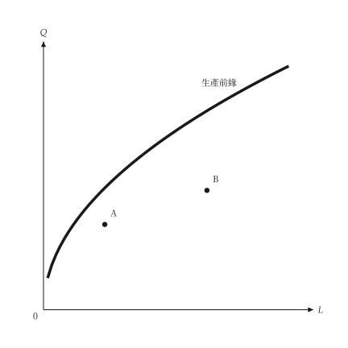{ .ev-figure-sm }

<div class="ev-downloads"><a class="ev-download" href="../../../assets/micro-viz/production_extensions/production_extensions.py" download aria-label="下載生圖原始檔"><svg viewBox="0 0 24 24" aria-hidden="true"><path d="M12 4v11m0 0-4.5-4.5M12 15l4.5-4.5M5 20h14" fill="none" stroke="currentColor" stroke-width="2" stroke-linecap="round" stroke-linejoin="round"/></svg><span>下載生圖原始檔</span></a></div>

<figcaption markdown>*生產前緣。* 前緣之下的點表示投入使用無效率。</figcaption>

</figure>

## 要素市場

<span id="sec-ex-factor-markets"></span>

廠商在 MRP 等於要素價格處僱用；圖中比較競爭與獨占的產品市場、短期與長期，以及經濟租。

<!-- api: micro_viz.guides_inputs_17 -->

`LinearValue` 是邊際價值產量，`LinearSupply` 是要素供給；`FactorMarket` 求均衡，`DerivedDemand` 比較 VMP 與 MRP，`LandMarket` 的供給為垂直。

<!-- api: micro_viz.guides_inputs_18 -->

資本增加時的 MRP 曲線，每條曲線上一個僱用點，對應 `wages` 中的工資（工資下降使廠商增加資本）。

<!-- api: micro_viz.guides_inputs_19 -->

`VMP`（競爭產品市場）在 `MRP`（獨占產品市場）之上：兩者都是以價格計算的邊際產量，獨占者的邊際收益較低。

<!-- api: micro_viz.guides_inputs_20 -->

經濟租：市場工資與供給曲線之間、到僱用量為止的三角形。

<!-- api: micro_viz.guides_inputs_21 -->

產品市場競爭（`MRP = VMP`）與獨占（較低的 MRP：工資與僱用量較低）的要素市場均衡並列。

<!-- api: micro_viz.guides_inputs_22 -->

面對水平供給 `W*` 的廠商在 `MRP = W*` 處僱用；`lower_wage` 使水平供給下移（細實線），僱用沿 MRP 增加。

<!-- api: micro_viz.guides_inputs_23 -->

廠商需求與產業需求並列：細線是廠商需求的水平加總，產業需求更陡。

<!-- api: micro_viz.guides_inputs_24 -->

垂直的土地供給 `supply`，需求決定地租 `R*`；地租以下的整個長方形都是經濟租。

<!-- api: micro_viz.guides_inputs_25 -->

向上的投入市場供給，與單一廠商在市場工資下面對的水平供給並列。

<!-- api: micro_viz.guides_inputs_26 -->

經過同一點的短期與長期投入需求，長期更平坦。

下面是腳本中畫圖的函式，與圖形使用相同的程式碼。

```python
def factor_examples(
    output_dir: Path,
    theme: PlotTheme,
    *,
    product: LinearValue,
    price: float,
    mr_share: float,
    supply: LinearSupply,
    wage: float,
    lower_wage: float,
    firms: int,
    price_effect: float,
    capital: tuple[float, ...],
    wages: tuple[float, ...],
    land: tuple[float, float, float],
    title: str | None = None,
) -> list[Path]:
    """Write the factor-market figures into ``output_dir`` and return their paths."""
    output_dir.mkdir(parents=True, exist_ok=True)
    competitive = DerivedDemand(product, price)
    monopoly = DerivedDemand(product, price, mr_share)
    market = FactorMarket(competitive.demand, supply)
    anchor = market.equilibrium()
    firm = FactorMarket(competitive.demand, supply)
    industry = IndustryFactorDemand(
        competitive.demand, firms, price_effect
    )
    adjustment = InputAdjustment(
        anchor[0],
        anchor[1],
        competitive.demand.slope * 2,
        competitive.demand.slope / 2,
    )
    figures = {
        "derived_demand.svg": derived_demand_canvas(
            monopoly, theme=theme, title=title
        ),
        "firm_hiring.svg": firm_hiring_canvas(
            firm, wage, theme=theme, title=title
        ),
        "wage_decline.svg": firm_hiring_canvas(
            firm, wage, lower_wage, theme=theme, title=title
        ),
        "capital_adjustment.svg": capital_adjustment_canvas(
            CapitalAdjustment(competitive.demand, capital),
            wages,
            theme=theme,
            title=title,
        ),
        "industry_demand.svg": industry_factor_demand_canvas(
            industry, anchor[1], theme=theme
        ),
        "short_long_run.svg": short_long_run_canvas(
            adjustment,
            competitive.demand.intercept,
            theme=theme,
            title=title,
        ),
        "market_supply.svg": market_supply_canvas(
            market, theme=theme
        ),
        "factor_equilibrium.svg": factor_equilibrium_canvas(
            market,
            FactorMarket(monopoly.demand, supply),
            theme=theme,
        ),
        "economic_rent.svg": economic_rent_canvas(
            market, theme=theme, title=title
        ),
        "land_rent.svg": land_rent_canvas(
            LandMarket(LinearValue(land[0], land[1]), land[2]),
            theme=theme,
            title=title,
        ),
    }
    paths = []
    for name, figure in figures.items():
        figure.save(output_dir / name)
        paths.append(output_dir / name)
    return paths
```

<span id="fig-factor-markets-derived-demand"></span>

<figure class="ev-fig" markdown>

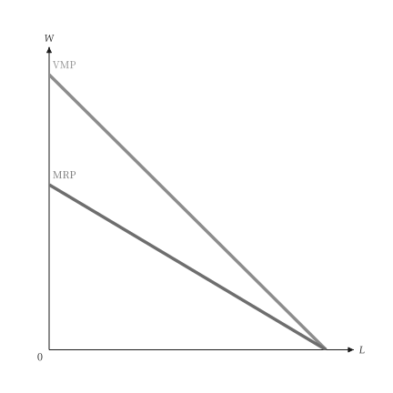{ .ev-figure-sm }

<div class="ev-downloads"><a class="ev-download" href="../../../assets/micro-viz/factor_markets/factor_markets.py" download aria-label="下載生圖原始檔"><svg viewBox="0 0 24 24" aria-hidden="true"><path d="M12 4v11m0 0-4.5-4.5M12 15l4.5-4.5M5 20h14" fill="none" stroke="currentColor" stroke-width="2" stroke-linecap="round" stroke-linejoin="round"/></svg><span>下載生圖原始檔</span></a></div>

<figcaption markdown>*VMP 與 MRP。* 完全競爭產品市場的 VMP 高於獨佔產品市場的 MRP。</figcaption>

</figure>

<span id="fig-factor-markets-firm-hiring"></span>

<figure class="ev-fig" markdown>

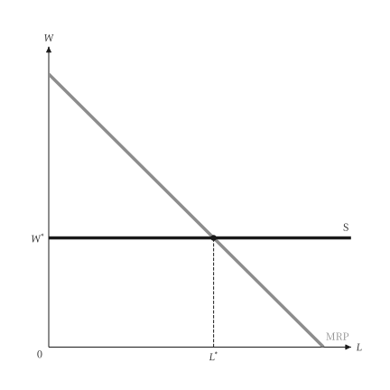{ .ev-figure-sm }

<div class="ev-downloads"><a class="ev-download" href="../../../assets/micro-viz/factor_markets/factor_markets.py" download aria-label="下載生圖原始檔"><svg viewBox="0 0 24 24" aria-hidden="true"><path d="M12 4v11m0 0-4.5-4.5M12 15l4.5-4.5M5 20h14" fill="none" stroke="currentColor" stroke-width="2" stroke-linecap="round" stroke-linejoin="round"/></svg><span>下載生圖原始檔</span></a></div>

<figcaption markdown>*廠商僱用。* 廠商面對水平的供給，在 MRP = W 處僱用。</figcaption>

</figure>

<span id="fig-factor-markets-wage-decline"></span>

<figure class="ev-fig" markdown>

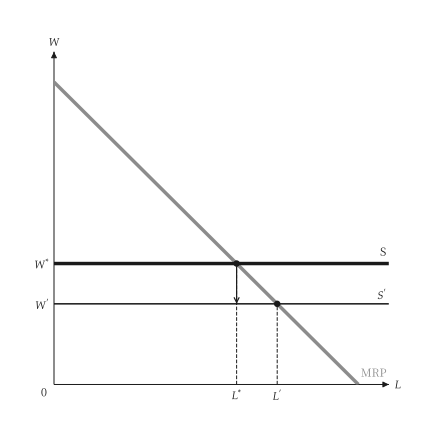{ .ev-figure-sm }

<div class="ev-downloads"><a class="ev-download" href="../../../assets/micro-viz/factor_markets/factor_markets.py" download aria-label="下載生圖原始檔"><svg viewBox="0 0 24 24" aria-hidden="true"><path d="M12 4v11m0 0-4.5-4.5M12 15l4.5-4.5M5 20h14" fill="none" stroke="currentColor" stroke-width="2" stroke-linecap="round" stroke-linejoin="round"/></svg><span>下載生圖原始檔</span></a></div>

<figcaption markdown>*市場工資下降。* 工資下降使水平供給下移，僱用量沿 MRP 增加。</figcaption>

</figure>

<span id="fig-factor-markets-capital-adjustment"></span>

<figure class="ev-fig" markdown>

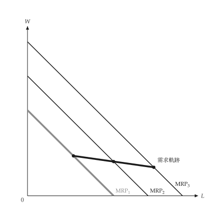{ .ev-figure-sm }

<div class="ev-downloads"><a class="ev-download" href="../../../assets/micro-viz/factor_markets/factor_markets.py" download aria-label="下載生圖原始檔"><svg viewBox="0 0 24 24" aria-hidden="true"><path d="M12 4v11m0 0-4.5-4.5M12 15l4.5-4.5M5 20h14" fill="none" stroke="currentColor" stroke-width="2" stroke-linecap="round" stroke-linejoin="round"/></svg><span>下載生圖原始檔</span></a></div>

<figcaption markdown>*資本調整。* 資本增加使 MRP 右移，各僱用點連成長期需求軌跡。</figcaption>

</figure>

<span id="fig-factor-markets-industry-demand"></span>

<figure class="ev-fig" markdown>

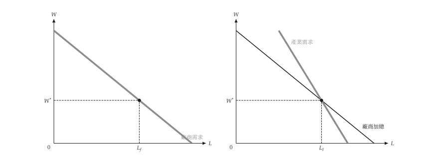{ .ev-figure-sm }

<div class="ev-downloads"><a class="ev-download" href="../../../assets/micro-viz/factor_markets/factor_markets.py" download aria-label="下載生圖原始檔"><svg viewBox="0 0 24 24" aria-hidden="true"><path d="M12 4v11m0 0-4.5-4.5M12 15l4.5-4.5M5 20h14" fill="none" stroke="currentColor" stroke-width="2" stroke-linecap="round" stroke-linejoin="round"/></svg><span>下載生圖原始檔</span></a></div>

<figcaption markdown>*廠商與產業需求。* 產業需求比廠商需求的水平加總更陡。</figcaption>

</figure>

<span id="fig-factor-markets-short-long-run"></span>

<figure class="ev-fig" markdown>

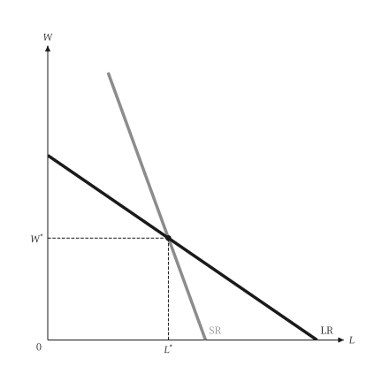{ .ev-figure-sm }

<div class="ev-downloads"><a class="ev-download" href="../../../assets/micro-viz/factor_markets/factor_markets.py" download aria-label="下載生圖原始檔"><svg viewBox="0 0 24 24" aria-hidden="true"><path d="M12 4v11m0 0-4.5-4.5M12 15l4.5-4.5M5 20h14" fill="none" stroke="currentColor" stroke-width="2" stroke-linecap="round" stroke-linejoin="round"/></svg><span>下載生圖原始檔</span></a></div>

<figcaption markdown>*短期與長期投入需求。* 長期投入需求比短期更平坦。</figcaption>

</figure>

<span id="fig-factor-markets-market-supply"></span>

<figure class="ev-fig" markdown>

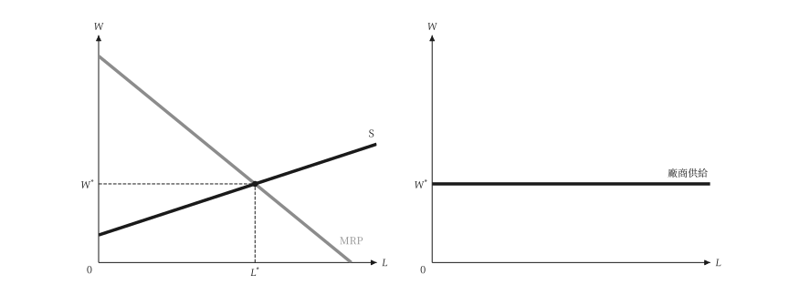{ .ev-figure-sm }

<div class="ev-downloads"><a class="ev-download" href="../../../assets/micro-viz/factor_markets/factor_markets.py" download aria-label="下載生圖原始檔"><svg viewBox="0 0 24 24" aria-hidden="true"><path d="M12 4v11m0 0-4.5-4.5M12 15l4.5-4.5M5 20h14" fill="none" stroke="currentColor" stroke-width="2" stroke-linecap="round" stroke-linejoin="round"/></svg><span>下載生圖原始檔</span></a></div>

<figcaption markdown>*市場與廠商供給。* 向上的市場供給與單一廠商面對的水平供給。</figcaption>

</figure>

<span id="fig-factor-markets-factor-equilibrium"></span>

<figure class="ev-fig" markdown>

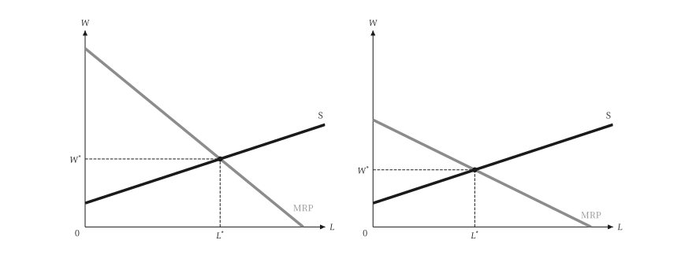{ .ev-figure-sm }

<div class="ev-downloads"><a class="ev-download" href="../../../assets/micro-viz/factor_markets/factor_markets.py" download aria-label="下載生圖原始檔"><svg viewBox="0 0 24 24" aria-hidden="true"><path d="M12 4v11m0 0-4.5-4.5M12 15l4.5-4.5M5 20h14" fill="none" stroke="currentColor" stroke-width="2" stroke-linecap="round" stroke-linejoin="round"/></svg><span>下載生圖原始檔</span></a></div>

<figcaption markdown>*要素市場均衡。* 產品市場獨佔使 MRP 較低，工資與僱用量也較低。</figcaption>

</figure>

<span id="fig-factor-markets-economic-rent"></span>

<figure class="ev-fig" markdown>

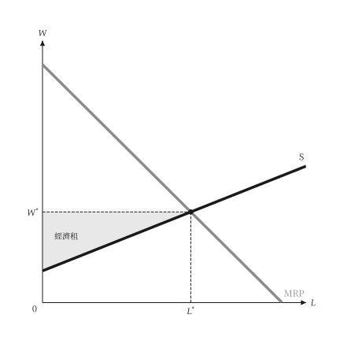{ .ev-figure-sm }

<div class="ev-downloads"><a class="ev-download" href="../../../assets/micro-viz/factor_markets/factor_markets.py" download aria-label="下載生圖原始檔"><svg viewBox="0 0 24 24" aria-hidden="true"><path d="M12 4v11m0 0-4.5-4.5M12 15l4.5-4.5M5 20h14" fill="none" stroke="currentColor" stroke-width="2" stroke-linecap="round" stroke-linejoin="round"/></svg><span>下載生圖原始檔</span></a></div>

<figcaption markdown>*勞動的經濟租。* 工資與供給曲線之間的面積是勞動的經濟租。</figcaption>

</figure>

<span id="fig-factor-markets-land-rent"></span>

<figure class="ev-fig" markdown>

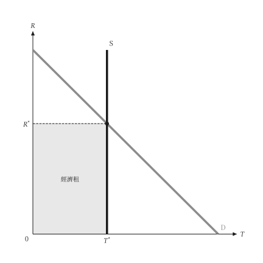{ .ev-figure-sm }

<div class="ev-downloads"><a class="ev-download" href="../../../assets/micro-viz/factor_markets/factor_markets.py" download aria-label="下載生圖原始檔"><svg viewBox="0 0 24 24" aria-hidden="true"><path d="M12 4v11m0 0-4.5-4.5M12 15l4.5-4.5M5 20h14" fill="none" stroke="currentColor" stroke-width="2" stroke-linecap="round" stroke-linejoin="round"/></svg><span>下載生圖原始檔</span></a></div>

<figcaption markdown>*地租。* 土地供給垂直，需求決定地租。</figcaption>

</figure>

## 買方獨佔與工會

<span id="sec-ex-monopsony"></span>

單一買者在 ME = MV 處購買，並支付供給價格；工會在勞動需求上選點。

<!-- api: micro_viz.guides_inputs_27 -->

`Monopsonist` 求買者的選擇與無謂損失；`UnionWageSetting` 與 `TwoSectorLabor` 求解工會的情形。

<!-- api: micro_viz.guides_inputs_28 -->

競爭買方（水平的 `ME = AE` 對 `MV`）與競爭賣方（水平的 `MR = AR` 對 `MC`）並列。

<!-- api: micro_viz.guides_inputs_29 -->

獨占（`AR`、`MR`、`MC`）與買方獨佔（`MV`、`ME`、`AE`）並列，由同一組線性曲線建成。

<!-- api: micro_viz.guides_inputs_30 -->

買方獨佔：買者在 `ME = MV`（勞動為 `MRP`）處僱用，支付該數量下的供給價格，低於競爭的數量與價格。

<!-- api: micro_viz.guides_inputs_31 -->

買方獨佔與競爭結果的比較：長方形 `A` 是由賣者移轉給買者，三角形 `B`、`C` 是無謂損失。

<!-- api: micro_viz.guides_inputs_32 -->

每條供給曲線一欄，共用座標軸：供給愈平坦（愈有彈性），`ME` 愈接近 `AE`。

<!-- api: micro_viz.guides_inputs_33 -->

兩部門：高於競爭工資 `W_c` 的工會工資使部門 1 就業下降，失業工人湧入部門 2 並壓低其工資。

<!-- api: micro_viz.guides_inputs_34 -->

工會在廠商勞動需求上選點：僱用量 `L`、工資總額長方形，以及高於會員供給價格的租。

下面是腳本中畫圖的函式，與圖形使用相同的程式碼。

```python
def monopsony_examples(
    output_dir: Path,
    theme: PlotTheme,
    *,
    value: LinearValue,
    supply: LinearSupply,
    elastic: LinearSupply,
    inelastic: LinearSupply,
    price: float,
    sector_2: LinearValue,
    total: float,
    union_wage: float,
    title: str | None = None,
) -> list[Path]:
    """Write the monopsony figures into ``output_dir`` and return their paths."""
    output_dir.mkdir(parents=True, exist_ok=True)
    model = Monopsonist(supply, value)
    figures = {
        "competitive_pair.svg": competitive_pair_canvas(
            value, supply, price, theme=theme
        ),
        "monopsony.svg": monopsony_canvas(
            model, theme=theme, title=title
        ),
        "monopoly_monopsony.svg": monopoly_monopsony_pair_canvas(
            model, theme=theme
        ),
        "supply_elasticity.svg": supply_elasticity_canvas(
            value, (elastic, inelastic), theme=theme
        ),
        "monopsony_dwl.svg": monopsony_dwl_canvas(
            model, theme=theme, title=title
        ),
        "labor_monopsony.svg": monopsony_canvas(
            model, labor=True, theme=theme, title=title
        ),
        "union.svg": union_wage_canvas(
            UnionWageSetting(value, supply),
            theme=theme,
            title=title,
        ),
        "two_sector.svg": two_sector_labor_canvas(
            TwoSectorLabor(value, sector_2, total),
            union_wage,
            theme=theme,
        ),
    }
    paths = []
    for name, figure in figures.items():
        figure.save(output_dir / name)
        paths.append(output_dir / name)
    return paths
```

<span id="fig-monopsony-competitive-pair"></span>

<figure class="ev-fig" markdown>

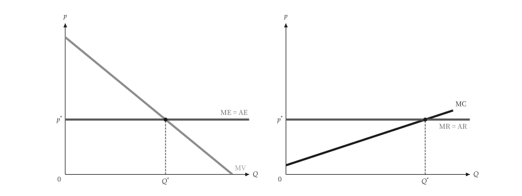{ .ev-figure-sm }

<div class="ev-downloads"><a class="ev-download" href="../../../assets/micro-viz/monopsony/monopsony.py" download aria-label="下載生圖原始檔"><svg viewBox="0 0 24 24" aria-hidden="true"><path d="M12 4v11m0 0-4.5-4.5M12 15l4.5-4.5M5 20h14" fill="none" stroke="currentColor" stroke-width="2" stroke-linecap="round" stroke-linejoin="round"/></svg><span>下載生圖原始檔</span></a></div>

<figcaption markdown>*競爭的買方與賣方。* 競爭買方面對水平的 ME = AE，競爭賣方面對水平的 MR = AR。</figcaption>

</figure>

<span id="fig-monopsony-monopsony"></span>

<figure class="ev-fig" markdown>

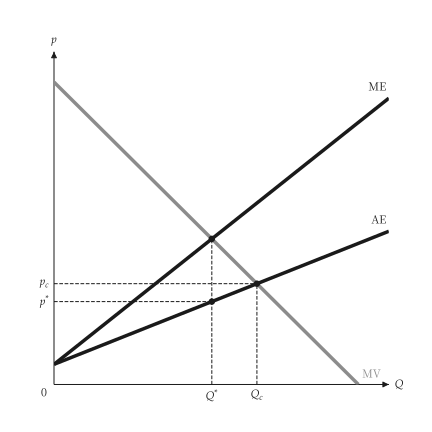{ .ev-figure-sm }

<div class="ev-downloads"><a class="ev-download" href="../../../assets/micro-viz/monopsony/monopsony.py" download aria-label="下載生圖原始檔"><svg viewBox="0 0 24 24" aria-hidden="true"><path d="M12 4v11m0 0-4.5-4.5M12 15l4.5-4.5M5 20h14" fill="none" stroke="currentColor" stroke-width="2" stroke-linecap="round" stroke-linejoin="round"/></svg><span>下載生圖原始檔</span></a></div>

<figcaption markdown>*買方獨佔。* 買方獨佔在 ME = MV 處購買，支付 AE 上的價格。</figcaption>

</figure>

<span id="fig-monopsony-monopoly-monopsony"></span>

<figure class="ev-fig" markdown>

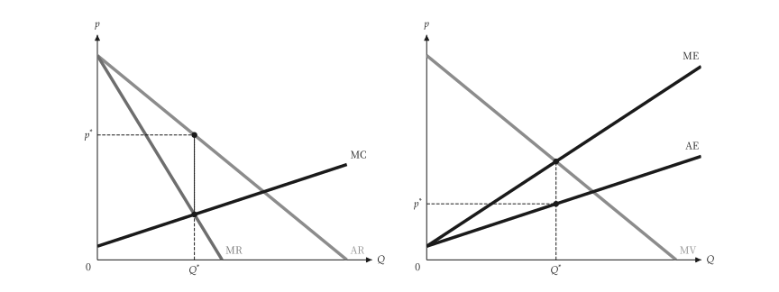{ .ev-figure-sm }

<div class="ev-downloads"><a class="ev-download" href="../../../assets/micro-viz/monopsony/monopsony.py" download aria-label="下載生圖原始檔"><svg viewBox="0 0 24 24" aria-hidden="true"><path d="M12 4v11m0 0-4.5-4.5M12 15l4.5-4.5M5 20h14" fill="none" stroke="currentColor" stroke-width="2" stroke-linecap="round" stroke-linejoin="round"/></svg><span>下載生圖原始檔</span></a></div>

<figcaption markdown>*獨占與買方獨佔。* 獨佔的 AR、MR、MC 與買方獨佔的 MV、ME、AE 並列。</figcaption>

</figure>

<span id="fig-monopsony-supply-elasticity"></span>

<figure class="ev-fig" markdown>

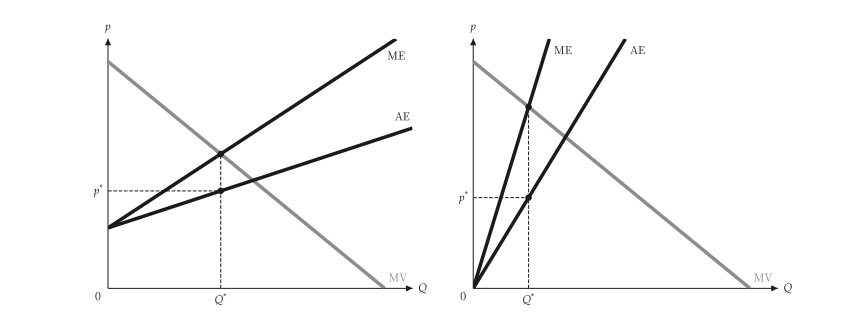{ .ev-figure-sm }

<div class="ev-downloads"><a class="ev-download" href="../../../assets/micro-viz/monopsony/monopsony.py" download aria-label="下載生圖原始檔"><svg viewBox="0 0 24 24" aria-hidden="true"><path d="M12 4v11m0 0-4.5-4.5M12 15l4.5-4.5M5 20h14" fill="none" stroke="currentColor" stroke-width="2" stroke-linecap="round" stroke-linejoin="round"/></svg><span>下載生圖原始檔</span></a></div>

<figcaption markdown>*供給彈性。* 供給愈有彈性，ME 愈接近 AE。</figcaption>

</figure>

<span id="fig-monopsony-monopsony-dwl"></span>

<figure class="ev-fig" markdown>

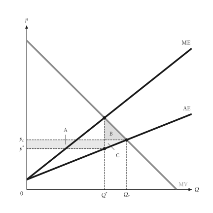{ .ev-figure-sm }

<div class="ev-downloads"><a class="ev-download" href="../../../assets/micro-viz/monopsony/monopsony.py" download aria-label="下載生圖原始檔"><svg viewBox="0 0 24 24" aria-hidden="true"><path d="M12 4v11m0 0-4.5-4.5M12 15l4.5-4.5M5 20h14" fill="none" stroke="currentColor" stroke-width="2" stroke-linecap="round" stroke-linejoin="round"/></svg><span>下載生圖原始檔</span></a></div>

<figcaption markdown>*買方獨佔的無謂損失。* 移轉長方形 A 與無謂損失三角形 B、C。</figcaption>

</figure>

<span id="fig-monopsony-labor-monopsony"></span>

<figure class="ev-fig" markdown>

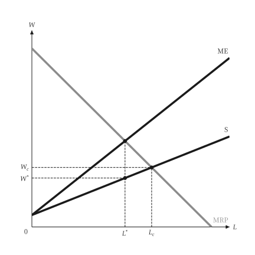{ .ev-figure-sm }

<div class="ev-downloads"><a class="ev-download" href="../../../assets/micro-viz/monopsony/monopsony.py" download aria-label="下載生圖原始檔"><svg viewBox="0 0 24 24" aria-hidden="true"><path d="M12 4v11m0 0-4.5-4.5M12 15l4.5-4.5M5 20h14" fill="none" stroke="currentColor" stroke-width="2" stroke-linecap="round" stroke-linejoin="round"/></svg><span>下載生圖原始檔</span></a></div>

<figcaption markdown>*勞動買方獨佔。* 勞動市場的買方獨佔：僱用量與工資都低於競爭水準。</figcaption>

</figure>

<span id="fig-monopsony-union"></span>

<figure class="ev-fig" markdown>

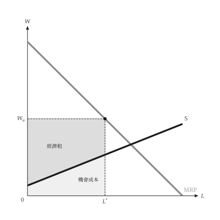{ .ev-figure-sm }

<div class="ev-downloads"><a class="ev-download" href="../../../assets/micro-viz/monopsony/monopsony.py" download aria-label="下載生圖原始檔"><svg viewBox="0 0 24 24" aria-hidden="true"><path d="M12 4v11m0 0-4.5-4.5M12 15l4.5-4.5M5 20h14" fill="none" stroke="currentColor" stroke-width="2" stroke-linecap="round" stroke-linejoin="round"/></svg><span>下載生圖原始檔</span></a></div>

<figcaption markdown>*工會訂工資。* 工會在勞動需求上選點：就業、租與機會成本。</figcaption>

</figure>

<span id="fig-monopsony-two-sector"></span>

<figure class="ev-fig" markdown>

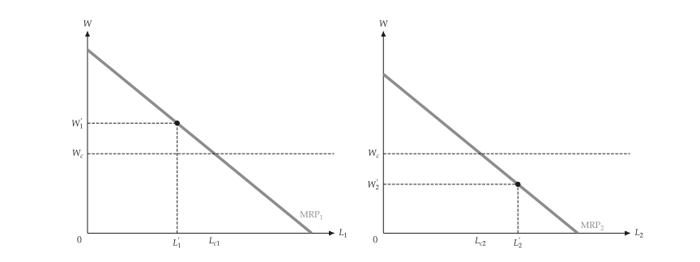{ .ev-figure-sm }

<div class="ev-downloads"><a class="ev-download" href="../../../assets/micro-viz/monopsony/monopsony.py" download aria-label="下載生圖原始檔"><svg viewBox="0 0 24 24" aria-hidden="true"><path d="M12 4v11m0 0-4.5-4.5M12 15l4.5-4.5M5 20h14" fill="none" stroke="currentColor" stroke-width="2" stroke-linecap="round" stroke-linejoin="round"/></svg><span>下載生圖原始檔</span></a></div>

<figcaption markdown>*兩部門勞動市場。* 工會工資使部門 1 就業下降，工人流入部門 2 而壓低其工資。</figcaption>

</figure>
