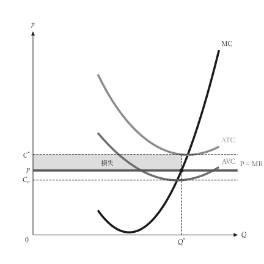

# 文字與位置

<span id="sec-labels"></span>

## 語系表

`micro-viz` 放進圖裡的每個字都存放在 `src/micro_viz/locale/labels.json`，先依穩定的編號（`production.tp`）、再依語言（`en`、`zh-TW`、`zh-CN`）排列。語言來自 `[micro] language`、`PlotTheme.language`，或範例腳本的 `--language`。

有欄位的文字在表裡用雙層大括號，例如 `$D_{{{index}}}$`；沒有欄位的文字用單層大括號。數學式寫在 `$...$` 裡，不使用 Unicode 下標。

符號在所有圖中一致：只有價格 `p` 用小寫，其他變數都是大寫斜體；縮寫（`MC`、`ATC`）與點名稱維持原來的大小寫。

## 取代文字

呼叫端傳入的內容照原樣使用，**不會**被翻譯。

```python
unit_cost_canvas(
    analysis,
    title="Unit costs",
    x_label="Quantity",
    labels={"cost.mc": "Marginal cost"},
)
```

`title=None`（預設）不畫標題。要用圖層編號調整某張圖的某個標籤，使用共用的逐圖表，`mosaickit` 會在儲存圖形時套用：

```toml
[figure.unit_cost.label."micro.cost.avc.label"]
top = "3pt"
right = "2mm"
```

<span id="sec-nudges"></span>

## 預設移動標籤

`[micro.label.<群組>]` 以每個方向一個長度（`top`、`bottom`、`left`、`right`；單位 `pt`、`mm`、`cm`、`in`）移動整組標籤。群組依標籤命名的對象分：

| 群組 | 標籤 |
| --- | --- |
| `point` | 有標籤的點 |
| `curve` | 曲線末端旁的曲線名稱 |
| `region` | 色塊內的名稱，包含引線標註 |
| `mark` | 價格線、數量標記與其他帶有數值的輔助線 |
| `annotation` | 其他文字 |

座標軸名稱、原點與軸上標記（`L_1`、`Q^*`）不屬於任何群組，**不能**移動。

## 標籤放在哪裡

- 曲線名稱放在曲線末端旁。兩條曲線末端很近時，繪圖函式會把其中一條命名在曲線中途（`at`），避免名稱互相碰到。
- 點標籤放在點旁，`mosaickit` 會選擇不碰到線、標記或其他文字的一側。
- 找不到空位時，`mosaickit` 會發出 `LayoutWarning`。測試把版面警告當成錯誤來繪圖，所以標籤重疊的圖會讓測試失敗。

## 落在曲線上的輔助線

完全落在實線直線段上的虛線輔助線**不會畫出**。最常見的是價格線上又疊一條虛線價格輔助線。標示水準的記號（例如 `p`）是獨立的圖層，會保留。

規則是 `micro_viz.visuals.common` 裡的 `drop_covered_guides`，在 `Plane` 或競爭圖完成時套用一次。虛線曲線（例如 AFC）不會遮住輔助線。

{ .ev-figure-sm }
