# 獨占與定價

<span id="sec-monopoly"></span>

每一節是一支範例腳本與它畫出的圖。腳本在範例壓縮檔中提供，參數可用 `--help` 查看。

## 獨占

<span id="sec-ex-monopoly"></span>

獨占者在 MR = MC 處生產，價格由需求曲線決定。總量、稅、需求移動、多個廠房與勒納指數都是這張圖的變化。 出處：[Lerner (1934)](../project/references.md#lerner1934)。

<!-- api: micro_viz.guides_monopoly_1 -->

`Monopolist.solve()` 回傳含產量、價格與利潤的 `MonopolyOutcome`；`MultiplantMonopoly` 把產量分給各廠房；`elasticity()` 是線性需求的價格彈性。

<!-- api: micro_viz.guides_monopoly_2 -->

每個需求一欄：以大括號標出 `p - MC` 的加成，需求有彈性時小、缺乏彈性時大。

<!-- api: micro_viz.guides_monopoly_3 -->

獨占者：需求 `D`（= AR）、`MR` 與 `curves` 中的成本曲線。

<!-- api: micro_viz.guides_monopoly_4 -->

需求移動（細實線 `D'` 與 `MR'`）：平行移動，或以 `rotate` 繞數量軸端點轉動。

<!-- api: micro_viz.guides_monopoly_5 -->

獨占與競爭結果 `p = MC` 的比較：移轉長方形與需求和 MC 之間的無謂損失三角形。

<!-- api: micro_viz.guides_monopoly_6 -->

從量稅使 MC 上移（細實線 `MC'`）；箭頭從 `Q_m` 處的舊 MC 指向新 MC，價格由 `p_m` 變為 `p'`。

<!-- api: micro_viz.guides_monopoly_7 -->

總收益、總成本與利潤對產量，利潤最大處 `Q_m` 的 R 與 TC 斜率相等。

<!-- api: micro_viz.guides_monopoly_8 -->

上方是總量，下方是單位曲線與利潤長方形，共用最適點 `Q_m`。

<!-- api: micro_viz.guides_monopoly_9 -->

各廠房的 MC 與水平加總的 `MC_T`，對 `D` 與 `MR`。

```python
def monopoly_examples(
    output_dir: Path,
    theme: PlotTheme,
    *,
    demand: LinearDemand,
    shifted: LinearDemand,
    rotated: LinearDemand,
    cost: CubicCost,
    plants: tuple[CubicCost, CubicCost],
    plant_demand: LinearDemand,
    elastic: LinearDemand,
    inelastic: LinearDemand,
    tax: float,
    lost_profit: tuple[float, float],
    min_output: float,
    max_output: float,
    samples: int,
    title: str | None = None,
) -> list[Path]:
    """Write the monopoly figures into ``output_dir`` and return their paths."""
    output_dir.mkdir(parents=True, exist_ok=True)
    window = (min_output, max_output)

    unit = analyze_costs(
        cost, output_range=window, samples=samples
    )
    firm = Monopolist(demand, cost)
    outcome = firm.solve()
    taxed_cost = cost.with_unit_tax(tax)
    taxed = analyze_costs(
        taxed_cost, output_range=window, samples=samples
    )
    taxed_outcome = Monopolist(demand, taxed_cost).solve()
    shifted_outcome = firm.with_demand(shifted).solve()
    rotated_outcome = firm.with_demand(rotated).solve()
    multi = MultiplantMonopoly(plant_demand, plants)
    elastic_outcome = Monopolist(elastic, cost).solve()
    inelastic_outcome = Monopolist(inelastic, cost).solve()
    figures = {
        "monopoly.svg": monopoly_canvas(
            outcome,
            unit,
            curves=("mc",),
            title=title,
            theme=theme,
        ),
        "monopoly_lost_profit.svg": monopoly_canvas(
            outcome,
            unit,
            curves=("mc",),
            lost_profit=lost_profit,
            title=title,
            theme=theme,
        ),
        "monopoly_profit.svg": monopoly_canvas(
            outcome, unit, profit=True, title=title, theme=theme
        ),
        "monopoly_totals.svg": monopoly_totals_canvas(
            outcome,
            output_range=window,
            title=title,
            theme=theme,
        ),
        "monopoly_totals_grid.svg": monopoly_totals_grid(
            outcome, unit, theme=theme
        ),
        "monopoly_dwl.svg": monopoly_dwl_canvas(
            outcome, unit, title=title, theme=theme
        ),
        "monopoly_tax.svg": monopoly_tax_canvas(
            outcome,
            taxed_outcome,
            unit,
            taxed,
            title=title,
            theme=theme,
        ),
        "monopoly_demand_shift.svg": monopoly_demand_shift_canvas(
            outcome,
            shifted_outcome,
            unit,
            title=title,
            theme=theme,
        ),
        "monopoly_demand_rotate.svg": monopoly_demand_shift_canvas(
            outcome,
            rotated_outcome,
            unit,
            rotate=True,
            title=title,
            theme=theme,
        ),
        "multiplant.svg": multiplant_canvas(
            multi, multi.solve(), theme=theme
        ),
        "lerner_markup.svg": lerner_markup_canvas(
            (elastic_outcome, inelastic_outcome),
            (unit, unit),
            theme=theme,
        ),
    }
    paths = []
    for name, figure in figures.items():
        figure.save(output_dir / name)
        paths.append(output_dir / name)
    return paths
```

<span id="fig-monopoly-monopoly"></span>

<figure class="ev-fig" markdown>

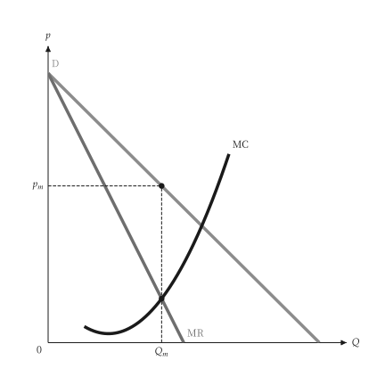{ .ev-figure-sm }

<div class="ev-downloads"><a class="ev-download" href="../../../assets/micro-viz/monopoly/monopoly.py" download aria-label="下載生圖原始檔"><svg viewBox="0 0 24 24" aria-hidden="true"><path d="M12 4v11m0 0-4.5-4.5M12 15l4.5-4.5M5 20h14" fill="none" stroke="currentColor" stroke-width="2" stroke-linecap="round" stroke-linejoin="round"/></svg><span>下載生圖原始檔</span></a></div>

<figcaption markdown>*獨占均衡。* 獨占者在 MR = MC 處生產，價格由需求曲線決定。</figcaption>

</figure>

<span id="fig-monopoly-monopoly-lost-profit"></span>

<figure class="ev-fig" markdown>

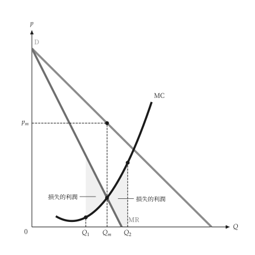{ .ev-figure-sm }

<div class="ev-downloads"><a class="ev-download" href="../../../assets/micro-viz/monopoly/monopoly.py" download aria-label="下載生圖原始檔"><svg viewBox="0 0 24 24" aria-hidden="true"><path d="M12 4v11m0 0-4.5-4.5M12 15l4.5-4.5M5 20h14" fill="none" stroke="currentColor" stroke-width="2" stroke-linecap="round" stroke-linejoin="round"/></svg><span>下載生圖原始檔</span></a></div>

<figcaption markdown>*偏離最適產量的損失。* 偏離 MR = MC 的產量都使利潤下降。</figcaption>

</figure>

<span id="fig-monopoly-monopoly-profit"></span>

<figure class="ev-fig" markdown>

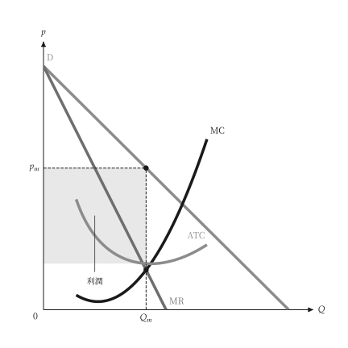{ .ev-figure-sm }

<div class="ev-downloads"><a class="ev-download" href="../../../assets/micro-viz/monopoly/monopoly.py" download aria-label="下載生圖原始檔"><svg viewBox="0 0 24 24" aria-hidden="true"><path d="M12 4v11m0 0-4.5-4.5M12 15l4.5-4.5M5 20h14" fill="none" stroke="currentColor" stroke-width="2" stroke-linecap="round" stroke-linejoin="round"/></svg><span>下載生圖原始檔</span></a></div>

<figcaption markdown>*獨占利潤。* 利潤為價格與 ATC 之間的長方形。</figcaption>

</figure>

<span id="fig-monopoly-monopoly-totals"></span>

<figure class="ev-fig" markdown>

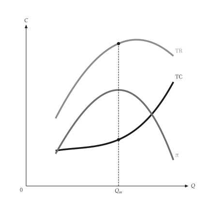{ .ev-figure-sm }

<div class="ev-downloads"><a class="ev-download" href="../../../assets/micro-viz/monopoly/monopoly.py" download aria-label="下載生圖原始檔"><svg viewBox="0 0 24 24" aria-hidden="true"><path d="M12 4v11m0 0-4.5-4.5M12 15l4.5-4.5M5 20h14" fill="none" stroke="currentColor" stroke-width="2" stroke-linecap="round" stroke-linejoin="round"/></svg><span>下載生圖原始檔</span></a></div>

<figcaption markdown>*總收益、總成本與利潤。* TR、TC 與利潤曲線，利潤最大處的斜率相等。</figcaption>

</figure>

<span id="fig-monopoly-monopoly-totals-grid"></span>

<figure class="ev-fig" markdown>

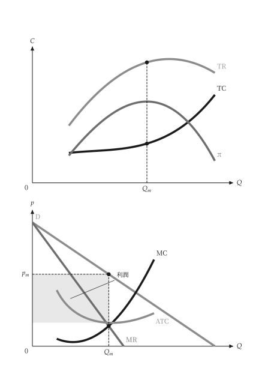{ .ev-figure-sm }

<div class="ev-downloads"><a class="ev-download" href="../../../assets/micro-viz/monopoly/monopoly.py" download aria-label="下載生圖原始檔"><svg viewBox="0 0 24 24" aria-hidden="true"><path d="M12 4v11m0 0-4.5-4.5M12 15l4.5-4.5M5 20h14" fill="none" stroke="currentColor" stroke-width="2" stroke-linecap="round" stroke-linejoin="round"/></svg><span>下載生圖原始檔</span></a></div>

<figcaption markdown>*總量與單位曲線。* 上圖為總量，下圖為單位曲線與利潤長方形。</figcaption>

</figure>

<span id="fig-monopoly-monopoly-dwl"></span>

<figure class="ev-fig" markdown>

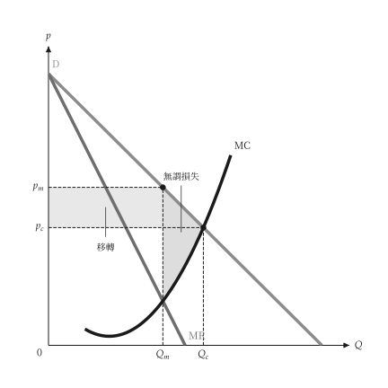{ .ev-figure-sm }

<div class="ev-downloads"><a class="ev-download" href="../../../assets/micro-viz/monopoly/monopoly.py" download aria-label="下載生圖原始檔"><svg viewBox="0 0 24 24" aria-hidden="true"><path d="M12 4v11m0 0-4.5-4.5M12 15l4.5-4.5M5 20h14" fill="none" stroke="currentColor" stroke-width="2" stroke-linecap="round" stroke-linejoin="round"/></svg><span>下載生圖原始檔</span></a></div>

<figcaption markdown>*獨占的無謂損失。* 與完全競爭相比的移轉長方形與無謂損失三角形。</figcaption>

</figure>

<span id="fig-monopoly-monopoly-tax"></span>

<figure class="ev-fig" markdown>

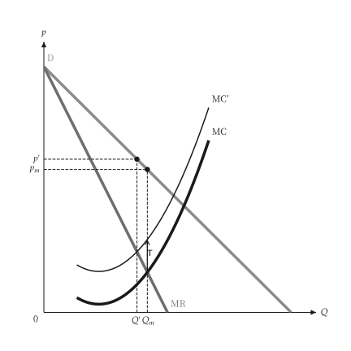{ .ev-figure-sm }

<div class="ev-downloads"><a class="ev-download" href="../../../assets/micro-viz/monopoly/monopoly.py" download aria-label="下載生圖原始檔"><svg viewBox="0 0 24 24" aria-hidden="true"><path d="M12 4v11m0 0-4.5-4.5M12 15l4.5-4.5M5 20h14" fill="none" stroke="currentColor" stroke-width="2" stroke-linecap="round" stroke-linejoin="round"/></svg><span>下載生圖原始檔</span></a></div>

<figcaption markdown>*對獨占者課從量稅。* 從量稅使 MC 上移，價格與產量隨之調整。</figcaption>

</figure>

<span id="fig-monopoly-monopoly-demand-shift"></span>

<figure class="ev-fig" markdown>

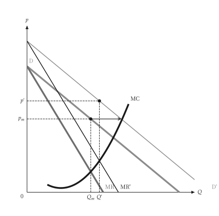{ .ev-figure-sm }

<div class="ev-downloads"><a class="ev-download" href="../../../assets/micro-viz/monopoly/monopoly.py" download aria-label="下載生圖原始檔"><svg viewBox="0 0 24 24" aria-hidden="true"><path d="M12 4v11m0 0-4.5-4.5M12 15l4.5-4.5M5 20h14" fill="none" stroke="currentColor" stroke-width="2" stroke-linecap="round" stroke-linejoin="round"/></svg><span>下載生圖原始檔</span></a></div>

<figcaption markdown>*需求移動。* 需求平行外移，獨占者沒有供給曲線，產量與價格隨 MR' = MC 改變。</figcaption>

</figure>

<span id="fig-monopoly-monopoly-demand-rotate"></span>

<figure class="ev-fig" markdown>

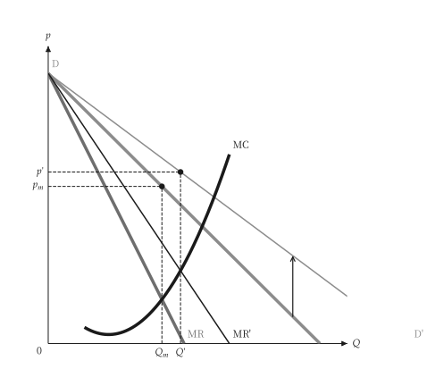{ .ev-figure-sm }

<div class="ev-downloads"><a class="ev-download" href="../../../assets/micro-viz/monopoly/monopoly.py" download aria-label="下載生圖原始檔"><svg viewBox="0 0 24 24" aria-hidden="true"><path d="M12 4v11m0 0-4.5-4.5M12 15l4.5-4.5M5 20h14" fill="none" stroke="currentColor" stroke-width="2" stroke-linecap="round" stroke-linejoin="round"/></svg><span>下載生圖原始檔</span></a></div>

<figcaption markdown>*需求轉動。* 需求曲線轉動時，價格與產量的變動方向取決於轉動的方式。</figcaption>

</figure>

<span id="fig-monopoly-multiplant"></span>

<figure class="ev-fig" markdown>

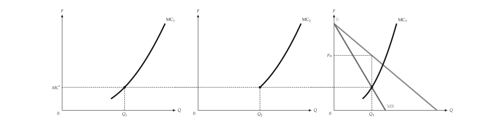{ .ev-figure-lg }

<div class="ev-downloads"><a class="ev-download" href="../../../assets/micro-viz/monopoly/monopoly.py" download aria-label="下載生圖原始檔"><svg viewBox="0 0 24 24" aria-hidden="true"><path d="M12 4v11m0 0-4.5-4.5M12 15l4.5-4.5M5 20h14" fill="none" stroke="currentColor" stroke-width="2" stroke-linecap="round" stroke-linejoin="round"/></svg><span>下載生圖原始檔</span></a></div>

<figcaption markdown>*多廠房獨占。* 各廠房 MC 水平加總後與 MR 相交，並決定各廠產量。</figcaption>

</figure>

<span id="fig-monopoly-lerner-markup"></span>

<figure class="ev-fig" markdown>

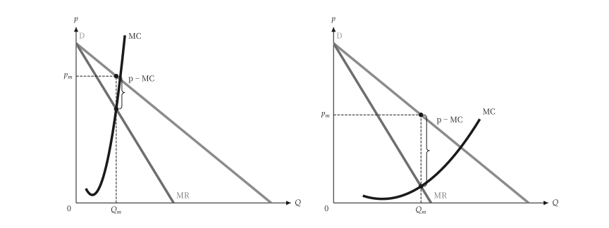{ .ev-figure-lg }

<div class="ev-downloads"><a class="ev-download" href="../../../assets/micro-viz/monopoly/monopoly.py" download aria-label="下載生圖原始檔"><svg viewBox="0 0 24 24" aria-hidden="true"><path d="M12 4v11m0 0-4.5-4.5M12 15l4.5-4.5M5 20h14" fill="none" stroke="currentColor" stroke-width="2" stroke-linecap="round" stroke-linejoin="round"/></svg><span>下載生圖原始檔</span></a></div>

<figcaption markdown>*勒納加成。* 需求愈缺乏彈性，加成 (p − MC) 愈大。</figcaption>

</figure>

## 獨占性競爭

<span id="sec-ex-monopolistic-competition"></span>

每家廠商面對向下的需求。進入使需求左移，直到與 ATC 相切，價格高於 MC，產能閒置。 出處：[Chamberlin (1933)](../project/references.md#chamberlin1933)。

<!-- api: micro_viz.guides_monopoly_10 -->

`solve_monopolistic_competition()` 回傳短期最適點與進入後的長期相切點；`long_run_demand()` 建立斜率相同且與 ATC 相切的需求曲線。

<!-- api: micro_viz.guides_monopoly_11 -->

獨占性競爭（價格高於 MC、有超額產能）與完全競爭（`p = MC` 在最低 ATC）並列。

<!-- api: micro_viz.guides_monopoly_12 -->

長期：需求在 `MR = MC` 的產量與 ATC 相切，價格高於 MC。

<!-- api: micro_viz.guides_monopoly_13 -->

短期：獨占最適點與進入前的利潤長方形。

```python
def monopolistic_examples(
    output_dir: Path,
    theme: PlotTheme,
    *,
    cost: CubicCost,
    demand: LinearDemand,
    min_output: float,
    max_output: float,
    samples: int,
    title: str | None = None,
) -> list[Path]:
    """Write the monopolistic-competition figures into ``output_dir``."""
    output_dir.mkdir(parents=True, exist_ok=True)
    unit = analyze_costs(
        cost,
        output_range=(min_output, max_output),
        samples=samples,
    )
    outcome = solve_monopolistic_competition(demand, cost)
    figures = {
        "short_run.svg": monopolistic_short_run_canvas(
            outcome, unit, theme=theme, title=title
        ),
        "long_run.svg": monopolistic_long_run_canvas(
            outcome, unit, theme=theme, title=title
        ),
        "excess_capacity.svg": excess_capacity_grid(
            outcome, unit, theme=theme
        ),
    }
    paths = []
    for name, figure in figures.items():
        figure.save(output_dir / name)
        paths.append(output_dir / name)
    return paths
```

<span id="fig-monopolistic-competition-short-run"></span>

<figure class="ev-fig" markdown>

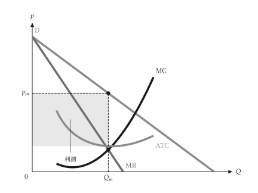{ .ev-figure-sm }

<div class="ev-downloads"><a class="ev-download" href="../../../assets/micro-viz/monopolistic_competition/monopolistic_competition.py" download aria-label="下載生圖原始檔"><svg viewBox="0 0 24 24" aria-hidden="true"><path d="M12 4v11m0 0-4.5-4.5M12 15l4.5-4.5M5 20h14" fill="none" stroke="currentColor" stroke-width="2" stroke-linecap="round" stroke-linejoin="round"/></svg><span>下載生圖原始檔</span></a></div>

<figcaption markdown>*短期均衡。* 短期有利潤，利潤矩形為價格與 ATC 之差乘以產量。</figcaption>

</figure>

<span id="fig-monopolistic-competition-long-run"></span>

<figure class="ev-fig" markdown>

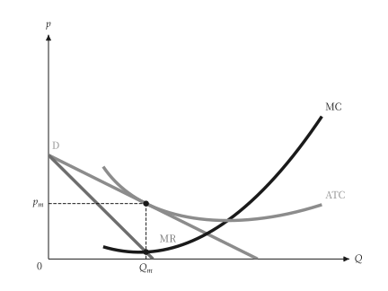{ .ev-figure-sm }

<div class="ev-downloads"><a class="ev-download" href="../../../assets/micro-viz/monopolistic_competition/monopolistic_competition.py" download aria-label="下載生圖原始檔"><svg viewBox="0 0 24 24" aria-hidden="true"><path d="M12 4v11m0 0-4.5-4.5M12 15l4.5-4.5M5 20h14" fill="none" stroke="currentColor" stroke-width="2" stroke-linecap="round" stroke-linejoin="round"/></svg><span>下載生圖原始檔</span></a></div>

<figcaption markdown>*長期相切。* 長期均衡：需求與 ATC 相切於 MR = MC 的產量，價格高於 MC。</figcaption>

</figure>

<span id="fig-monopolistic-competition-excess-capacity"></span>

<figure class="ev-fig" markdown>

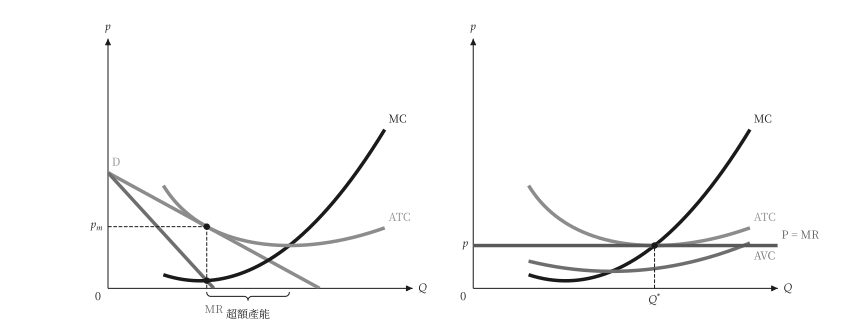{ .ev-figure-lg }

<div class="ev-downloads"><a class="ev-download" href="../../../assets/micro-viz/monopolistic_competition/monopolistic_competition.py" download aria-label="下載生圖原始檔"><svg viewBox="0 0 24 24" aria-hidden="true"><path d="M12 4v11m0 0-4.5-4.5M12 15l4.5-4.5M5 20h14" fill="none" stroke="currentColor" stroke-width="2" stroke-linecap="round" stroke-linejoin="round"/></svg><span>下載生圖原始檔</span></a></div>

<figcaption markdown>*超額產能。* 獨占性競爭的產量低於最低 ATC 的產量，差距為超額產能。</figcaption>

</figure>

## 管制

<span id="sec-ex-regulation"></span>

價格上限使獨占者的平均收益變平；ATC 遞減的自然獨占比較不管制、邊際成本定價與平均成本定價。

<!-- api: micro_viz.guides_monopoly_14 -->

`price_ceiling_outcome()` 求價格上限下的最適產量；`natural_monopoly_pricing()` 以 `PricingPoint` 回傳三種價格。

<!-- api: micro_viz.guides_monopoly_15 -->

ATC 遞減的自然獨占：不管制價格、`P = MC`（虧損以底色標出）與 `P = ATC`（零利潤）。

<!-- api: micro_viz.guides_monopoly_16 -->

價格上限：平均收益在上限處到 `Q_max` 為水平，邊際收益在該點等於上限，之後跳降回未管制的 MR。

```python
def regulation_examples(
    output_dir: Path,
    theme: PlotTheme,
    *,
    cost: CubicCost,
    demand: LinearDemand,
    ceiling: float,
    natural_demand: LinearDemand,
    fixed_cost: float,
    marginal_cost: float,
    min_output: float,
    max_output: float,
    samples: int,
    title: str | None = None,
) -> list[Path]:
    """Write the regulation figures into ``output_dir`` and return their paths."""
    output_dir.mkdir(parents=True, exist_ok=True)
    unit = analyze_costs(
        cost,
        output_range=(min_output, max_output),
        samples=samples,
    )
    capped = price_ceiling_outcome(
        Monopolist(demand, cost), ceiling
    )
    natural_cost = PiecewiseCost(
        (
            CostSegment(
                natural_demand.quantity_intercept * 1.05,
                marginal_cost,
            ),
        ),
        fixed_cost=fixed_cost,
    )
    natural = analyze_costs(
        natural_cost,
        output_range=(
            min_output,
            natural_demand.quantity_intercept,
        ),
        samples=samples,
    )
    pricing = natural_monopoly_pricing(
        Monopolist(natural_demand, natural_cost)
    )
    figures = {
        "price_ceiling.svg": price_ceiling_canvas(
            capped, unit, theme=theme, title=title
        ),
        "natural_monopoly.svg": natural_monopoly_canvas(
            pricing, natural, theme=theme, title=title
        ),
    }
    paths = []
    for name, figure in figures.items():
        figure.save(output_dir / name)
        paths.append(output_dir / name)
    return paths
```

<span id="fig-regulation-price-ceiling"></span>

<figure class="ev-fig" markdown>

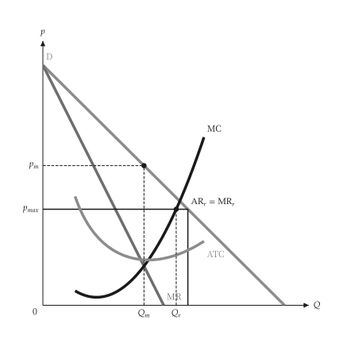{ .ev-figure-sm }

<div class="ev-downloads"><a class="ev-download" href="../../../assets/micro-viz/regulation/regulation.py" download aria-label="下載生圖原始檔"><svg viewBox="0 0 24 24" aria-hidden="true"><path d="M12 4v11m0 0-4.5-4.5M12 15l4.5-4.5M5 20h14" fill="none" stroke="currentColor" stroke-width="2" stroke-linecap="round" stroke-linejoin="round"/></svg><span>下載生圖原始檔</span></a></div>

<figcaption markdown>*價格上限。* 價格上限使平均收益在上限處變平，邊際收益在該點跳降。</figcaption>

</figure>

<span id="fig-regulation-natural-monopoly"></span>

<figure class="ev-fig" markdown>

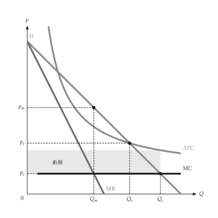{ .ev-figure-sm }

<div class="ev-downloads"><a class="ev-download" href="../../../assets/micro-viz/regulation/regulation.py" download aria-label="下載生圖原始檔"><svg viewBox="0 0 24 24" aria-hidden="true"><path d="M12 4v11m0 0-4.5-4.5M12 15l4.5-4.5M5 20h14" fill="none" stroke="currentColor" stroke-width="2" stroke-linecap="round" stroke-linejoin="round"/></svg><span>下載生圖原始檔</span></a></div>

<figcaption markdown>*自然獨占定價。* 比較不管制價格、邊際成本定價（虧損）與平均成本定價。</figcaption>

</figure>

## 價格歧視

<span id="sec-ex-price-discrimination"></span>

完全、分段與三級差別訂價，與單一獨占價格對照。

<!-- api: micro_viz.guides_monopoly_17 -->

`first_degree()`、`block_pricing()` 與 `third_degree()` 回傳對應的結果物件，含數量、價格與利潤。

<!-- api: micro_viz.guides_monopoly_18 -->

每一段以最後一位買者的價格出售：需求下方的階梯，到 `D = MC` 為止；`average_cost` 另加遞減的 ATC。

<!-- api: micro_viz.guides_monopoly_19 -->

完全差別訂價：價格隨需求到 `D = MC`，利潤為需求與 MC 之間的面積。

<!-- api: micro_viz.guides_monopoly_20 -->

單一獨占價格（`MR = MC`）：其上的消費者剩餘，以及 `Q^*` 之後需求與 MC 之間未被攫取的剩餘；`groups` 可另加分組。

<!-- api: micro_viz.guides_monopoly_21 -->

每個市場一欄（`D_i`、`MR_i` 與共同水準 `MC*`），最後一欄是加總的 `MR_T` 與 MC 相交。

```python
def discrimination_examples(
    output_dir: Path,
    theme: PlotTheme,
    *,
    demand: LinearDemand,
    marginal_cost: float,
    fixed_cost: float,
    blocks: int,
    markets: tuple[LinearDemand, ...],
    skipped_market: LinearDemand,
    rising_cost: CubicCost,
    capacity: float,
    title: str | None = None,
) -> list[Path]:
    """Write the price-discrimination figures into ``output_dir``."""
    output_dir.mkdir(parents=True, exist_ok=True)
    flat: CostFunction = PiecewiseCost(
        (CostSegment(capacity, marginal_cost),)
    )
    with_fixed = PiecewiseCost(
        (CostSegment(capacity, marginal_cost),),
        fixed_cost=fixed_cost,
    )
    figures = {
        "single_price.svg": single_price_canvas(
            demand, flat, groups=True, theme=theme, title=title
        ),
        "first_degree.svg": first_degree_canvas(
            first_degree(demand, flat), theme=theme, title=title
        ),
        "block_pricing_three.svg": block_pricing_canvas(
            block_pricing(demand, flat, 3),
            theme=theme,
            title=title,
        ),
        "block_pricing.svg": block_pricing_canvas(
            block_pricing(demand, with_fixed, blocks),
            average_cost=True,
            theme=theme,
            title=title,
        ),
        "third_degree.svg": third_degree_canvas(
            third_degree(markets, flat), theme=theme
        ),
        "third_degree_corner.svg": third_degree_canvas(
            third_degree(
                (markets[0], skipped_market), rising_cost
            ),
            theme=theme,
        ),
    }
    paths = []
    for name, figure in figures.items():
        figure.save(output_dir / name)
        paths.append(output_dir / name)
    return paths
```

<span id="fig-price-discrimination-single-price"></span>

<figure class="ev-fig" markdown>

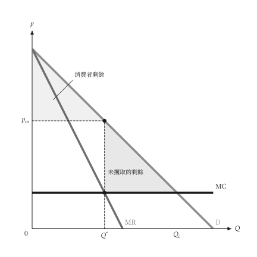{ .ev-figure-sm }

<div class="ev-downloads"><a class="ev-download" href="../../../assets/micro-viz/price_discrimination/price_discrimination.py" download aria-label="下載生圖原始檔"><svg viewBox="0 0 24 24" aria-hidden="true"><path d="M12 4v11m0 0-4.5-4.5M12 15l4.5-4.5M5 20h14" fill="none" stroke="currentColor" stroke-width="2" stroke-linecap="round" stroke-linejoin="round"/></svg><span>下載生圖原始檔</span></a></div>

<figcaption markdown>*單一價格。* 單一價格下有未攫取的剩餘。</figcaption>

</figure>

<span id="fig-price-discrimination-first-degree"></span>

<figure class="ev-fig" markdown>

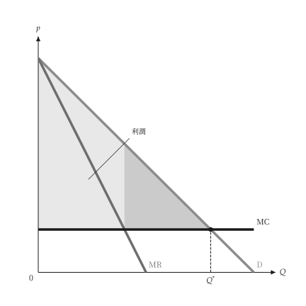{ .ev-figure-sm }

<div class="ev-downloads"><a class="ev-download" href="../../../assets/micro-viz/price_discrimination/price_discrimination.py" download aria-label="下載生圖原始檔"><svg viewBox="0 0 24 24" aria-hidden="true"><path d="M12 4v11m0 0-4.5-4.5M12 15l4.5-4.5M5 20h14" fill="none" stroke="currentColor" stroke-width="2" stroke-linecap="round" stroke-linejoin="round"/></svg><span>下載生圖原始檔</span></a></div>

<figcaption markdown>*完全差別訂價。* 價格隨需求曲線，利潤為需求與 MC 之間的面積。</figcaption>

</figure>

<span id="fig-price-discrimination-block-pricing-three"></span>

<figure class="ev-fig" markdown>

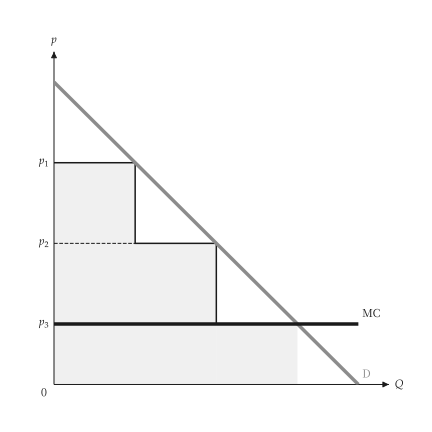{ .ev-figure-sm }

<div class="ev-downloads"><a class="ev-download" href="../../../assets/micro-viz/price_discrimination/price_discrimination.py" download aria-label="下載生圖原始檔"><svg viewBox="0 0 24 24" aria-hidden="true"><path d="M12 4v11m0 0-4.5-4.5M12 15l4.5-4.5M5 20h14" fill="none" stroke="currentColor" stroke-width="2" stroke-linecap="round" stroke-linejoin="round"/></svg><span>下載生圖原始檔</span></a></div>

<figcaption markdown>*三段式定價。* 三段式定價是不完全的一級差別訂價。</figcaption>

</figure>

<span id="fig-price-discrimination-block-pricing"></span>

<figure class="ev-fig" markdown>

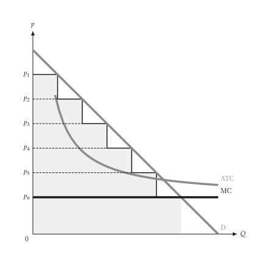{ .ev-figure-sm }

<div class="ev-downloads"><a class="ev-download" href="../../../assets/micro-viz/price_discrimination/price_discrimination.py" download aria-label="下載生圖原始檔"><svg viewBox="0 0 24 24" aria-hidden="true"><path d="M12 4v11m0 0-4.5-4.5M12 15l4.5-4.5M5 20h14" fill="none" stroke="currentColor" stroke-width="2" stroke-linecap="round" stroke-linejoin="round"/></svg><span>下載生圖原始檔</span></a></div>

<figcaption markdown>*遞減 ATC 的分段定價。* 需求在遞減平均成本之上，分段定價。</figcaption>

</figure>

<span id="fig-price-discrimination-third-degree"></span>

<figure class="ev-fig" markdown>

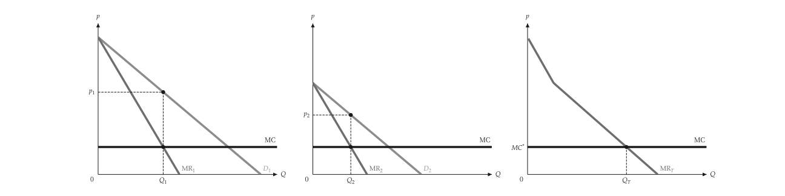{ .ev-figure-lg }

<div class="ev-downloads"><a class="ev-download" href="../../../assets/micro-viz/price_discrimination/price_discrimination.py" download aria-label="下載生圖原始檔"><svg viewBox="0 0 24 24" aria-hidden="true"><path d="M12 4v11m0 0-4.5-4.5M12 15l4.5-4.5M5 20h14" fill="none" stroke="currentColor" stroke-width="2" stroke-linecap="round" stroke-linejoin="round"/></svg><span>下載生圖原始檔</span></a></div>

<figcaption markdown>*三級差別訂價。* MR1 = MR2 = MC，加總的邊際收益決定總產量。</figcaption>

</figure>

<span id="fig-price-discrimination-third-degree-corner"></span>

<figure class="ev-fig" markdown>

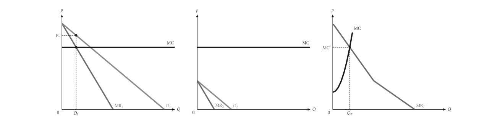{ .ev-figure-lg }

<div class="ev-downloads"><a class="ev-download" href="../../../assets/micro-viz/price_discrimination/price_discrimination.py" download aria-label="下載生圖原始檔"><svg viewBox="0 0 24 24" aria-hidden="true"><path d="M12 4v11m0 0-4.5-4.5M12 15l4.5-4.5M5 20h14" fill="none" stroke="currentColor" stroke-width="2" stroke-linecap="round" stroke-linejoin="round"/></svg><span>下載生圖原始檔</span></a></div>

<figcaption markdown>*角解。* 邊際成本上升時，小市場可能不被服務。</figcaption>

</figure>

## 兩部定價

<span id="sec-ex-two-part-tariff"></span>

入場費加使用費。入場費取走被服務買者中剩餘最小者的剩餘，由此得到利潤。 出處：[Oi (1971)](../project/references.md#oi1971)。

<!-- api: micro_viz.guides_monopoly_22 -->

`BuyerType` 是附權重的需求曲線；`best_tariff()` 搜尋使用費，`evaluate_tariff()` 給出一組費用的利潤。

<!-- api: micro_viz.guides_monopoly_23 -->

入場費利潤、銷售利潤與總利潤對入場費 `T`：每當一類買者被擠出就向下跳。

<!-- api: micro_viz.guides_monopoly_24 -->

各類買者的需求、固定的 MC 與使用費 `p^*`；入場費是剩餘最小的買者的消費者剩餘三角形。

```python
def tariff_examples(
    output_dir: Path,
    theme: PlotTheme,
    *,
    single: BuyerType,
    buyers: tuple[BuyerType, ...],
    marginal_cost: float,
    usage_fee: float,
    fee_max: float,
    title: str | None = None,
) -> list[Path]:
    """Write the tariff figures into ``output_dir`` and return their paths."""
    output_dir.mkdir(parents=True, exist_ok=True)
    flat = evaluate_tariff(
        (single,),
        marginal_cost,
        marginal_cost,
        single.surplus(marginal_cost),
    )
    best = best_tariff(buyers, marginal_cost)
    figures = {
        "single_buyer.svg": two_part_tariff_canvas(
            (single,), flat, theme=theme, title=title
        ),
        "two_buyers.svg": two_part_tariff_canvas(
            buyers, best, theme=theme, title=title
        ),
        "tariff_profit.svg": tariff_profit_canvas(
            buyers,
            marginal_cost,
            usage_fee,
            fee_max,
            theme=theme,
            title=title,
        ),
    }
    paths = []
    for name, figure in figures.items():
        figure.save(output_dir / name)
        paths.append(output_dir / name)
    return paths
```

<span id="fig-two-part-tariff-single-buyer"></span>

<figure class="ev-fig" markdown>

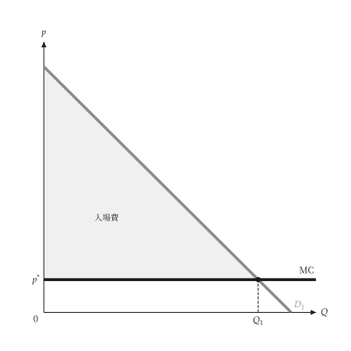{ .ev-figure-sm }

<div class="ev-downloads"><a class="ev-download" href="../../../assets/micro-viz/two_part_tariff/two_part_tariff.py" download aria-label="下載生圖原始檔"><svg viewBox="0 0 24 24" aria-hidden="true"><path d="M12 4v11m0 0-4.5-4.5M12 15l4.5-4.5M5 20h14" fill="none" stroke="currentColor" stroke-width="2" stroke-linecap="round" stroke-linejoin="round"/></svg><span>下載生圖原始檔</span></a></div>

<figcaption markdown>*兩部定價，單一買者。* 使用費等於 MC，入場費取走整個消費者剩餘。</figcaption>

</figure>

<span id="fig-two-part-tariff-two-buyers"></span>

<figure class="ev-fig" markdown>

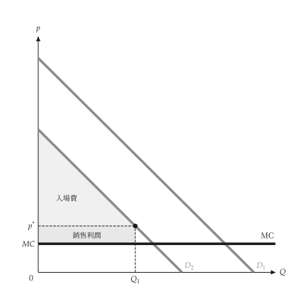{ .ev-figure-sm }

<div class="ev-downloads"><a class="ev-download" href="../../../assets/micro-viz/two_part_tariff/two_part_tariff.py" download aria-label="下載生圖原始檔"><svg viewBox="0 0 24 24" aria-hidden="true"><path d="M12 4v11m0 0-4.5-4.5M12 15l4.5-4.5M5 20h14" fill="none" stroke="currentColor" stroke-width="2" stroke-linecap="round" stroke-linejoin="round"/></svg><span>下載生圖原始檔</span></a></div>

<figcaption markdown>*兩部定價，兩類買者。* 使用費高於 MC，入場費等於需求較小者的剩餘。</figcaption>

</figure>

<span id="fig-two-part-tariff-tariff-profit"></span>

<figure class="ev-fig" markdown>

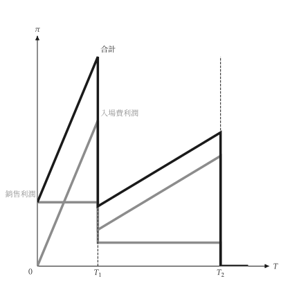{ .ev-figure-sm }

<div class="ev-downloads"><a class="ev-download" href="../../../assets/micro-viz/two_part_tariff/two_part_tariff.py" download aria-label="下載生圖原始檔"><svg viewBox="0 0 24 24" aria-hidden="true"><path d="M12 4v11m0 0-4.5-4.5M12 15l4.5-4.5M5 20h14" fill="none" stroke="currentColor" stroke-width="2" stroke-linecap="round" stroke-linejoin="round"/></svg><span>下載生圖原始檔</span></a></div>

<figcaption markdown>*利潤與入場費。* 入場費利潤、銷售利潤與總利潤隨入場費變動。</figcaption>

</figure>

## 搭售

<span id="sec-ex-bundling"></span>

消費者位於保留價格空間。分開銷售、純粹搭售與混合搭售把這個空間切成購買區域。 出處：[Adams (1976)](../project/references.md#adamsyellen1976)。

<!-- api: micro_viz.guides_monopoly_25 -->

`ValuationProfile` 保存消費者的保留價格；`best_separate()`、`best_pure()` 與 `best_mixed()` 搜尋利潤最大的價格；`choice_regions()` 以多邊形給出購買區域。

<!-- api: micro_viz.guides_monopoly_26 -->

混合搭售的區域（商品價格 `P1`、`P2`，組合價格 `P_B`）；成本為正時標出成本線，`numbered` 以編號標示區域。

<!-- api: micro_viz.guides_monopoly_27 -->

保留價格空間被對角線 `r1 + r2 = P_B` 切開，線上方的消費者購買。

<!-- api: micro_viz.guides_monopoly_28 -->

`r1 = P1` 與 `r2 = P2` 切出的四個購買區域（分開銷售）。

<!-- api: micro_viz.guides_monopoly_29 -->

消費者是保留價格空間中的點 `(r1, r2)`；`names` 標出前幾個點。

```python
def bundling_examples(
    output_dir: Path,
    theme: PlotTheme,
    *,
    consumers: tuple[tuple[float, float], ...],
    count: int,
    low: float,
    high: float,
    spread: float,
    cost_1: float,
    cost_2: float,
    title: str | None = None,
) -> list[Path]:
    """Write the bundling figures into ``output_dir`` and return their paths."""
    output_dir.mkdir(parents=True, exist_ok=True)
    few = ValuationProfile(consumers)
    negative = ValuationProfile.correlated(
        count, low=low, high=high, direction=-1.0, spread=spread
    )
    costly = ValuationProfile.correlated(
        count,
        low=low,
        high=high,
        direction=-1.0,
        spread=spread,
        cost_1=cost_1,
        cost_2=cost_2,
    )
    positive = ValuationProfile.correlated(
        count, low=low, high=high, direction=1.0, spread=spread
    )
    separate = best_separate(negative).offer
    figures = {
        "valuation_points.svg": valuation_scatter_canvas(
            few, theme=theme, title=title
        ),
        "separate_regions.svg": separate_selling_regions_canvas(
            negative, separate, theme=theme, title=title
        ),
        "pure_bundling.svg": pure_bundling_canvas(
            negative,
            best_pure(negative).offer.price_bundle or 0.0,
            theme=theme,
            title=title,
        ),
        "mixed_bundling.svg": mixed_bundling_canvas(
            negative,
            best_mixed(negative).offer,
            theme=theme,
            title=title,
        ),
        "mixed_with_costs.svg": mixed_bundling_canvas(
            costly,
            best_mixed(costly).offer,
            theme=theme,
            title=title,
        ),
        "regions_numbered.svg": mixed_bundling_canvas(
            positive,
            best_mixed(positive).offer,
            numbered=True,
            theme=theme,
            title=title,
        ),
    }
    paths = []
    for name, figure in figures.items():
        figure.save(output_dir / name)
        paths.append(output_dir / name)
    return paths
```

<span id="fig-bundling-valuation-points"></span>

<figure class="ev-fig" markdown>

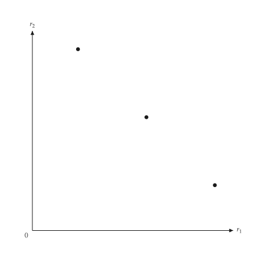{ .ev-figure-sm }

<div class="ev-downloads"><a class="ev-download" href="../../../assets/micro-viz/bundling/bundling.py" download aria-label="下載生圖原始檔"><svg viewBox="0 0 24 24" aria-hidden="true"><path d="M12 4v11m0 0-4.5-4.5M12 15l4.5-4.5M5 20h14" fill="none" stroke="currentColor" stroke-width="2" stroke-linecap="round" stroke-linejoin="round"/></svg><span>下載生圖原始檔</span></a></div>

<figcaption markdown>*保留價格空間。* 以保留價格 r1、r2 標出各消費者的位置。</figcaption>

</figure>

<span id="fig-bundling-separate-regions"></span>

<figure class="ev-fig" markdown>

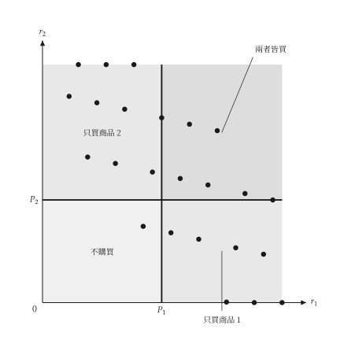{ .ev-figure-sm }

<div class="ev-downloads"><a class="ev-download" href="../../../assets/micro-viz/bundling/bundling.py" download aria-label="下載生圖原始檔"><svg viewBox="0 0 24 24" aria-hidden="true"><path d="M12 4v11m0 0-4.5-4.5M12 15l4.5-4.5M5 20h14" fill="none" stroke="currentColor" stroke-width="2" stroke-linecap="round" stroke-linejoin="round"/></svg><span>下載生圖原始檔</span></a></div>

<figcaption markdown>*分開銷售。* 價格 P1、P2 把保留價格空間分成四個購買區域。</figcaption>

</figure>

<span id="fig-bundling-pure-bundling"></span>

<figure class="ev-fig" markdown>

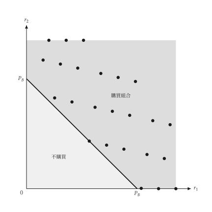{ .ev-figure-sm }

<div class="ev-downloads"><a class="ev-download" href="../../../assets/micro-viz/bundling/bundling.py" download aria-label="下載生圖原始檔"><svg viewBox="0 0 24 24" aria-hidden="true"><path d="M12 4v11m0 0-4.5-4.5M12 15l4.5-4.5M5 20h14" fill="none" stroke="currentColor" stroke-width="2" stroke-linecap="round" stroke-linejoin="round"/></svg><span>下載生圖原始檔</span></a></div>

<figcaption markdown>*純粹搭售。* 對角線 r1 + r2 = PB 以上的消費者購買組合。</figcaption>

</figure>

<span id="fig-bundling-mixed-bundling"></span>

<figure class="ev-fig" markdown>

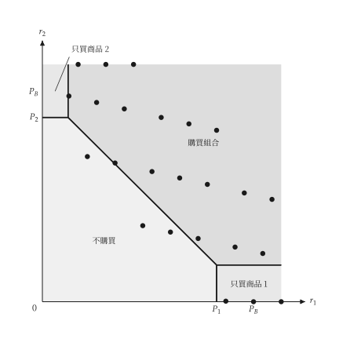{ .ev-figure-sm }

<div class="ev-downloads"><a class="ev-download" href="../../../assets/micro-viz/bundling/bundling.py" download aria-label="下載生圖原始檔"><svg viewBox="0 0 24 24" aria-hidden="true"><path d="M12 4v11m0 0-4.5-4.5M12 15l4.5-4.5M5 20h14" fill="none" stroke="currentColor" stroke-width="2" stroke-linecap="round" stroke-linejoin="round"/></svg><span>下載生圖原始檔</span></a></div>

<figcaption markdown>*混合搭售。* 混合搭售下四個購買區域。</figcaption>

</figure>

<span id="fig-bundling-mixed-with-costs"></span>

<figure class="ev-fig" markdown>

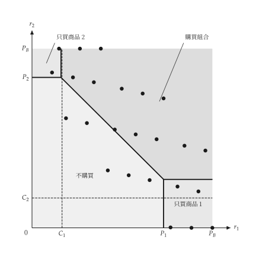{ .ev-figure-sm }

<div class="ev-downloads"><a class="ev-download" href="../../../assets/micro-viz/bundling/bundling.py" download aria-label="下載生圖原始檔"><svg viewBox="0 0 24 24" aria-hidden="true"><path d="M12 4v11m0 0-4.5-4.5M12 15l4.5-4.5M5 20h14" fill="none" stroke="currentColor" stroke-width="2" stroke-linecap="round" stroke-linejoin="round"/></svg><span>下載生圖原始檔</span></a></div>

<figcaption markdown>*有成本的混合搭售。* 邊際成本為正時的混合搭售區域。</figcaption>

</figure>

<span id="fig-bundling-regions-numbered"></span>

<figure class="ev-fig" markdown>

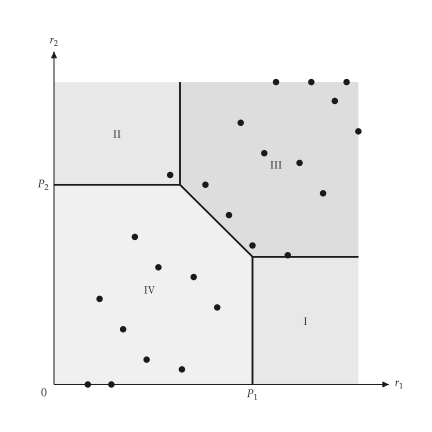{ .ev-figure-sm }

<div class="ev-downloads"><a class="ev-download" href="../../../assets/micro-viz/bundling/bundling.py" download aria-label="下載生圖原始檔"><svg viewBox="0 0 24 24" aria-hidden="true"><path d="M12 4v11m0 0-4.5-4.5M12 15l4.5-4.5M5 20h14" fill="none" stroke="currentColor" stroke-width="2" stroke-linecap="round" stroke-linejoin="round"/></svg><span>下載生圖原始檔</span></a></div>

<figcaption markdown>*區域編號。* 以編號 I 至 IV 標示混合搭售的區域。</figcaption>

</figure>

## 跨期與尖峰定價

<span id="sec-ex-time-pricing"></span>

兩群買者在不同時間面對不同價格，或兩個時期分攤容量成本。

<!-- api: micro_viz.guides_monopoly_30 -->

`IntertemporalPricing` 與 `PeakLoadPricing` 求解兩個市場，回傳對應的結果物件。

<!-- api: micro_viz.guides_monopoly_31 -->

兩個需求與其邊際收益對固定 MC：高價給較早的一群，低價給較晚的一群。

<!-- api: micro_viz.guides_monopoly_32 -->

尖峰與離峰需求與各自的邊際收益；兩期都有營運成本 `MC`，尖峰另加容量成本 `MC + MC_K`。

```python
def time_pricing_examples(
    output_dir: Path,
    theme: PlotTheme,
    *,
    first: LinearDemand,
    second: LinearDemand,
    peak: LinearDemand,
    off_peak: LinearDemand,
    marginal_cost: float,
    capacity_cost: float,
    title: str | None = None,
) -> list[Path]:
    """Write the time-pricing figures into ``output_dir`` and return their paths."""
    output_dir.mkdir(parents=True, exist_ok=True)
    figures = {
        "intertemporal.svg": intertemporal_pricing_canvas(
            IntertemporalPricing(first, second, marginal_cost),
            theme=theme,
            title=title,
        ),
        "peak_load.svg": peak_load_canvas(
            PeakLoadPricing(
                peak, off_peak, marginal_cost, capacity_cost
            ),
            theme=theme,
            title=title,
        ),
    }
    paths = []
    for name, figure in figures.items():
        figure.save(output_dir / name)
        paths.append(output_dir / name)
    return paths
```

<span id="fig-time-pricing-intertemporal"></span>

<figure class="ev-fig" markdown>

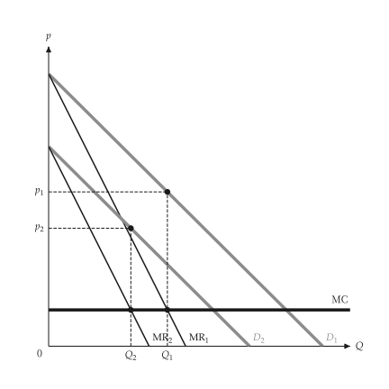{ .ev-figure-sm }

<div class="ev-downloads"><a class="ev-download" href="../../../assets/micro-viz/time_pricing/time_pricing.py" download aria-label="下載生圖原始檔"><svg viewBox="0 0 24 24" aria-hidden="true"><path d="M12 4v11m0 0-4.5-4.5M12 15l4.5-4.5M5 20h14" fill="none" stroke="currentColor" stroke-width="2" stroke-linecap="round" stroke-linejoin="round"/></svg><span>下載生圖原始檔</span></a></div>

<figcaption markdown>*跨期訂價。* 先對高估價的買者索取高價，之後再降價。</figcaption>

</figure>

<span id="fig-time-pricing-peak-load"></span>

<figure class="ev-fig" markdown>

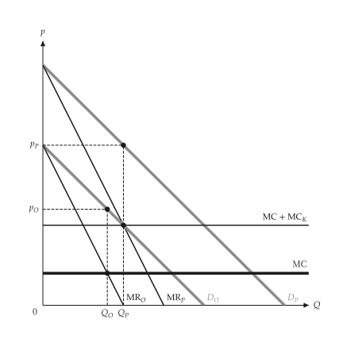{ .ev-figure-sm }

<div class="ev-downloads"><a class="ev-download" href="../../../assets/micro-viz/time_pricing/time_pricing.py" download aria-label="下載生圖原始檔"><svg viewBox="0 0 24 24" aria-hidden="true"><path d="M12 4v11m0 0-4.5-4.5M12 15l4.5-4.5M5 20h14" fill="none" stroke="currentColor" stroke-width="2" stroke-linecap="round" stroke-linejoin="round"/></svg><span>下載生圖原始檔</span></a></div>

<figcaption markdown>*尖峰訂價。* 尖峰與離峰需求分別訂價，容量成本由尖峰負擔。</figcaption>

</figure>

## 廣告

<span id="sec-ex-advertising"></span>

廣告使平均收益外移、平均成本上升；圖中比較前後的利潤。

<!-- api: micro_viz.guides_monopoly_33 -->

`AdvertisingDecision` 比較有無廣告的利潤，回傳 `AdvertisingOutcome`。

<!-- api: micro_viz.guides_monopoly_34 -->

`AR` 外移到 `AR'`、平均成本上升到 `AC'`；長方形顯示前（淺）後（深）的利潤。

```python
def advertising_examples(
    output_dir: Path,
    theme: PlotTheme,
    *,
    decision: AdvertisingDecision,
    title: str | None = None,
) -> list[Path]:
    """Write the advertising figure into ``output_dir`` and return its path."""
    output_dir.mkdir(parents=True, exist_ok=True)
    path = output_dir / "advertising.svg"
    advertising_effect_canvas(
        decision, theme=theme, title=title
    ).save(path)
    return [path]
```

<span id="fig-advertising-advertising"></span>

<figure class="ev-fig" markdown>

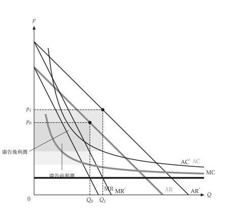{ .ev-figure-sm }

<div class="ev-downloads"><a class="ev-download" href="../../../assets/micro-viz/advertising/advertising.py" download aria-label="下載生圖原始檔"><svg viewBox="0 0 24 24" aria-hidden="true"><path d="M12 4v11m0 0-4.5-4.5M12 15l4.5-4.5M5 20h14" fill="none" stroke="currentColor" stroke-width="2" stroke-linecap="round" stroke-linejoin="round"/></svg><span>下載生圖原始檔</span></a></div>

<figcaption markdown>*廣告。* 廣告使 AR 外移、平均成本上升，比較前後利潤。</figcaption>

</figure>

## 可耗竭資源

<span id="sec-ex-exhaustible-resource"></span>

價格減去邊際開採成本以利率成長，直到存量耗盡時達到禁止價格。 出處：[Hotelling (1931)](../project/references.md#hotelling1931)。

<!-- api: micro_viz.guides_monopoly_35 -->

`ExhaustibleResourcePath` 給出價格路徑 $p(t)$，以及對應的靜態需求與存量。

<!-- api: micro_viz.guides_monopoly_36 -->

左圖是價格路徑 `p(t)`，從 `p_0` 上升到時間 `T` 的禁止價格，高於邊際開採成本 `c`；右圖是對應的靜態圖。

```python
def resource_examples(
    output_dir: Path,
    theme: PlotTheme,
    *,
    path: ExhaustibleResourcePath,
    title: str | None = None,
) -> list[Path]:
    """Write the resource figure into ``output_dir`` and return its path."""
    output_dir.mkdir(parents=True, exist_ok=True)
    target = output_dir / "resource_price_path.svg"
    resource_price_path_canvas(
        path, titles=(title, None), theme=theme
    ).save(target)
    return [target]
```

<span id="fig-exhaustible-resource-resource-price-path"></span>

<figure class="ev-fig" markdown>

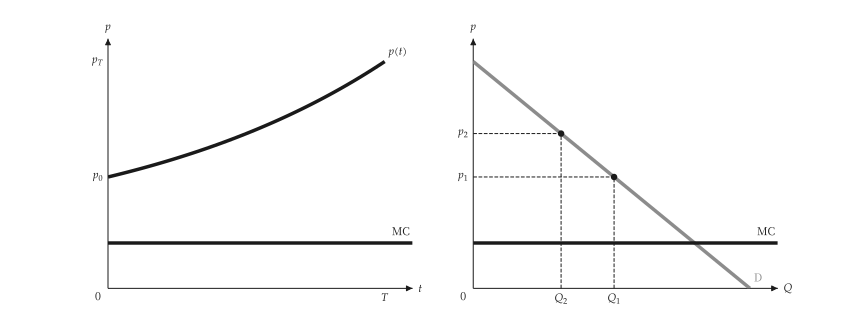{ .ev-figure-lg }

<div class="ev-downloads"><a class="ev-download" href="../../../assets/micro-viz/exhaustible_resource/exhaustible_resource.py" download aria-label="下載生圖原始檔"><svg viewBox="0 0 24 24" aria-hidden="true"><path d="M12 4v11m0 0-4.5-4.5M12 15l4.5-4.5M5 20h14" fill="none" stroke="currentColor" stroke-width="2" stroke-linecap="round" stroke-linejoin="round"/></svg><span>下載生圖原始檔</span></a></div>

<figcaption markdown>*可耗竭資源。* 價格減邊際開採成本以利率成長，並對應靜態需求。</figcaption>

</figure>
