# 寡占與垂直關係

<span id="sec-oligopoly"></span>

每一節是一支範例腳本與它畫出的圖。腳本在範例壓縮檔中提供，參數可用 `--help` 查看。

## 雙占

<span id="sec-ex-oligopoly"></span>

產量與價格的反應曲線給出古諾、史塔克柏格、柏川與勾結的結果。 出處：[Cournot (1838)](../project/references.md#cournot1838)、[von Stackelberg (1934)](../project/references.md#stackelberg1934)、[Bertrand (1883)](../project/references.md#bertrand1883)。

<!-- api: micro_viz.guides_oligopoly_1 -->

`Duopoly` 有 `cournot()`、`stackelberg()`、`competitive_total()` 與 `collusive_total()`；`DifferentiatedDuopoly` 的 `bertrand()` 處理價格競爭。

<!-- api: micro_viz.guides_oligopoly_2 -->

`(p1, p2)` 空間中向上傾斜的價格反應曲線 `R1`、`R2`、納許價格 `N`，以及可選的勾結價格。

<!-- api: micro_viz.guides_oligopoly_3 -->

`(Q1, Q2)` 空間中的反應曲線 `R1`、`R2` 相交於古諾點 `N`；`competitive` 與 `collusive` 另加總產量固定線。

<!-- api: micro_viz.guides_oligopoly_4 -->

廠商 1 對各種對手產量猜測下的剩餘需求 `D1(q2)` 與 `MR1(q2)`，以及它的邊際成本。

```python
def oligopoly_examples(
    output_dir: Path,
    theme: PlotTheme,
    *,
    duopoly: Duopoly,
    guesses: tuple[float, ...],
    differentiated: DifferentiatedDuopoly,
    title: str | None = None,
) -> list[Path]:
    """Write the oligopoly figures into ``output_dir`` and return their paths."""
    output_dir.mkdir(parents=True, exist_ok=True)
    figures = {
        "residual_demand.svg": residual_demand_canvas(
            duopoly, guesses, theme=theme, title=title
        ),
        "cournot.svg": reaction_curves_canvas(
            duopoly, theme=theme, title=title
        ),
        "cournot_points.svg": reaction_curves_canvas(
            duopoly,
            competitive=True,
            collusive=True,
            theme=theme,
            title=title,
        ),
        "stackelberg.svg": reaction_curves_canvas(
            duopoly, leader=1, theme=theme, title=title
        ),
        "price_reaction.svg": price_reaction_canvas(
            differentiated, theme=theme, title=title
        ),
    }
    paths = []
    for name, figure in figures.items():
        figure.save(output_dir / name)
        paths.append(output_dir / name)
    return paths
```

<span id="fig-oligopoly-residual-demand"></span>

<figure class="ev-fig" markdown>

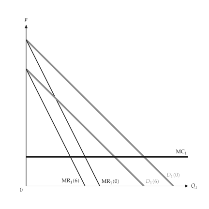{ .ev-figure-sm }

<div class="ev-downloads"><a class="ev-download" href="../../../assets/micro-viz/oligopoly/oligopoly.py" download aria-label="下載生圖原始檔"><svg viewBox="0 0 24 24" aria-hidden="true"><path d="M12 4v11m0 0-4.5-4.5M12 15l4.5-4.5M5 20h14" fill="none" stroke="currentColor" stroke-width="2" stroke-linecap="round" stroke-linejoin="round"/></svg><span>下載生圖原始檔</span></a></div>

<figcaption markdown>*剩餘需求。* 對手產量的各種猜測對應的剩餘需求與邊際收益。</figcaption>

</figure>

<span id="fig-oligopoly-cournot"></span>

<figure class="ev-fig" markdown>

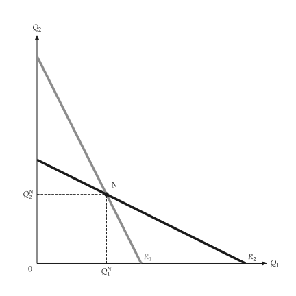{ .ev-figure-sm }

<div class="ev-downloads"><a class="ev-download" href="../../../assets/micro-viz/oligopoly/oligopoly.py" download aria-label="下載生圖原始檔"><svg viewBox="0 0 24 24" aria-hidden="true"><path d="M12 4v11m0 0-4.5-4.5M12 15l4.5-4.5M5 20h14" fill="none" stroke="currentColor" stroke-width="2" stroke-linecap="round" stroke-linejoin="round"/></svg><span>下載生圖原始檔</span></a></div>

<figcaption markdown>*反應曲線。* 兩條反應曲線的交點即古諾均衡 N。</figcaption>

</figure>

<span id="fig-oligopoly-cournot-points"></span>

<figure class="ev-fig" markdown>

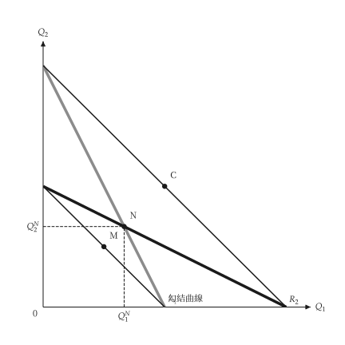{ .ev-figure-sm }

<div class="ev-downloads"><a class="ev-download" href="../../../assets/micro-viz/oligopoly/oligopoly.py" download aria-label="下載生圖原始檔"><svg viewBox="0 0 24 24" aria-hidden="true"><path d="M12 4v11m0 0-4.5-4.5M12 15l4.5-4.5M5 20h14" fill="none" stroke="currentColor" stroke-width="2" stroke-linecap="round" stroke-linejoin="round"/></svg><span>下載生圖原始檔</span></a></div>

<figcaption markdown>*競爭、古諾與勾結。* 競爭、古諾與勾結的點，以及勾結曲線。</figcaption>

</figure>

<span id="fig-oligopoly-stackelberg"></span>

<figure class="ev-fig" markdown>

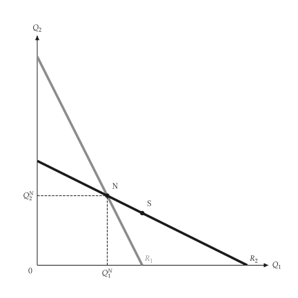{ .ev-figure-sm }

<div class="ev-downloads"><a class="ev-download" href="../../../assets/micro-viz/oligopoly/oligopoly.py" download aria-label="下載生圖原始檔"><svg viewBox="0 0 24 24" aria-hidden="true"><path d="M12 4v11m0 0-4.5-4.5M12 15l4.5-4.5M5 20h14" fill="none" stroke="currentColor" stroke-width="2" stroke-linecap="round" stroke-linejoin="round"/></svg><span>下載生圖原始檔</span></a></div>

<figcaption markdown>*史塔克柏格。* 領導者沿追隨者的反應曲線選擇產量。</figcaption>

</figure>

<span id="fig-oligopoly-price-reaction"></span>

<figure class="ev-fig" markdown>

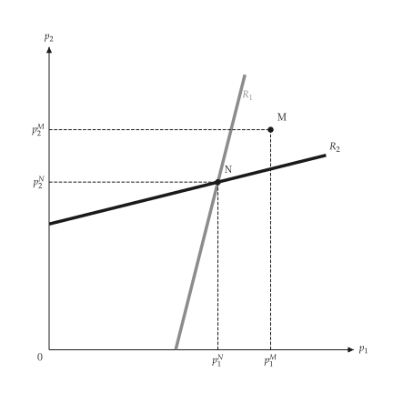{ .ev-figure-sm }

<div class="ev-downloads"><a class="ev-download" href="../../../assets/micro-viz/oligopoly/oligopoly.py" download aria-label="下載生圖原始檔"><svg viewBox="0 0 24 24" aria-hidden="true"><path d="M12 4v11m0 0-4.5-4.5M12 15l4.5-4.5M5 20h14" fill="none" stroke="currentColor" stroke-width="2" stroke-linecap="round" stroke-linejoin="round"/></svg><span>下載生圖原始檔</span></a></div>

<figcaption markdown>*價格反應曲線。* 差異化產品的價格反應曲線、納許價格與勾結價格。</figcaption>

</figure>

## 拗折需求、支配廠商與卡特爾

<span id="sec-ex-dominant-firm"></span>

對手跟進降價但不跟進漲價，需求出現拗折；有邊緣廠商的廠商面對剩餘需求。 出處：[Sweezy (1939)](../project/references.md#sweezy1939)。

<!-- api: micro_viz.guides_oligopoly_5 -->

`KinkedDemand` 給出拗折點與邊際收益的缺口；`DominantFirm` 對邊緣廠商求解剩餘需求。

<!-- api: micro_viz.guides_oligopoly_6 -->

卡特爾與邊緣廠商：缺乏彈性的需求與有彈性的需求（市場力量小）並列。

<!-- api: micro_viz.guides_oligopoly_7 -->

市場需求 `D`、邊緣廠商供給 `S_F`，以及剩餘需求 `D_D = D - S_F`、其邊際收益與廠商的邊際成本。

<!-- api: micro_viz.guides_oligopoly_8 -->

拗折需求與其邊際收益在拗折點的垂直缺口；`marginal_costs` 中每條 MC 畫成水平線。

```python
def dominant_examples(
    output_dir: Path,
    theme: PlotTheme,
    *,
    kinked: KinkedDemand,
    costs: tuple[float, ...],
    firm: DominantFirm,
    inelastic: DominantFirm,
    elastic: DominantFirm,
    title: str | None = None,
) -> list[Path]:
    """Write the dominant-firm figures into ``output_dir`` and return their paths."""
    output_dir.mkdir(parents=True, exist_ok=True)
    figures = {
        "kinked_demand.svg": kinked_demand_canvas(
            kinked, costs, theme=theme, title=title
        ),
        "dominant_firm.svg": dominant_firm_canvas(
            firm, theme=theme, title=title
        ),
        "cartel_fringe.svg": dominant_firm_canvas(
            firm,
            cartel=True,
            theme=theme,
            title=title,
            prefix="oligopoly.cartel",
        ),
        "cartel_elasticity.svg": cartel_elasticity_canvas(
            inelastic, elastic, theme=theme
        ),
    }
    paths = []
    for name, figure in figures.items():
        figure.save(output_dir / name)
        paths.append(output_dir / name)
    return paths
```

<span id="fig-dominant-firm-kinked-demand"></span>

<figure class="ev-fig" markdown>

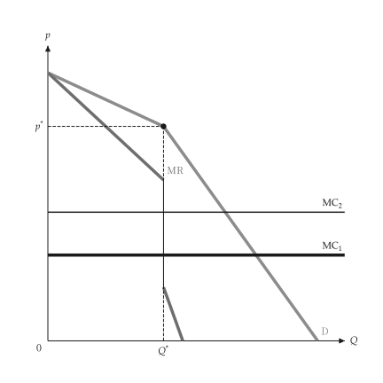{ .ev-figure-sm }

<div class="ev-downloads"><a class="ev-download" href="../../../assets/micro-viz/dominant_firm/dominant_firm.py" download aria-label="下載生圖原始檔"><svg viewBox="0 0 24 24" aria-hidden="true"><path d="M12 4v11m0 0-4.5-4.5M12 15l4.5-4.5M5 20h14" fill="none" stroke="currentColor" stroke-width="2" stroke-linecap="round" stroke-linejoin="round"/></svg><span>下載生圖原始檔</span></a></div>

<figcaption markdown>*拗折需求。* 拗折需求與 MR 的缺口，缺口內的 MC 變動不影響價格。</figcaption>

</figure>

<span id="fig-dominant-firm-dominant-firm"></span>

<figure class="ev-fig" markdown>

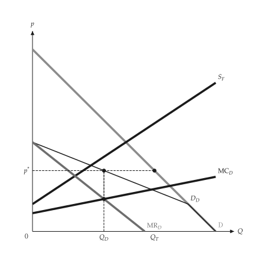{ .ev-figure-sm }

<div class="ev-downloads"><a class="ev-download" href="../../../assets/micro-viz/dominant_firm/dominant_firm.py" download aria-label="下載生圖原始檔"><svg viewBox="0 0 24 24" aria-hidden="true"><path d="M12 4v11m0 0-4.5-4.5M12 15l4.5-4.5M5 20h14" fill="none" stroke="currentColor" stroke-width="2" stroke-linecap="round" stroke-linejoin="round"/></svg><span>下載生圖原始檔</span></a></div>

<figcaption markdown>*支配廠商。* 市場需求減去邊緣廠商供給即支配廠商的剩餘需求。</figcaption>

</figure>

<span id="fig-dominant-firm-cartel-fringe"></span>

<figure class="ev-fig" markdown>

{ .ev-figure-sm }

<div class="ev-downloads"><a class="ev-download" href="../../../assets/micro-viz/dominant_firm/dominant_firm.py" download aria-label="下載生圖原始檔"><svg viewBox="0 0 24 24" aria-hidden="true"><path d="M12 4v11m0 0-4.5-4.5M12 15l4.5-4.5M5 20h14" fill="none" stroke="currentColor" stroke-width="2" stroke-linecap="round" stroke-linejoin="round"/></svg><span>下載生圖原始檔</span></a></div>

<figcaption markdown>*卡特爾與邊緣廠商。* 卡特爾面對總需求減去邊緣廠商供給後的需求。</figcaption>

</figure>

<span id="fig-dominant-firm-cartel-elasticity"></span>

<figure class="ev-fig" markdown>

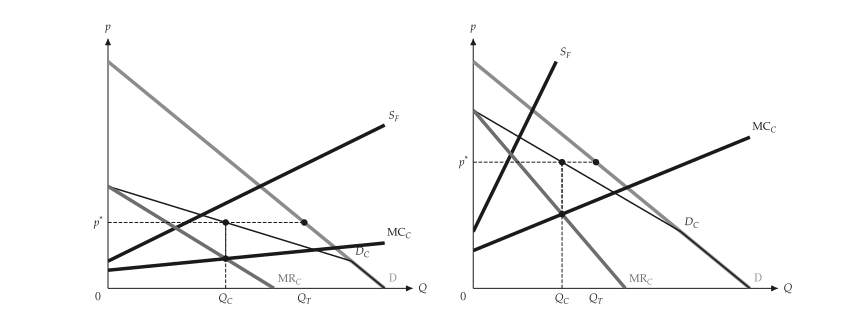{ .ev-figure-lg }

<div class="ev-downloads"><a class="ev-download" href="../../../assets/micro-viz/dominant_firm/dominant_firm.py" download aria-label="下載生圖原始檔"><svg viewBox="0 0 24 24" aria-hidden="true"><path d="M12 4v11m0 0-4.5-4.5M12 15l4.5-4.5M5 20h14" fill="none" stroke="currentColor" stroke-width="2" stroke-linecap="round" stroke-linejoin="round"/></svg><span>下載生圖原始檔</span></a></div>

<figcaption markdown>*卡特爾與需求彈性。* 需求愈有彈性，卡特爾的市場力量愈小。</figcaption>

</figure>

## 垂直關係

<span id="sec-ex-vertical"></span>

兩個上下游的獨占者各加成一次。整合廠商只有一次加成；外部市場決定移轉價格。 出處：[Spengler (1950)](../project/references.md#spengler1950)。

<!-- api: micro_viz.guides_oligopoly_9 -->

`VerticalChain` 求解分開與整合的結果；`transfer_pricing()` 在有外部市場時給出最適移轉價格。

<!-- api: micro_viz.guides_oligopoly_10 -->

兩個疊起來的獨占：最終需求 `D`、`NMR`（上游面對的需求）、上游邊際收益 `MR_u` 與 `MC_u`。

<!-- api: micro_viz.guides_oligopoly_11 -->

整合廠商令 `NMR = MC_u`：產量 `Q_i` 高於分開時的 `Q_s`，最終價格 `p_i` 較低。

<!-- api: micro_viz.guides_oligopoly_12 -->

有外部市場價格 `P_m` 時，有效邊際成本在 `Q_u` 以下為 `MC_u`，之後為水平的 `P_m`。

```python
def vertical_examples(
    output_dir: Path,
    theme: PlotTheme,
    *,
    chain: VerticalChain,
    market_price: float,
    title: str | None = None,
) -> list[Path]:
    """Write the vertical-chain figures into ``output_dir`` and return their paths."""
    output_dir.mkdir(parents=True, exist_ok=True)
    figures = {
        "double_marginalization.svg": double_marginalization_canvas(
            chain, theme=theme, title=title
        ),
        "integrated_firm.svg": integrated_firm_canvas(
            chain, theme=theme, title=title
        ),
        "transfer_kinked.svg": transfer_price_outside_market_canvas(
            chain, market_price, theme=theme, title=title
        ),
        "transfer_price.svg": transfer_price_outside_market_canvas(
            chain,
            market_price,
            kinked=False,
            theme=theme,
            title=title,
        ),
    }
    paths = []
    for name, figure in figures.items():
        figure.save(output_dir / name)
        paths.append(output_dir / name)
    return paths
```

<span id="fig-vertical-double-marginalization"></span>

<figure class="ev-fig" markdown>

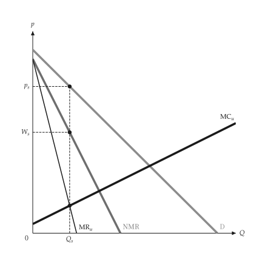{ .ev-figure-sm }

<div class="ev-downloads"><a class="ev-download" href="../../../assets/micro-viz/vertical/vertical.py" download aria-label="下載生圖原始檔"><svg viewBox="0 0 24 24" aria-hidden="true"><path d="M12 4v11m0 0-4.5-4.5M12 15l4.5-4.5M5 20h14" fill="none" stroke="currentColor" stroke-width="2" stroke-linecap="round" stroke-linejoin="round"/></svg><span>下載生圖原始檔</span></a></div>

<figcaption markdown>*雙重加成。* 下游 NMR 即上游需求，兩次加成使產量更低。</figcaption>

</figure>

<span id="fig-vertical-integrated-firm"></span>

<figure class="ev-fig" markdown>

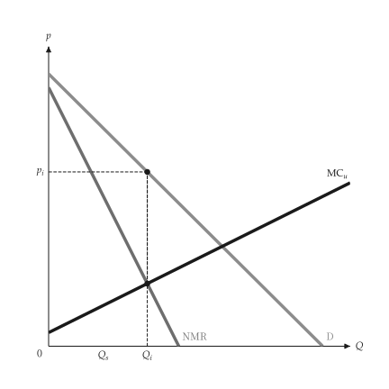{ .ev-figure-sm }

<div class="ev-downloads"><a class="ev-download" href="../../../assets/micro-viz/vertical/vertical.py" download aria-label="下載生圖原始檔"><svg viewBox="0 0 24 24" aria-hidden="true"><path d="M12 4v11m0 0-4.5-4.5M12 15l4.5-4.5M5 20h14" fill="none" stroke="currentColor" stroke-width="2" stroke-linecap="round" stroke-linejoin="round"/></svg><span>下載生圖原始檔</span></a></div>

<figcaption markdown>*整合廠商。* 整合廠商令 NMR 等於上游 MC，產量較高、價格較低。</figcaption>

</figure>

<span id="fig-vertical-transfer-kinked"></span>

<figure class="ev-fig" markdown>

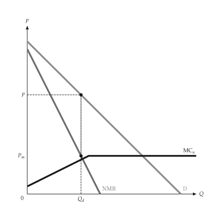{ .ev-figure-sm }

<div class="ev-downloads"><a class="ev-download" href="../../../assets/micro-viz/vertical/vertical.py" download aria-label="下載生圖原始檔"><svg viewBox="0 0 24 24" aria-hidden="true"><path d="M12 4v11m0 0-4.5-4.5M12 15l4.5-4.5M5 20h14" fill="none" stroke="currentColor" stroke-width="2" stroke-linecap="round" stroke-linejoin="round"/></svg><span>下載生圖原始檔</span></a></div>

<figcaption markdown>*折線移轉價格。* 有外部市場時，MC 在市場價格處拗折。</figcaption>

</figure>

<span id="fig-vertical-transfer-price"></span>

<figure class="ev-fig" markdown>

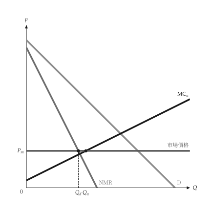{ .ev-figure-sm }

<div class="ev-downloads"><a class="ev-download" href="../../../assets/micro-viz/vertical/vertical.py" download aria-label="下載生圖原始檔"><svg viewBox="0 0 24 24" aria-hidden="true"><path d="M12 4v11m0 0-4.5-4.5M12 15l4.5-4.5M5 20h14" fill="none" stroke="currentColor" stroke-width="2" stroke-linecap="round" stroke-linejoin="round"/></svg><span>下載生圖原始檔</span></a></div>

<figcaption markdown>*最適移轉價格。* 最適內部移轉價格等於市場價格，餘量在外部出售。</figcaption>

</figure>
