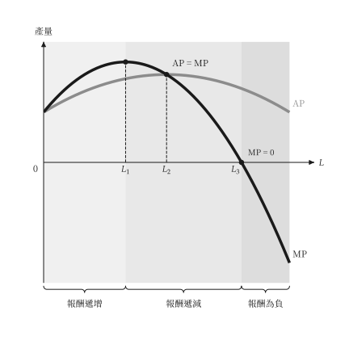
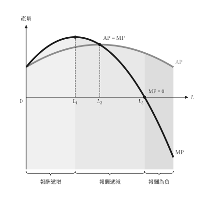
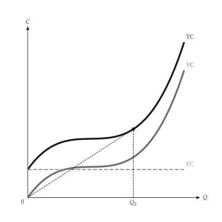
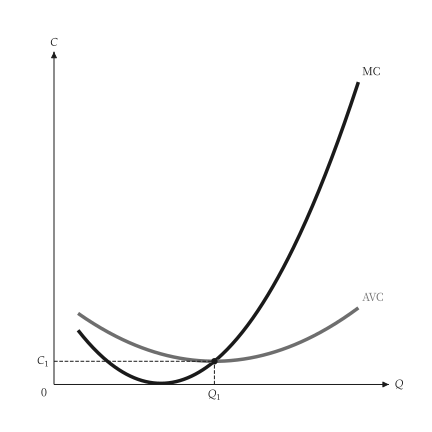
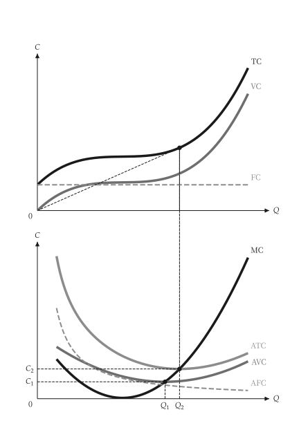
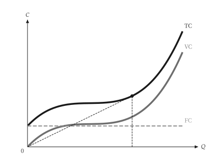
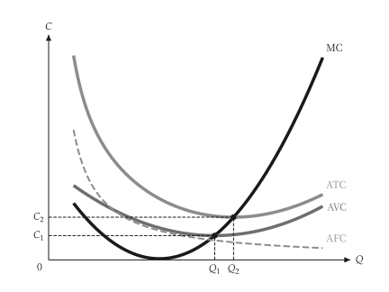
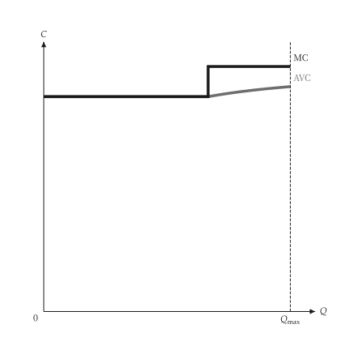
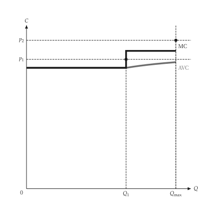
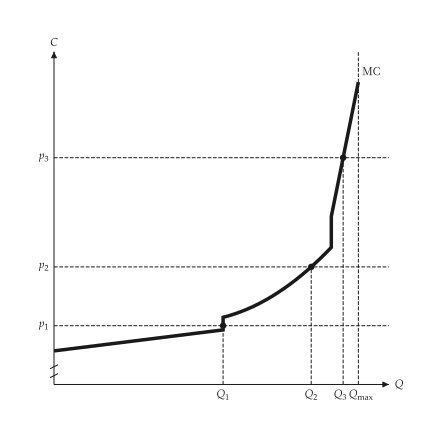

# 生產與成本

<span id="sec-production-costs"></span>

每一節是一支範例腳本與它畫出的圖。腳本在範例壓縮檔中提供，參數可用 `--help` 查看。

## 短期生產

<span id="sec-ex-production"></span>

一種變動投入與一種固定投入，得到總產量、平均產量與邊際產量。邊際報酬的區間由模型分類，圖中以底色標出。

<!-- api: micro_viz.guides_production_costs_1 -->

`ShortRunProductionFunction` 是三次生產函數 $Q = a L + b L^2 + c L^3$；`analyze_production()` 取樣 TP、AP 與 MP，並把範圍分成邊際報酬遞增、遞減與為負的區間。

<!-- api: micro_viz.guides_production_costs_2 -->

平均與邊際產量圖：含邊際報酬區間，並標出 AP = MP 與 MP = 0 的點。

<!-- api: micro_viz.guides_production_costs_3 -->

總產量圖：曲線、三個邊際報酬區間與分界線。

```python
def production_examples(
    output_dir: Path,
    theme: PlotTheme,
    *,
    function: ShortRunProductionFunction,
    input_range: tuple[float, float],
    samples: int,
    region_colors: dict[str, str] | None = None,
    title: str | None = None,
) -> tuple[Path, Path]:
    """Write the two production examples into ``output_dir`` and return their paths."""
    analysis = analyze_production(
        function, input_range=input_range, samples=samples
    )
    output_dir.mkdir(parents=True, exist_ok=True)
    total_output = output_dir / "total_product.svg"
    products_output = (
        output_dir / "average_marginal_product.svg"
    )
    total_product_canvas(
        analysis,
        theme=theme,
        title=title,
        region_colors=region_colors,
    ).save(total_output)
    average_marginal_product_canvas(
        analysis,
        theme=theme,
        title=title,
        region_colors=region_colors,
    ).save(products_output)
    # The same figures with the shade stopping at the curve instead of reaching the top.
    under = replace(theme, region_extent="curve")
    total_product_canvas(
        analysis,
        theme=under,
        title=title,
        region_colors=region_colors,
    ).save(output_dir / "total_product_under_curve.svg")
    average_marginal_product_canvas(
        analysis,
        theme=under,
        title=title,
        region_colors=region_colors,
    ).save(
        output_dir / "average_marginal_product_under_curve.svg"
    )
    return total_output, products_output
```

<span id="fig-production-total-product"></span>

<figure class="ev-fig" markdown>

{ .ev-figure-sm }

<div class="ev-downloads"><a class="ev-download" href="../../../assets/micro-viz/production/production.py" download aria-label="下載生圖原始檔"><svg viewBox="0 0 24 24" aria-hidden="true"><path d="M12 4v11m0 0-4.5-4.5M12 15l4.5-4.5M5 20h14" fill="none" stroke="currentColor" stroke-width="2" stroke-linecap="round" stroke-linejoin="round"/></svg><span>下載生圖原始檔</span></a></div>

<figcaption markdown>*總產量曲線。* 短期總產量曲線，並標出邊際報酬遞增與遞減的區間。</figcaption>

</figure>

<span id="fig-production-average-marginal-product"></span>

<figure class="ev-fig" markdown>

{ .ev-figure-sm }

<div class="ev-downloads"><a class="ev-download" href="../../../assets/micro-viz/production/production.py" download aria-label="下載生圖原始檔"><svg viewBox="0 0 24 24" aria-hidden="true"><path d="M12 4v11m0 0-4.5-4.5M12 15l4.5-4.5M5 20h14" fill="none" stroke="currentColor" stroke-width="2" stroke-linecap="round" stroke-linejoin="round"/></svg><span>下載生圖原始檔</span></a></div>

<figcaption markdown>*平均與邊際產量。* 平均產量與邊際產量曲線，MP 通過 AP 的最高點。</figcaption>

</figure>

<span id="fig-production-total-product-under-curve"></span>

<figure class="ev-fig" markdown>

{ .ev-figure-sm }

<div class="ev-downloads"><a class="ev-download" href="../../../assets/micro-viz/production/production.py" download aria-label="下載生圖原始檔"><svg viewBox="0 0 24 24" aria-hidden="true"><path d="M12 4v11m0 0-4.5-4.5M12 15l4.5-4.5M5 20h14" fill="none" stroke="currentColor" stroke-width="2" stroke-linecap="round" stroke-linejoin="round"/></svg><span>下載生圖原始檔</span></a></div>

<figcaption markdown>*總產量，底色在曲線下。* 區域底色只填到曲線為止。</figcaption>

</figure>

<span id="fig-production-average-marginal-product-under-curve"></span>

<figure class="ev-fig" markdown>

{ .ev-figure-sm }

<div class="ev-downloads"><a class="ev-download" href="../../../assets/micro-viz/production/production.py" download aria-label="下載生圖原始檔"><svg viewBox="0 0 24 24" aria-hidden="true"><path d="M12 4v11m0 0-4.5-4.5M12 15l4.5-4.5M5 20h14" fill="none" stroke="currentColor" stroke-width="2" stroke-linecap="round" stroke-linejoin="round"/></svg><span>下載生圖原始檔</span></a></div>

<figcaption markdown>*平均與邊際產量，底色在曲線下。* 區域底色只填到 AP、MP 的上緣為止。</figcaption>

</figure>

## 短期成本

<span id="sec-ex-costs"></span>

三次成本函數得到總成本、變動成本、固定成本與四條單位成本曲線。MC 通過 AVC 與 ATC 的最低點。

<!-- api: micro_viz.guides_production_costs_4 -->

`CubicCost` 是 $\text{TC} = \text{FC} + b Q + c Q^2 + d Q^3$；`analyze_costs()` 在產量範圍內計算各種成本，並找出 AVC 與 ATC 的最低點。

<!-- api: micro_viz.guides_production_costs_5 -->

上方是總成本、下方是單位成本，共用產量軸。

<!-- api: micro_viz.guides_production_costs_6 -->

把 `cost_curves_grid` 的兩欄分成兩張畫布，各自可獨立成圖。

<!-- api: micro_viz.guides_production_costs_7 -->

TC、VC 與 FC 對產量。

<!-- api: micro_viz.guides_production_costs_8 -->

MC、ATC、AVC 與 AFC 對產量；`curves` 可選子集。

```python
def cost_examples(
    output_dir: Path,
    theme: PlotTheme,
    *,
    cost: CubicCost,
    min_output: float,
    max_output: float,
    samples: int,
    avc_reach: float = 1.15,
    title: str | None = None,
) -> list[Path]:
    """Write the cost-curve examples for ``cost`` into ``output_dir`` and return the paths."""
    analysis = analyze_costs(
        cost,
        output_range=(min_output, max_output),
        samples=samples,
    )
    no_fixed = analyze_costs(
        CubicCost(
            fixed_cost=0.0,
            linear=cost.linear,
            quadratic=cost.quadratic,
            cubic=cost.cubic,
            output_symbol=cost.output_symbol,
        ),
        output_range=(min_output, max_output * avc_reach),
        samples=samples,
    )
    total_panel, unit_panel = cost_curves_panels(
        analysis, theme=theme, titles=(title, None)
    )
    output_dir.mkdir(parents=True, exist_ok=True)
    figures = {
        "total_cost.svg": total_cost_canvas(
            analysis, theme=theme, title=title
        ),
        "unit_cost.svg": unit_cost_canvas(
            analysis, theme=theme, title=title
        ),
        "cubic_avc_mc.svg": unit_cost_canvas(
            no_fixed,
            curves=("mc", "avc"),
            theme=theme,
            title=title,
        ),
        "cost_curves_total.svg": total_panel,
        "cost_curves_unit.svg": unit_panel,
        "cost_curves.svg": cost_curves_grid(
            analysis, theme=theme, titles=(title, None)
        ),
    }
    paths = []
    for name, figure in figures.items():
        figure.save(output_dir / name)
        paths.append(output_dir / name)
    return paths
```

<span id="fig-costs-total-cost"></span>

<figure class="ev-fig" markdown>

{ .ev-figure-sm }

<div class="ev-downloads"><a class="ev-download" href="../../../assets/micro-viz/costs/costs.py" download aria-label="下載生圖原始檔"><svg viewBox="0 0 24 24" aria-hidden="true"><path d="M12 4v11m0 0-4.5-4.5M12 15l4.5-4.5M5 20h14" fill="none" stroke="currentColor" stroke-width="2" stroke-linecap="round" stroke-linejoin="round"/></svg><span>下載生圖原始檔</span></a></div>

<figcaption markdown>*總成本曲線。* 總成本、變動成本與固定成本曲線。</figcaption>

</figure>

<span id="fig-costs-unit-cost"></span>

<figure class="ev-fig" markdown>

{ .ev-figure-sm }

<div class="ev-downloads"><a class="ev-download" href="../../../assets/micro-viz/costs/costs.py" download aria-label="下載生圖原始檔"><svg viewBox="0 0 24 24" aria-hidden="true"><path d="M12 4v11m0 0-4.5-4.5M12 15l4.5-4.5M5 20h14" fill="none" stroke="currentColor" stroke-width="2" stroke-linecap="round" stroke-linejoin="round"/></svg><span>下載生圖原始檔</span></a></div>

<figcaption markdown>*單位成本曲線。* MC、ATC、AVC 與 AFC 曲線，MC 通過 AVC 與 ATC 的最低點。</figcaption>

</figure>

<span id="fig-costs-cubic-avc-mc"></span>

<figure class="ev-fig" markdown>

{ .ev-figure-sm }

<div class="ev-downloads"><a class="ev-download" href="../../../assets/micro-viz/costs/costs.py" download aria-label="下載生圖原始檔"><svg viewBox="0 0 24 24" aria-hidden="true"><path d="M12 4v11m0 0-4.5-4.5M12 15l4.5-4.5M5 20h14" fill="none" stroke="currentColor" stroke-width="2" stroke-linecap="round" stroke-linejoin="round"/></svg><span>下載生圖原始檔</span></a></div>

<figcaption markdown>*三次函數的 AVC 與 MC。* 三次成本函數的 AVC 與 MC。</figcaption>

</figure>

<span id="fig-costs-cost-curves"></span>

<figure class="ev-fig" markdown>

{ .ev-figure-sm }

<div class="ev-downloads"><a class="ev-download" href="../../../assets/micro-viz/costs/costs.py" download aria-label="下載生圖原始檔"><svg viewBox="0 0 24 24" aria-hidden="true"><path d="M12 4v11m0 0-4.5-4.5M12 15l4.5-4.5M5 20h14" fill="none" stroke="currentColor" stroke-width="2" stroke-linecap="round" stroke-linejoin="round"/></svg><span>下載生圖原始檔</span></a></div>

<figcaption markdown>*成本曲線上下對照。* 總成本與單位成本的兩欄對照圖。</figcaption>

</figure>

<span id="fig-costs-cost-curves-total"></span>

<figure class="ev-fig" markdown>

{ .ev-figure-sm }

<div class="ev-downloads"><a class="ev-download" href="../../../assets/micro-viz/costs/costs.py" download aria-label="下載生圖原始檔"><svg viewBox="0 0 24 24" aria-hidden="true"><path d="M12 4v11m0 0-4.5-4.5M12 15l4.5-4.5M5 20h14" fill="none" stroke="currentColor" stroke-width="2" stroke-linecap="round" stroke-linejoin="round"/></svg><span>下載生圖原始檔</span></a></div>

<figcaption markdown>*總成本圖。* 兩欄對照圖中的總成本圖，可單獨使用。</figcaption>

</figure>

<span id="fig-costs-cost-curves-unit"></span>

<figure class="ev-fig" markdown>

{ .ev-figure-sm }

<div class="ev-downloads"><a class="ev-download" href="../../../assets/micro-viz/costs/costs.py" download aria-label="下載生圖原始檔"><svg viewBox="0 0 24 24" aria-hidden="true"><path d="M12 4v11m0 0-4.5-4.5M12 15l4.5-4.5M5 20h14" fill="none" stroke="currentColor" stroke-width="2" stroke-linecap="round" stroke-linejoin="round"/></svg><span>下載生圖原始檔</span></a></div>

<figcaption markdown>*單位成本圖。* 兩欄對照圖中的單位成本圖，可單獨使用。</figcaption>

</figure>

## 階梯與折點成本

<span id="sec-ex-piecewise-costs"></span>

數個容量固定的廠房得到階梯式邊際成本；一個有產能限制的廠房得到折線邊際成本。

<!-- api: micro_viz.guides_production_costs_9 -->

`PiecewiseCost` 把各有容量與邊際成本的 `CostSegment` 接起來；它是 `CostFunction`，因此 `analyze_costs()` 可以使用。

<!-- api: micro_viz.guides_production_costs_10 -->

階梯或折線邊際成本，含容量與價格帶。

```python
def piecewise_examples(
    output_dir: Path,
    theme: PlotTheme,
    *,
    stepped: PiecewiseCost,
    kinked: PiecewiseCost,
    prices: tuple[float, ...],
    kinked_prices: tuple[float, ...],
    kinked_y_min: float,
    samples: int,
    title: str | None = None,
) -> list[Path]:
    """Write the stepped and kinked marginal-cost examples into ``output_dir``."""
    output_dir.mkdir(parents=True, exist_ok=True)
    step_analysis = analyze_costs(
        stepped,
        output_range=(0.0, stepped.capacity),
        samples=samples,
    )
    kink_analysis = analyze_costs(
        kinked,
        output_range=(0.0, kinked.capacity),
        samples=samples,
    )
    kink_top = max(
        value for _, value in kink_analysis.marginal_cost_path
    )
    figures = {
        "stepped_cost.svg": piecewise_cost_canvas(
            step_analysis, theme=theme, title=title
        ),
        "stepped_cost_prices.svg": piecewise_cost_canvas(
            step_analysis,
            prices=prices,
            theme=theme,
            title=title,
        ),
        "kinked_marginal_cost.svg": piecewise_cost_canvas(
            kink_analysis,
            prices=kinked_prices,
            average=False,
            y_range=(
                kinked_y_min,
                kink_top + (kink_top - kinked_y_min) * 0.1,
            ),
            theme=theme,
            title=title,
        ),
    }
    for name, figure in figures.items():
        figure.save(output_dir / name)
    return [output_dir / name for name in figures]
```

<span id="fig-piecewise-costs-stepped-cost"></span>

<figure class="ev-fig" markdown>

{ .ev-figure-sm }

<div class="ev-downloads"><a class="ev-download" href="../../../assets/micro-viz/piecewise_costs/piecewise_costs.py" download aria-label="下載生圖原始檔"><svg viewBox="0 0 24 24" aria-hidden="true"><path d="M12 4v11m0 0-4.5-4.5M12 15l4.5-4.5M5 20h14" fill="none" stroke="currentColor" stroke-width="2" stroke-linecap="round" stroke-linejoin="round"/></svg><span>下載生圖原始檔</span></a></div>

<figcaption markdown>*階梯式邊際成本。* 多個廠房的階梯式邊際成本。</figcaption>

</figure>

<span id="fig-piecewise-costs-stepped-cost-prices"></span>

<figure class="ev-fig" markdown>

{ .ev-figure-sm }

<div class="ev-downloads"><a class="ev-download" href="../../../assets/micro-viz/piecewise_costs/piecewise_costs.py" download aria-label="下載生圖原始檔"><svg viewBox="0 0 24 24" aria-hidden="true"><path d="M12 4v11m0 0-4.5-4.5M12 15l4.5-4.5M5 20h14" fill="none" stroke="currentColor" stroke-width="2" stroke-linecap="round" stroke-linejoin="round"/></svg><span>下載生圖原始檔</span></a></div>

<figcaption markdown>*階梯成本與產量。* 價格穿過階梯時產量隨之跳動。</figcaption>

</figure>

<span id="fig-piecewise-costs-kinked-marginal-cost"></span>

<figure class="ev-fig" markdown>

{ .ev-figure-sm }

<div class="ev-downloads"><a class="ev-download" href="../../../assets/micro-viz/piecewise_costs/piecewise_costs.py" download aria-label="下載生圖原始檔"><svg viewBox="0 0 24 24" aria-hidden="true"><path d="M12 4v11m0 0-4.5-4.5M12 15l4.5-4.5M5 20h14" fill="none" stroke="currentColor" stroke-width="2" stroke-linecap="round" stroke-linejoin="round"/></svg><span>下載生圖原始檔</span></a></div>

<figcaption markdown>*折線邊際成本。* 有產能限制的折線邊際成本。</figcaption>

</figure>
