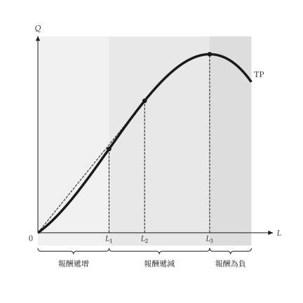
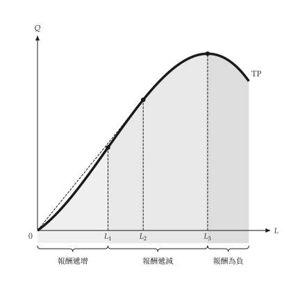

# 設定

<span id="sec-settings"></span>

`micro-viz` 讀取共用的 `econ-viz.toml`。檔案由 `mosaickit` 解析與檢查；`micro-viz` 只在 `[micro]` 下宣告自己接受的項目。

<!-- api: micro_viz.guides_settings_1 -->

從 `econ-viz.toml` 檔案載入的主題。`load()` 讀取 `path`，省略時讀工作目錄中的 `econ-viz.toml`。`use()` 把它設為預設並回傳該設定，之後沒有明確指定 `theme` 的圖形都使用它。檔案中的相對路徑相對於檔案所在的目錄。

```python
from micro_viz import Config

Config.load("econ-viz.toml").use()
```

省略的項目保留內建預設值；沒有任何檔案時，輸出與有設定功能之前相同。

```toml
base = "manual"            # 共用外觀：白底黑白

[font]
text = "serif"
math = "texgyrepagella-math.otf"

[fonts]
serif = ["texgyrepagella-regular.otf", "texgyrepagella-italic.otf"]

[micro]
language = "en"            # en、zh-TW 或 zh-CN

[micro.stroke]
curve = 3.5                # 點

[micro.region]
fill = true
extent = "top"
```

本頁的圖形分別由 `config/econ-viz.toml`、`config/econ-viz.zh-TW.toml` 與 `config/econ-viz.zh-CN.toml` 繪製；三份檔案只有字型與語言不同。

## 共用項目

`base`、`[font]`、`[fonts]`、`background`、`axis` 與 `label` 為所有 EconViz 套件共用，說明見 `mosaickit`。套件沒有深色主題，背景一律為白色。

## `[micro]` 表

<span id="sec-micro-tables"></span>

<span id="tab-micro"></span>

| 項目 | 說明 | 預設值 |
| --- | --- | --- |
| `language` | 內建圖形文字的語言 | `en` |
| `color.<element>` | 單一元素的顏色（見下） | 主題的顏色 |
| `stroke.curve` | 主要曲線的線寬，單位為點 | 3.5 |
| `stroke.dashed` | 虛線曲線的線寬 | 2.0 |
| `stroke.guide` | 座標軸與輔助線的線寬 | 1.0 |
| `stroke.after` | 變動後曲線的線寬（細實線） | 1.5 |
| `stroke.arrow` | 移動箭頭的線寬（實線） | 1.2 |
| `marker.diameter` | 標記點的直徑 | 6.5 |
| `brace.gap` | 上色區域與大括號之間的距離 | 4.0 |
| `opacity.region` | 上色區域的不透明度，大於 0 且至多為 1 | 0.2 |
| `region.fill` | 是否為圖中的區域上色（`false` 只保留大括號與名稱） | `true` |
| `region.extent` | `top` 填到圖的頂端，`curve` 只填到曲線 | `top` |
| `label.<group>.<side>` | 移動一組標籤（參見 [預設移動標籤](labels.md#sec-nudges)） | 無 |

顏色元素有 `axis`、`label`、`guide`、`marker`、`total`、`average`、`marginal`、`variable`、`fixed`、`price`、`region_light`、`region_mid` 與 `region_dark`。每一項接受一個主題角色，所以 `manual` 給出黑白，`default` 給出彩色。

變動後的曲線一律是細實線，平行移動一律是直箭頭，彎箭頭只表示轉動；設定改變線寬，不改變這些慣例。

## 程式中的主題

<!-- api: micro_viz.guides_settings_2 -->

`PlotTheme` 保存一張圖的外觀：顏色、線寬、標記大小、區域底色、字型與語言。`shared_theme(name)` 由 `mosaickit` 的共用主題名稱（例如 `"manual"`）建立；`default_theme()` 回傳沒有明確指定時圖形使用的主題，也就是目前啟用的 `Config` 的主題。

## 區域底色

<span id="sec-region-fill"></span>

生產圖中的邊際報酬區間可以上色或不上色，可以填到圖頂或只填到曲線，每個區間也可以有自己的顏色。

```python
from dataclasses import replace

from micro_viz import shared_theme, total_product_canvas

theme = replace(shared_theme("manual"), region_extent="curve")
total_product_canvas(
    result,
    theme=theme,
    region_colors={
        "increasing": "#bbbbbb",
        "diminishing": "#dddddd",
    },
)
```

`region_colors` 把區間種類（`increasing`、`diminishing`、`negative`）對應到顏色；沒有列出的種類保留主題的底色。

<span id="fig-region-top"></span>

<figure class="ev-fig" markdown>

{ .ev-figure-sm }

<div class="ev-downloads"><a class="ev-download" href="../../../assets/micro-viz/production/production.py" download aria-label="下載生圖原始檔"><svg viewBox="0 0 24 24" aria-hidden="true"><path d="M12 4v11m0 0-4.5-4.5M12 15l4.5-4.5M5 20h14" fill="none" stroke="currentColor" stroke-width="2" stroke-linecap="round" stroke-linejoin="round"/></svg><span>下載生圖原始檔</span></a></div>

<figcaption markdown>底色填到圖頂</figcaption>

</figure>

<span id="fig-region-curve"></span>

<figure class="ev-fig" markdown>

{ .ev-figure-sm }

<div class="ev-downloads"><a class="ev-download" href="../../../assets/micro-viz/production/production.py" download aria-label="下載生圖原始檔"><svg viewBox="0 0 24 24" aria-hidden="true"><path d="M12 4v11m0 0-4.5-4.5M12 15l4.5-4.5M5 20h14" fill="none" stroke="currentColor" stroke-width="2" stroke-linecap="round" stroke-linejoin="round"/></svg><span>下載生圖原始檔</span></a></div>

<figcaption markdown>底色填到曲線</figcaption>

</figure>
