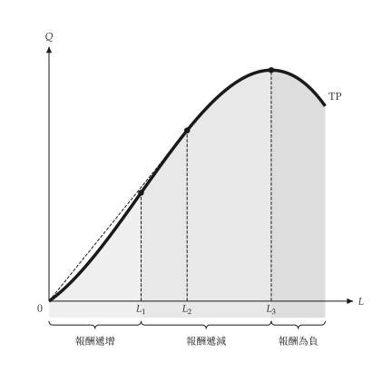

# 設定

<span id="sec-settings"></span>

`micro-viz` 讀取共用的 `econ-viz.toml`。檔案由 `mosaickit` 解析與檢查，`micro-viz` 只在 `[micro]` 底下宣告自己用到的項目。載入一次之後，沒有指定 `theme` 的圖都會使用它：

```python
from micro_viz import Config

Config.load("econ-viz.toml").use()
```

相對路徑以設定檔所在資料夾為準。沒寫的項目沿用內建預設；完全沒有設定檔時，輸出與沒有設定機制時**完全相同**。

```toml
base = "manual"            # 共用外觀：白底黑白

[font]
text = "serif"
math = "texgyrepagella-math.otf"

[fonts]
serif = ["texgyrepagella-regular.otf", "texgyrepagella-italic.otf"]

[micro]
language = "zh-TW"         # en、zh-TW 或 zh-CN

[micro.stroke]
curve = 3.5                # 單位為點

[micro.region]
fill = true
extent = "top"
```

## 共用項目

`base`、`[font]`、`[fonts]`、`background`、`axis` 與 `label` 由所有 EconViz 套件共用，說明見[主題與設定](../../mosaickit/guides/themes.md)。**沒有深色主題**，背景永遠是白的。

## `[micro]` 的表

| 項目 | 意義 | 預設 |
| --- | --- | --- |
| `language` | 內建文字的語言 | `en` |
| `color.<元素>` | 單一元素的顏色（見下） | 主題的顏色 |
| `stroke.curve` | 主要曲線線寬（點） | 3.5 |
| `stroke.dashed` | 虛線曲線線寬 | 2.0 |
| `stroke.guide` | 座標軸與輔助線線寬 | 1.0 |
| `stroke.after` | 變動後曲線的線寬（細實線） | 1.5 |
| `stroke.arrow` | 移動箭頭線寬（實線） | 1.2 |
| `marker.diameter` | 標示點的直徑 | 6.5 |
| `brace.gap` | 色塊與大括號的間距 | 4.0 |
| `opacity.region` | 色塊不透明度，大於 0 且最大為 1 | 0.2 |
| `region.fill` | 是否為區域填色（`false` 只留大括號與名稱） | `true` |
| `region.extent` | `top` 填到圖頂，`curve` 只填曲線下方 | `top` |
| `label.<群組>.<方向>` | 移動一組標籤，見[文字與位置](labels.md#sec-nudges) | 無 |

顏色元素有 `axis`、`label`、`guide`、`marker`、`total`、`average`、`marginal`、`variable`、`fixed`、`price`、`region_light`、`region_mid` 與 `region_dark`。每個元素對應一個主題角色，所以 `manual` 是黑白，`default` 是彩色。

變動後的曲線**一律**是細實線，平行移動是直的箭頭，彎箭頭只代表旋轉；設定只改線寬，不改這些慣例。

## 區域填色

生產圖的邊際報酬區域可以填色或不填，可以填到圖頂或只填曲線下方，每個區域也能各自指定顏色。

```python
from dataclasses import replace

from micro_viz import shared_theme, total_product_canvas

theme = replace(shared_theme("manual"), region_extent="curve")
total_product_canvas(
    result, theme=theme, region_colors={"increasing": "#bbbbbb", "diminishing": "#dddddd"}
)
```

`region_colors` 把區域種類（`increasing`、`diminishing`、`negative`）對應到顏色；沒列出的種類沿用主題的色階。

{ .ev-figure-sm }

{ .ev-figure-sm }
