# 不確定性與資訊

<span id="sec-uncertainty"></span>

風險、拍賣與資訊不對稱。

每一節是一支範例腳本與它畫出的圖。腳本在範例壓縮檔中提供，參數可用 `--help` 查看。

## 不確定下的選擇

<span id="sec-ex-uncertainty"></span>

期望效用與風險態度、均數變異數選擇、狀態請求權與隨機優勢。 出處：[Pratt (1964)](../project/references.md#pratt1964)、[Rothschild (1970)](../project/references.md#rothschildstiglitz1970)、[Markowitz (1952)](../project/references.md#markowitz1952)。

<!-- api: micro_viz.guides_uncertainty_1 -->

`Gamble` 與 `IncomeUtility` 給出期望效用、確定等值與風險貼水；`MeanVarianceInvestor` 與 `RiskReturnLine` 求風險報酬選擇；`StateClaims`、`UniformLottery` 與 `TwoAssetFrontier` 處理保險、優勢與前緣。

<!-- api: micro_viz.guides_uncertainty_2 -->

兩資產組合在標準差－平均數平面上的前緣：最小變異數組合 `G` 以上的效率部分為粗線。

<!-- api: micro_viz.guides_uncertainty_3 -->

標準差－所得平面上每位投資人一欄的無異曲線：愈趨避風險，曲線愈陡。

<!-- api: micro_viz.guides_uncertainty_4 -->

凹的 `u` 與弦：確定等值 `CE` 的效用等於賭局的 `EU`，風險貼水是 `E(I)` 與 `CE` 之差。

<!-- api: micro_viz.guides_uncertainty_5 -->

風險報酬線與各投資人和它相切的無異曲線；`market_sd` 另標市場投資組合 `M`，其外是借款。

<!-- api: micro_viz.guides_uncertainty_6 -->

狀態請求權：45 度的確定線、稟賦 `E`、每個保費率一條預算線（第一條畫粗；公平保費導致完全保險）。

<!-- api: micro_viz.guides_uncertainty_7 -->

兩個賭局的 CDF `F_A` 與 `F_B`：`kind="first"` 顯示 `F_A` 處處在 `F_B` 之下，`kind="second"` 顯示二階優勢。

<!-- api: micro_viz.guides_uncertainty_8 -->

每個效用函數一小欄：`u(I)`、兩個結果間的弦，以及弦上高於期望所得處的期望效用。

下面是腳本中畫圖的函式，與圖形使用相同的程式碼。

```python
def uncertainty_examples(
    output_dir: Path,
    theme: PlotTheme,
    *,
    gamble: Gamble,
    exponents: tuple[float, float, float],
    averse: float,
    flat: float,
    level: float,
    line: RiskReturnLine,
    sd_max: float,
    market_sd: float,
    claims: StateClaims,
    premiums: tuple[float, float],
    lotteries: tuple[
        UniformLottery,
        UniformLottery,
        UniformLottery,
        UniformLottery,
    ],
    frontier: TwoAssetFrontier,
    title: str | None = None,
) -> list[Path]:
    """Write the uncertainty figures into ``output_dir`` and return their paths."""
    output_dir.mkdir(parents=True, exist_ok=True)
    concave, convex, linear = (
        IncomeUtility(e) for e in exponents
    )
    steep, shallow = (
        MeanVarianceInvestor(averse),
        MeanVarianceInvestor(flat),
    )
    figures = {
        "utility_of_income.svg": utility_of_income_canvas(
            gamble, (concave, convex, linear), theme=theme
        ),
        "risk_premium.svg": risk_premium_canvas(
            gamble, concave, theme=theme, title=title
        ),
        "risk_attitude.svg": risk_attitude_canvas(
            (steep, shallow), level, sd_max, theme=theme
        ),
        "risk_return_choice.svg": risk_return_choice_canvas(
            line,
            (steep,),
            level,
            sd_max,
            theme=theme,
            title=title,
        ),
        "risk_return_two_investors.svg": risk_return_choice_canvas(
            line,
            (steep, shallow),
            level,
            sd_max,
            theme=theme,
            title=title,
        ),
        "state_claims_fair.svg": state_claims_canvas(
            claims, premiums[:1], theme=theme, title=title
        ),
        "state_claims_unfair.svg": state_claims_canvas(
            claims, premiums, theme=theme, title=title
        ),
        "first_order_dominance.svg": stochastic_dominance_canvas(
            lotteries[0],
            lotteries[1],
            "first",
            theme=theme,
            title=title,
        ),
        "second_order_dominance.svg": stochastic_dominance_canvas(
            lotteries[2],
            lotteries[3],
            "second",
            theme=theme,
            title=title,
        ),
        "mean_variance_frontier.svg": mean_variance_frontier_canvas(
            frontier, theme=theme, title=title
        ),
        "risk_return_borrowing.svg": risk_return_choice_canvas(
            line,
            (shallow,),
            level,
            sd_max,
            market_sd,
            theme=theme,
            title=title,
        ),
    }
    paths = []
    for name, figure in figures.items():
        figure.save(output_dir / name)
        paths.append(output_dir / name)
    return paths
```

<span id="fig-uncertainty-utility-of-income"></span>

<figure class="ev-fig" markdown>

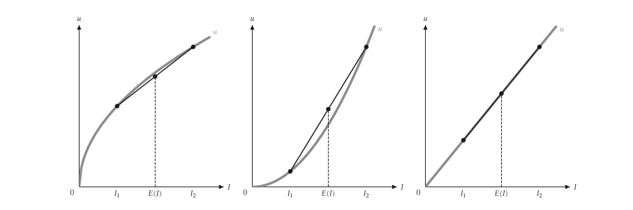{ .ev-figure-sm }

<div class="ev-downloads"><a class="ev-download" href="../../../assets/micro-viz/uncertainty/uncertainty.py" download aria-label="下載生圖原始檔"><svg viewBox="0 0 24 24" aria-hidden="true"><path d="M12 4v11m0 0-4.5-4.5M12 15l4.5-4.5M5 20h14" fill="none" stroke="currentColor" stroke-width="2" stroke-linecap="round" stroke-linejoin="round"/></svg><span>下載生圖原始檔</span></a></div>

<figcaption markdown>*所得效用。* 三種風險態度的所得效用與期望效用弦。</figcaption>

</figure>

<span id="fig-uncertainty-risk-premium"></span>

<figure class="ev-fig" markdown>

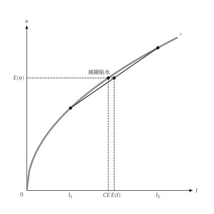{ .ev-figure-sm }

<div class="ev-downloads"><a class="ev-download" href="../../../assets/micro-viz/uncertainty/uncertainty.py" download aria-label="下載生圖原始檔"><svg viewBox="0 0 24 24" aria-hidden="true"><path d="M12 4v11m0 0-4.5-4.5M12 15l4.5-4.5M5 20h14" fill="none" stroke="currentColor" stroke-width="2" stroke-linecap="round" stroke-linejoin="round"/></svg><span>下載生圖原始檔</span></a></div>

<figcaption markdown>*風險貼水。* 確定等值與風險貼水。</figcaption>

</figure>

<span id="fig-uncertainty-risk-attitude"></span>

<figure class="ev-fig" markdown>

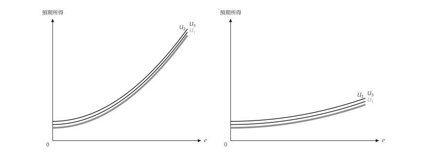{ .ev-figure-sm }

<div class="ev-downloads"><a class="ev-download" href="../../../assets/micro-viz/uncertainty/uncertainty.py" download aria-label="下載生圖原始檔"><svg viewBox="0 0 24 24" aria-hidden="true"><path d="M12 4v11m0 0-4.5-4.5M12 15l4.5-4.5M5 20h14" fill="none" stroke="currentColor" stroke-width="2" stroke-linecap="round" stroke-linejoin="round"/></svg><span>下載生圖原始檔</span></a></div>

<figcaption markdown>*風險態度。* 風險趨避愈強，無異曲線愈陡。</figcaption>

</figure>

<span id="fig-uncertainty-risk-return-choice"></span>

<figure class="ev-fig" markdown>

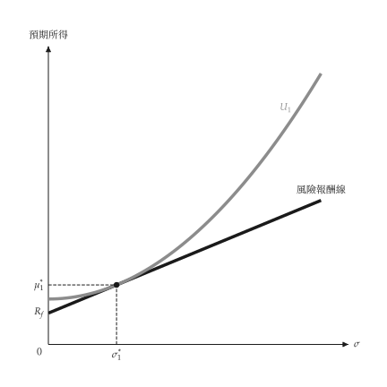{ .ev-figure-sm }

<div class="ev-downloads"><a class="ev-download" href="../../../assets/micro-viz/uncertainty/uncertainty.py" download aria-label="下載生圖原始檔"><svg viewBox="0 0 24 24" aria-hidden="true"><path d="M12 4v11m0 0-4.5-4.5M12 15l4.5-4.5M5 20h14" fill="none" stroke="currentColor" stroke-width="2" stroke-linecap="round" stroke-linejoin="round"/></svg><span>下載生圖原始檔</span></a></div>

<figcaption markdown>*風險報酬選擇。* 無異曲線與風險報酬線相切。</figcaption>

</figure>

<span id="fig-uncertainty-risk-return-two-investors"></span>

<figure class="ev-fig" markdown>

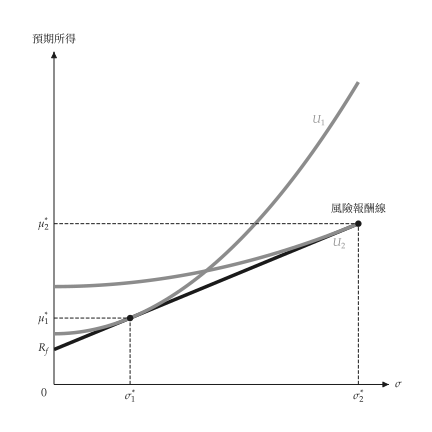{ .ev-figure-sm }

<div class="ev-downloads"><a class="ev-download" href="../../../assets/micro-viz/uncertainty/uncertainty.py" download aria-label="下載生圖原始檔"><svg viewBox="0 0 24 24" aria-hidden="true"><path d="M12 4v11m0 0-4.5-4.5M12 15l4.5-4.5M5 20h14" fill="none" stroke="currentColor" stroke-width="2" stroke-linecap="round" stroke-linejoin="round"/></svg><span>下載生圖原始檔</span></a></div>

<figcaption markdown>*兩位投資人。* 不同風險趨避者選擇不同切點。</figcaption>

</figure>

<span id="fig-uncertainty-state-claims-fair"></span>

<figure class="ev-fig" markdown>

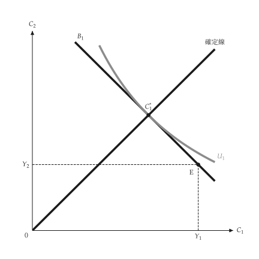{ .ev-figure-sm }

<div class="ev-downloads"><a class="ev-download" href="../../../assets/micro-viz/uncertainty/uncertainty.py" download aria-label="下載生圖原始檔"><svg viewBox="0 0 24 24" aria-hidden="true"><path d="M12 4v11m0 0-4.5-4.5M12 15l4.5-4.5M5 20h14" fill="none" stroke="currentColor" stroke-width="2" stroke-linecap="round" stroke-linejoin="round"/></svg><span>下載生圖原始檔</span></a></div>

<figcaption markdown>*狀態請求權，公平保費。* 公平保費下，消費者選擇兩狀態所得相等的*完全保險*。</figcaption>

</figure>

<span id="fig-uncertainty-state-claims-unfair"></span>

<figure class="ev-fig" markdown>

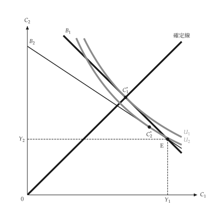{ .ev-figure-sm }

<div class="ev-downloads"><a class="ev-download" href="../../../assets/micro-viz/uncertainty/uncertainty.py" download aria-label="下載生圖原始檔"><svg viewBox="0 0 24 24" aria-hidden="true"><path d="M12 4v11m0 0-4.5-4.5M12 15l4.5-4.5M5 20h14" fill="none" stroke="currentColor" stroke-width="2" stroke-linecap="round" stroke-linejoin="round"/></svg><span>下載生圖原始檔</span></a></div>

<figcaption markdown>*狀態請求權，高保費。* 保費高於公平時，消費者只買*部分保險*。</figcaption>

</figure>

<span id="fig-uncertainty-first-order-dominance"></span>

<figure class="ev-fig" markdown>

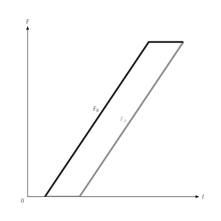{ .ev-figure-sm }

<div class="ev-downloads"><a class="ev-download" href="../../../assets/micro-viz/uncertainty/uncertainty.py" download aria-label="下載生圖原始檔"><svg viewBox="0 0 24 24" aria-hidden="true"><path d="M12 4v11m0 0-4.5-4.5M12 15l4.5-4.5M5 20h14" fill="none" stroke="currentColor" stroke-width="2" stroke-linecap="round" stroke-linejoin="round"/></svg><span>下載生圖原始檔</span></a></div>

<figcaption markdown>*一階隨機優勢。* 一條 CDF 處處在另一條之下，即*一階隨機優勢*。</figcaption>

</figure>

<span id="fig-uncertainty-second-order-dominance"></span>

<figure class="ev-fig" markdown>

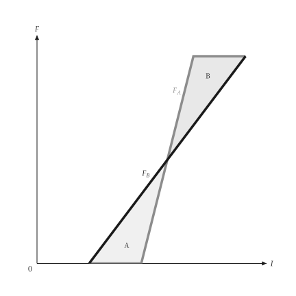{ .ev-figure-sm }

<div class="ev-downloads"><a class="ev-download" href="../../../assets/micro-viz/uncertainty/uncertainty.py" download aria-label="下載生圖原始檔"><svg viewBox="0 0 24 24" aria-hidden="true"><path d="M12 4v11m0 0-4.5-4.5M12 15l4.5-4.5M5 20h14" fill="none" stroke="currentColor" stroke-width="2" stroke-linecap="round" stroke-linejoin="round"/></svg><span>下載生圖原始檔</span></a></div>

<figcaption markdown>*二階隨機優勢。* 平均數相同、較不分散者*二階隨機優勢*。</figcaption>

</figure>

<span id="fig-uncertainty-mean-variance-frontier"></span>

<figure class="ev-fig" markdown>

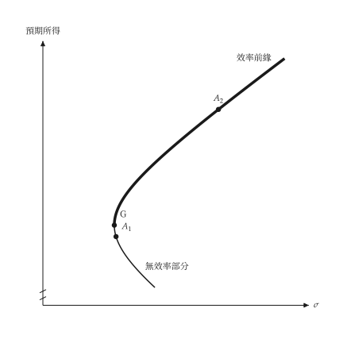{ .ev-figure-sm }

<div class="ev-downloads"><a class="ev-download" href="../../../assets/micro-viz/uncertainty/uncertainty.py" download aria-label="下載生圖原始檔"><svg viewBox="0 0 24 24" aria-hidden="true"><path d="M12 4v11m0 0-4.5-4.5M12 15l4.5-4.5M5 20h14" fill="none" stroke="currentColor" stroke-width="2" stroke-linecap="round" stroke-linejoin="round"/></svg><span>下載生圖原始檔</span></a></div>

<figcaption markdown>*均數變異數前緣。* 兩資產組合的*效率前緣*與無效率部分。</figcaption>

</figure>

<span id="fig-uncertainty-risk-return-borrowing"></span>

<figure class="ev-fig" markdown>

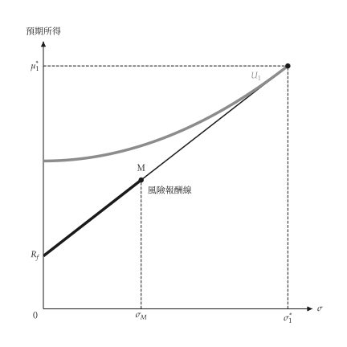{ .ev-figure-sm }

<div class="ev-downloads"><a class="ev-download" href="../../../assets/micro-viz/uncertainty/uncertainty.py" download aria-label="下載生圖原始檔"><svg viewBox="0 0 24 24" aria-hidden="true"><path d="M12 4v11m0 0-4.5-4.5M12 15l4.5-4.5M5 20h14" fill="none" stroke="currentColor" stroke-width="2" stroke-linecap="round" stroke-linejoin="round"/></svg><span>下載生圖原始檔</span></a></div>

<figcaption markdown>*借款。* 借款可持有超過市場投資組合的風險。</figcaption>

</figure>

## 拍賣

<span id="sec-ex-auctions"></span>

獨立均勻估值下的第一與第二價格密封拍賣：出價函數與收益相等。 出處：[Vickrey (1961)](../project/references.md#vickrey1961)。

<!-- api: micro_viz.guides_uncertainty_9 -->

`Auction` 給出某估值下的出價，以及兩種形式的預期收益。

<!-- api: micro_viz.guides_uncertainty_10 -->

出價對估值：45 度的第二價格出價 `b = v`，以及 `auctions` 中每個拍賣的第一價格出價 `b = (n - 1) v / n`。

<!-- api: micro_viz.guides_uncertainty_11 -->

兩種形式下賣者的預期收益對競標者數目：兩條曲線重合（收益相等），並隨人數上升。

下面是腳本中畫圖的函式，與圖形使用相同的程式碼。

```python
def auction_examples(
    output_dir: Path,
    theme: PlotTheme,
    *,
    bidders: tuple[int, ...],
    max_value: float,
    title: str | None = None,
) -> list[Path]:
    """Write the auction figures into ``output_dir`` and return their paths."""
    output_dir.mkdir(parents=True, exist_ok=True)
    figures = {
        "bid_functions.svg": bid_functions_canvas(
            (Auction(bidders[0], max_value),),
            theme=theme,
            title=title,
        ),
        "bid_functions_by_bidders.svg": bid_functions_canvas(
            tuple(Auction(n, max_value) for n in bidders),
            theme=theme,
            title=title,
        ),
        "revenue_equivalence.svg": revenue_equivalence_canvas(
            tuple(range(2, max(bidders) + 8)),
            max_value,
            theme=theme,
            title=title,
        ),
    }
    paths = []
    for name, figure in figures.items():
        figure.save(output_dir / name)
        paths.append(output_dir / name)
    return paths
```

<span id="fig-auctions-bid-functions"></span>

<figure class="ev-fig" markdown>

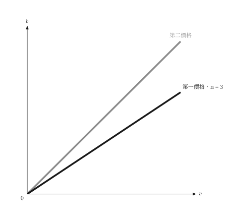{ .ev-figure-sm }

<div class="ev-downloads"><a class="ev-download" href="../../../assets/micro-viz/auctions/auctions.py" download aria-label="下載生圖原始檔"><svg viewBox="0 0 24 24" aria-hidden="true"><path d="M12 4v11m0 0-4.5-4.5M12 15l4.5-4.5M5 20h14" fill="none" stroke="currentColor" stroke-width="2" stroke-linecap="round" stroke-linejoin="round"/></svg><span>下載生圖原始檔</span></a></div>

<figcaption markdown>*出價函數。* 第二價格拍賣出價等於估值，第一價格出價*低於估值*。</figcaption>

</figure>

<span id="fig-auctions-bid-functions-by-bidders"></span>

<figure class="ev-fig" markdown>

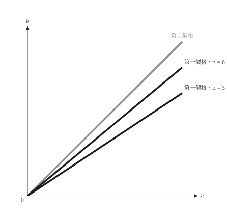{ .ev-figure-sm }

<div class="ev-downloads"><a class="ev-download" href="../../../assets/micro-viz/auctions/auctions.py" download aria-label="下載生圖原始檔"><svg viewBox="0 0 24 24" aria-hidden="true"><path d="M12 4v11m0 0-4.5-4.5M12 15l4.5-4.5M5 20h14" fill="none" stroke="currentColor" stroke-width="2" stroke-linecap="round" stroke-linejoin="round"/></svg><span>下載生圖原始檔</span></a></div>

<figcaption markdown>*出價折減。* 競標者愈多，第一價格出價愈*接近估值*。</figcaption>

</figure>

<span id="fig-auctions-revenue-equivalence"></span>

<figure class="ev-fig" markdown>

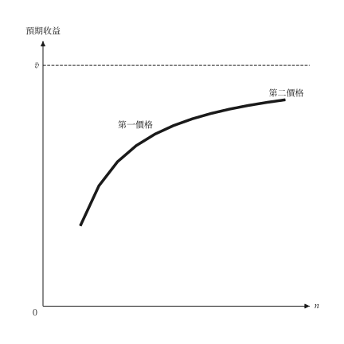{ .ev-figure-sm }

<div class="ev-downloads"><a class="ev-download" href="../../../assets/micro-viz/auctions/auctions.py" download aria-label="下載生圖原始檔"><svg viewBox="0 0 24 24" aria-hidden="true"><path d="M12 4v11m0 0-4.5-4.5M12 15l4.5-4.5M5 20h14" fill="none" stroke="currentColor" stroke-width="2" stroke-linecap="round" stroke-linejoin="round"/></svg><span>下載生圖原始檔</span></a></div>

<figcaption markdown>*收益相等。* 兩種拍賣的*預期收益相同*，且隨競標者增加。</figcaption>

</figure>

## 資訊

<span id="sec-ex-information"></span>

逆選擇、訊號、道德風險、誘因相容的獎金與效率工資。 出處：[Akerlof (1970)](../project/references.md#akerlof1970)、[Spence (1973)](../project/references.md#spence1973)、[Shapiro (1984)](../project/references.md#shapirostiglitz1984)。

<!-- api: micro_viz.guides_uncertainty_12 -->

每個模型求解一種資訊不對稱的情形；`Signaling` 有分離與混同兩種訊號。

<!-- api: micro_viz.guides_uncertainty_13 -->

獎金對申報的廠房規模 `R`，每種真實產能一條：每條在申報等於產能處最高，所以誠實申報是最適。

<!-- api: micro_viz.guides_uncertainty_14 -->

勞動需求 `D`、供給 `S` 與不偷懶條件 `NSC`：均衡在 `NSC` 與 `D` 相交處，工資高於競爭工資。

<!-- api: micro_viz.guides_uncertainty_15 -->

每個高品質比例一欄：高、低品質的需求 `D_H`、`D_L`，賣者的保留線 `S_H`、`S_L` 與混合需求。

<!-- api: micro_viz.guides_uncertainty_16 -->

需求 `D` 對真實邊際成本 `MC`，以及被保險病人面對的較低價格 `MC'`：使用量由 `Q_e` 增至 `Q_i`，三角形是無謂損失。

<!-- api: micro_viz.guides_uncertainty_17 -->

低能力組（左）與高能力組（右）的教育成本對工資利益：在分離訊號 `y*` 下只有高能力者購買。

下面是腳本中畫圖的函式，與圖形使用相同的程式碼。

```python
def information_examples(
    output_dir: Path,
    theme: PlotTheme,
    *,
    lemons: LemonsMarket,
    shares: tuple[float, ...],
    signaling: Signaling,
    hazard: MoralHazard,
    bonus: BonusSchedule,
    capacities: tuple[float, ...],
    reach: float,
    efficiency: EfficiencyWage,
    title: str | None = None,
) -> list[Path]:
    """Write the information figures into ``output_dir`` and return their paths."""
    output_dir.mkdir(parents=True, exist_ok=True)
    figures = {
        "lemons.svg": lemons_market_canvas(
            lemons, shares, theme=theme
        ),
        "signaling.svg": signaling_canvas(
            signaling, theme=theme
        ),
        "pooling.svg": signaling_canvas(
            signaling, signaling.low_ceiling / 2, theme=theme
        ),
        "moral_hazard.svg": moral_hazard_canvas(
            hazard, theme=theme, title=title
        ),
        "bonus_schedule.svg": bonus_schedule_canvas(
            bonus, capacities, reach, theme=theme, title=title
        ),
        "efficiency_wage.svg": efficiency_wage_canvas(
            efficiency, theme=theme, title=title
        ),
    }
    paths = []
    for name, figure in figures.items():
        figure.save(output_dir / name)
        paths.append(output_dir / name)
    return paths
```

<span id="fig-information-pooling"></span>

<figure class="ev-fig" markdown>

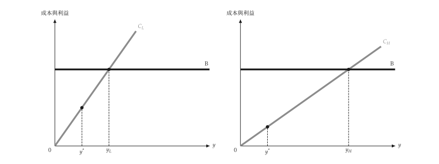{ .ev-figure-sm }

<div class="ev-downloads"><a class="ev-download" href="../../../assets/micro-viz/information/information.py" download aria-label="下載生圖原始檔"><svg viewBox="0 0 24 24" aria-hidden="true"><path d="M12 4v11m0 0-4.5-4.5M12 15l4.5-4.5M5 20h14" fill="none" stroke="currentColor" stroke-width="2" stroke-linecap="round" stroke-linejoin="round"/></svg><span>下載生圖原始檔</span></a></div>

<figcaption markdown>*混同訊號。* 訊號成本低時，兩類型皆購買，形成*混同均衡*。</figcaption>

</figure>

<span id="fig-information-lemons"></span>

<figure class="ev-fig" markdown>

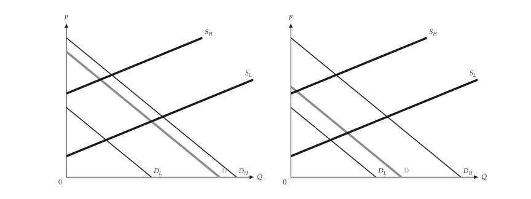{ .ev-figure-sm }

<div class="ev-downloads"><a class="ev-download" href="../../../assets/micro-viz/information/information.py" download aria-label="下載生圖原始檔"><svg viewBox="0 0 24 24" aria-hidden="true"><path d="M12 4v11m0 0-4.5-4.5M12 15l4.5-4.5M5 20h14" fill="none" stroke="currentColor" stroke-width="2" stroke-linecap="round" stroke-linejoin="round"/></svg><span>下載生圖原始檔</span></a></div>

<figcaption markdown>*檸檬市場。* 高品質比例過低時，高品質被逐出市場。</figcaption>

</figure>

<span id="fig-information-signaling"></span>

<figure class="ev-fig" markdown>

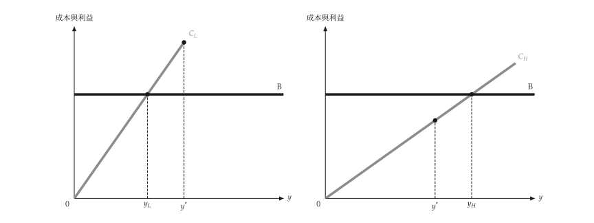{ .ev-figure-sm }

<div class="ev-downloads"><a class="ev-download" href="../../../assets/micro-viz/information/information.py" download aria-label="下載生圖原始檔"><svg viewBox="0 0 24 24" aria-hidden="true"><path d="M12 4v11m0 0-4.5-4.5M12 15l4.5-4.5M5 20h14" fill="none" stroke="currentColor" stroke-width="2" stroke-linecap="round" stroke-linejoin="round"/></svg><span>下載生圖原始檔</span></a></div>

<figcaption markdown>*訊號。* 分離訊號只有高能力者願意購買。</figcaption>

</figure>

<span id="fig-information-moral-hazard"></span>

<figure class="ev-fig" markdown>

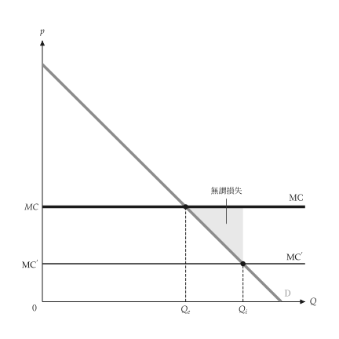{ .ev-figure-sm }

<div class="ev-downloads"><a class="ev-download" href="../../../assets/micro-viz/information/information.py" download aria-label="下載生圖原始檔"><svg viewBox="0 0 24 24" aria-hidden="true"><path d="M12 4v11m0 0-4.5-4.5M12 15l4.5-4.5M5 20h14" fill="none" stroke="currentColor" stroke-width="2" stroke-linecap="round" stroke-linejoin="round"/></svg><span>下載生圖原始檔</span></a></div>

<figcaption markdown>*道德風險。* 保險降低價格，造成過度使用。</figcaption>

</figure>

<span id="fig-information-bonus-schedule"></span>

<figure class="ev-fig" markdown>

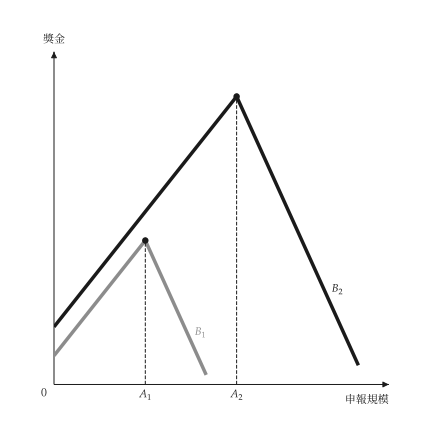{ .ev-figure-sm }

<div class="ev-downloads"><a class="ev-download" href="../../../assets/micro-viz/information/information.py" download aria-label="下載生圖原始檔"><svg viewBox="0 0 24 24" aria-hidden="true"><path d="M12 4v11m0 0-4.5-4.5M12 15l4.5-4.5M5 20h14" fill="none" stroke="currentColor" stroke-width="2" stroke-linecap="round" stroke-linejoin="round"/></svg><span>下載生圖原始檔</span></a></div>

<figcaption markdown>*獎金表。* 誠實申報時獎金最大，誘因相容。</figcaption>

</figure>

<span id="fig-information-efficiency-wage"></span>

<figure class="ev-fig" markdown>

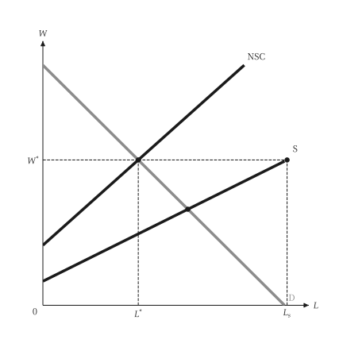{ .ev-figure-sm }

<div class="ev-downloads"><a class="ev-download" href="../../../assets/micro-viz/information/information.py" download aria-label="下載生圖原始檔"><svg viewBox="0 0 24 24" aria-hidden="true"><path d="M12 4v11m0 0-4.5-4.5M12 15l4.5-4.5M5 20h14" fill="none" stroke="currentColor" stroke-width="2" stroke-linecap="round" stroke-linejoin="round"/></svg><span>下載生圖原始檔</span></a></div>

<figcaption markdown>*效率工資。* 不偷懶條件使工資高於均衡並產生失業。</figcaption>

</figure>
