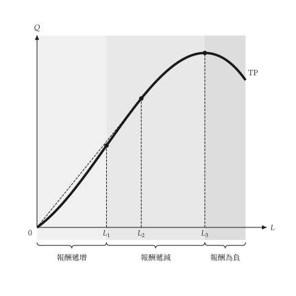

<h1 class="ev-visually-hidden">micro-viz：用 Python 繪製個體經濟學圖形</h1>

<p align="center"><em>廠商與市場的教科書分析與圖形 Python 套件。</em></p>

`micro-viz` 負責個體經濟學的廠商端：生產、成本、市場結構、定價、要素市場、不確定性與資訊。每個模型都是有型別的物件，**不負責繪圖**；每張圖都是由模型建立的 `mosaickit` 畫布。統計資料圖與方塊加箭頭的流程圖不在範圍內。

```python
from micro_viz import ShortRunProductionFunction, analyze_production, total_product_canvas

production = ShortRunProductionFunction(linear=6, quadratic=3, cubic=-0.5)
result = analyze_production(production, input_range=(0, 6))

total_product_canvas(result).save("total_product.svg")
```

{ .ev-figure-sm }

## 模型與圖形

| 模型 | 模組 | 圖形 |
| --- | --- | --- |
| 短期生產、成本函數、階梯成本 | `production`、`costs` | [生產與成本](guides/production-costs.md) |
| 等產量線、成本最小化、學習與範疇、要素市場、買方獨占與工會 | `isoquant`、`production.extras`、`factors` | [投入與技術](guides/inputs.md) |
| 完全競爭、進入與退出、長期成本 | `competition`、`entry`、`longrun` | [競爭與長期](guides/competition.md) |
| 獨占、獨占性競爭、管制、價格歧視、關稅式定價、搭售、廣告、可耗竭資源 | `monopoly`、`monopolistic`、`regulation`、`discrimination`、`pricing`、`bundling`、`advertising`、`capital` | [獨占與定價](guides/monopoly.md) |
| 雙占、凹折需求、主導廠商、垂直關係 | `oligopoly`、`vertical` | [寡占與垂直關係](guides/oligopoly.md) |
| 期望效用、風險、拍賣、逆向選擇、訊號、道德危害 | `uncertainty`、`auctions`、`information` | [不確定性與資訊](guides/uncertainty.md) |

每個繪圖函式都接受 `title=None`，回傳 `mosaickit` 的 `Canvas`，並產生穩定的 `micro.*` 圖層編號。文字來自英文、繁體中文與簡體中文的語系表，任何一句都能用 `labels=` 取代。尺寸、線寬、顏色與字型來自主題和共用的 `econ-viz.toml`，**不寫在繪圖程式裡**。

!!! note "狀態"

    `micro-viz` 目前是 `0.2.0.dev0`，尚未上架 PyPI；請從 GitHub 安裝（見[安裝](installation.md#sec-install)）。

## 範圍

- `micro-viz` 負責生產者理論、市場結構、要素市場、不確定性與資訊。
- 消費者理論與一般均衡屬於 [utility-viz](../utility-viz/index.md)。
- 入門的供需政策圖屬於 [principle-viz](../principle-viz/index.md)。
- 賽局理論不在這個套件內。
