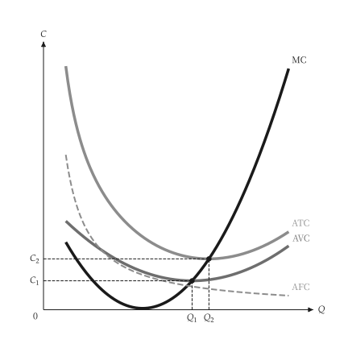

# 快速開始

<span id="sec-quickstart"></span>

畫一張圖分兩步：建立模型，再把模型的結果交給 `micro_viz` 的繪圖函式。

```python
from micro_viz import CubicCost, analyze_costs, unit_cost_canvas

cost = CubicCost(
    fixed_cost=50, linear=36, quadratic=-8, cubic=0.6
)
analysis = analyze_costs(cost, output_range=(1, 11))

unit_cost_canvas(analysis).save("unit_cost.svg")
```

<span id="fig-quick-unit-cost"></span>

<figure class="ev-fig" markdown>

{ .ev-figure-sm }

<div class="ev-downloads"><a class="ev-download" href="../../assets/micro-viz/costs/costs.py" download aria-label="下載生圖原始檔"><svg viewBox="0 0 24 24" aria-hidden="true"><path d="M12 4v11m0 0-4.5-4.5M12 15l4.5-4.5M5 20h14" fill="none" stroke="currentColor" stroke-width="2" stroke-linecap="round" stroke-linejoin="round"/></svg><span>下載生圖原始檔</span></a></div>

<figcaption markdown>單位成本曲線</figcaption>

</figure>

`save()` 依副檔名寫出 PNG、SVG 或 PDF。模型不可變，不畫圖也能回答問題：

```python
# 最低 ATC 與其產量
analysis.minimum_average_total_cost
# 某一產量的 MC
cost.marginal_cost(5.0)
```

## 標題、標籤與設定

- `title=None` 不畫標題，`title="..."` 設定標題。
- 內建文字（座標軸標題、曲線名稱、點名）是語系表的標籤編號；`labels={"id": "text"}` 可取代其中任何一個（參見 [標籤與位置](guides/labels.md#sec-labels)）。
- 顏色、線寬、字型與大小來自主題與共用 `econ-viz.toml` 的 `[micro]` 表（參見 [設定](guides/settings.md#sec-settings)），繪圖程式碼不含這些值。
- 範圍、產量標記與取樣數等數字是繪圖函式的參數。
