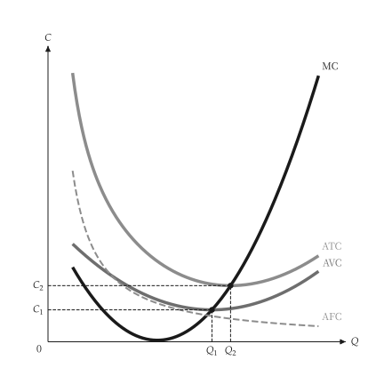

# 快速開始

<span id="sec-quickstart"></span>

畫一張圖分兩步：先建立模型，再把結果交給 `micro_viz` 的繪圖函式。

```python
from micro_viz import CubicCost, analyze_costs, unit_cost_canvas

cost = CubicCost(fixed_cost=50, linear=36, quadratic=-8, cubic=0.6)
analysis = analyze_costs(cost, output_range=(1, 11))

unit_cost_canvas(analysis).save("unit_cost.svg")
```

{ .ev-figure-sm }

`save()` 依副檔名輸出 PNG、SVG 或 PDF。模型不可變，不畫圖也能回答問題：

```python
analysis.minimum_average_total_cost    # 最低 ATC 與其產量
cost.marginal_cost(5.0)                # 某產量的 MC
```

## 標題、文字與設定

- `title=None` 不畫標題，`title="..."` 設定標題。
- 內建文字（座標軸名稱、曲線名稱、點名稱）是語系表的文字編號；`labels={"編號": "文字"}` 可以取代任何一句（見[文字與位置](guides/labels.md#sec-labels)）。
- 顏色、線寬、字型與大小來自主題和共用 `econ-viz.toml` 的 `[micro]` 表（見[設定](guides/settings.md#sec-settings)），繪圖程式裡**沒有**這些值。
- 範圍、產量標記與取樣數等數字都是繪圖函式的參數。
