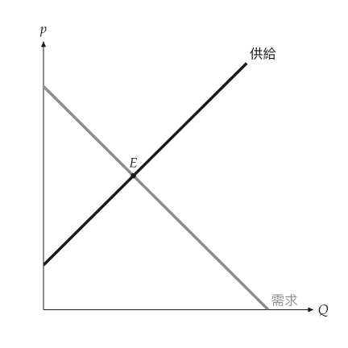

# 圖形

<span id="sec-figures"></span>

本手冊的每張圖都是 `MarketFigure`，或由 `ppf_canvas()` 等函式建立的 `mosaickit` 畫布。兩者的繪圖區為正方形，座標軸帶箭頭、無刻度與格線；曲線名稱標在末端，面積名稱寫在區塊內，數值標在座標軸上，文字不遮住線、點、區塊或其他文字。

## MarketFigure

<!-- api: agora.principle_viz.guides_figures_1 -->

`mosaickit` 畫布上的市場圖，座標軸由 0 延伸到 `x_max` 與 `y_max`。座標軸名稱除非是文字，否則以 LaTeX 數學排版；`title` 為空字串時不畫標題。

<!-- api: agora.principle_viz.guides_figures_2 -->

由 $Q = 0$ 到 `q_max` 畫出需求與供給並在末端命名；以實心點與標籤標出均衡。

各主題另有專屬方法，說明見對應章節（參見[`MarketFigure` 的主題方法](figures.md#tab-figure-methods)）。

<span id="tab-figure-methods"></span>

| 方法 | 章節 |
| --- | --- |
| `add_comparative_statics` | [比較靜態](markets.md#sec-shifts) |
| `add_discrete_curves`、`add_discrete_equilibrium` | [離散市場](discrete.md#sec-discrete) |
| `add_welfare`、`add_welfare_transition` | [福利](welfare.md#sec-welfare) |
| `add_tax_transform`、`add_tax_comparison`、`add_subsidy_comparison` | [租稅與補貼](taxes.md#sec-taxes) |
| `add_price_control` | [價格管制](controls.md#sec-controls) |
| `add_trade` | [國際貿易](trade.md#sec-trade) |
| `add_externality`、`add_common_resource` | [市場失靈](failures.md#sec-failures) |
| `add_minimum_wage`、`add_loanable_funds` | [勞動與可貸資金](factor-markets.md#sec-factor) |

<!-- api: agora.principle_viz.guides_figures_3 -->

`finalize()` 隱藏會把福利區塊切成兩半的輔助線（數值仍標在座標軸上），只有在 `legend=True` 時才加入圖例。`save()` 依副檔名寫出 PNG、SVG 或 PDF，並建立不存在的目錄。`close()` 不做任何事，僅為相容而保留。

<!-- api: agora.principle_viz.guides_figures_4 -->

加入任意 `mosaickit` 圖層，用於主題方法未提供的註記。同一數值的座標軸標記會取代先前的標記。完成的場景可由 `fig.scene` 取得。

<!-- api: agora.principle_viz.guides_figures_5 -->

以名稱與數值組成的文字框，供筆記本與除錯使用。教學用圖不放此框，數值應寫在正文中。

## 標籤與圖層

<span id="sec-labels"></span>

圖中的每條線、每個點、每個區塊與每段文字都是一個圖層，各有固定的 id，例如 `market.demand`、`market.demand.label` 或 `market.welfare.dwl`。id 依圖形結構命名：座標軸為 `axes.*`，各元素為 `market.<部分>`，命名該元素的文字再加上 `.label` 後綴。`fig.layer_ids` 列出所有圖層；`fig.label_ids` 列出可設定的文字（標籤、座標軸標記與括號）。

<!-- api: agora.principle_viz.guides_figures_6 -->

覆寫一個內建標籤。值為 `None` 的欄位保留套件的預設值。指定 `offset`（單位為點）時，標籤不再自動放置，改為精確移動該距離。

<!-- api: agora.principle_viz.guides_figures_7 -->

改名、隱藏或移動一個標籤（id 可省略結尾的 `.label`），或顯示、隱藏任一圖層。`hide(*ids)` 與 `show(*ids)` 一次切換多個圖層。每個方法都回傳圖形本身。

同樣的覆寫也可在建立圖形時以 `labels=` 與 `visibility=` 對應表傳入，之後加入的圖層也會套用。加總圖與各畫布函式（`ppf_canvas()`、`public_good_canvas()` 等）接受同樣的兩個參數。

參見[改名的曲線與均衡點](figures.md#fig-labels)：

```python
from principle_viz import Label, MarketFigure

fig = MarketFigure(
    x_max=12,
    y_max=12,
    labels={
        "market.demand.label": Label(text="Demand"),
        "market.supply.label": Label(text="Supply"),
    },
)
fig.add_curves(demand, supply, q_max=10)
fig.add_equilibrium(eq)
fig.configure_label("market.equilibrium", text="$e^*$")
fig.hide("axes.origin.label")
fig.finalize()
```

<span id="fig-labels"></span>

<figure class="ev-fig" markdown>

{ .ev-figure-sm }

<div class="ev-downloads"><a class="ev-download" href="../../../assets/principle-viz/agora/figures/figures.py" download aria-label="下載生圖原始檔"><svg viewBox="0 0 24 24" aria-hidden="true"><path d="M12 4v11m0 0-4.5-4.5M12 15l4.5-4.5M5 20h14" fill="none" stroke="currentColor" stroke-width="2" stroke-linecap="round" stroke-linejoin="round"/></svg><span>下載生圖原始檔</span></a></div>

<figcaption markdown>改名的曲線與均衡點</figcaption>

</figure>

## 配色與主題

<span id="sec-palettes"></span>

`ColorModel` 為每個經濟角色指定顏色；`PlotTheme` 再加上線寬與座標軸選項，並將兩者編譯為 `mosaickit` 主題。內建的四種配色如[內建配色](figures.md#tab-palettes)。

<!-- api: agora.principle_viz.guides_figures_8 -->

具名的顏色角色：`axis_color`、`label_color`、`demand_color`、`supply_color`、`baseline_color`、`shifted_color`、`tax_color`、`control_color`、`cs_color`、`ps_color`、`tax_revenue_color`、`dwl_color` 與 `arrow_color`。每個值可為 `"#hex"` 或 `"blue"` 等 `mosaickit` 調色盤名稱。

<span id="tab-palettes"></span>

| 名稱 | 特色 |
| --- | --- |
| `default` | `mosaickit` 色相：需求藍、供給紅、無謂損失青；剩餘沿用曲線色相，透明度 15% |
| `colorblind` | 色盲友善的質性配色 |
| `nord` | Nord 配色 |
| `monochrome` | 黑、白與灰階，供印刷使用 |

`list_color_models()` 回傳所有名稱，`get_color_model(name)` 回傳對應的配色；四種配色也以 `DEFAULT_COLOR_MODEL`、`COLORBLIND_COLOR_MODEL`、`NORD_COLOR_MODEL` 與 `MONOCHROME_COLOR_MODEL` 匯出。

<!-- api: agora.principle_viz.guides_figures_9 -->

配色加上線寬（`demand_linewidth`、`supply_linewidth`、`shifted_linewidth`、`tax_linewidth`、`arrow_linewidth`、`dashed_linewidth`）、`equilibrium_marker_size`，以及開關 `show_grid`、`show_ticks`、`show_axis_arrows` 與 `show_origin_label`。`from_palette()` 以內建配色為起點，並可設定上述任一欄位。

字型有三個欄位。`font` 是 `"sans"`（預設）、`"serif"` 或 `"mono"`，已安裝的字型名稱（如 `"Arial"`）會報錯。`fonts` 是 `mosaickit.TextFonts`，用字型檔取代三者之一，沒給的沿用 `mosaickit` 的 DejaVu 預設。`math_font` 是 `MathFont` 或 OpenType 數學字型的路徑，經由 `glyphkit` 排版 `$...$`。`font_roles` 把樣式角色對應到通用字型，例如 `{"axes": "mono"}`。系統字型不會被搜尋，請直接給路徑。

```python
from mosaickit import TextFonts
from principle_viz import MarketFigure, PlotTheme

theme = PlotTheme(
    font="serif",
    fonts=TextFonts(
        serif=[
            "fonts/Pagella-Regular.otf",
            "fonts/Pagella-Bold.otf",
        ]
    ),
    math_font="fonts/Pagella-Math.otf",
)
fig = MarketFigure(x_max=12, y_max=12, theme=theme)
```

以 `palette` 參數選用配色（參見[`monochrome` 配色](figures.md#fig-monochrome)）：

```python
fig = MarketFigure(x_max=12, y_max=12, palette="monochrome")
```

<span id="fig-monochrome"></span>

<figure class="ev-fig" markdown>

{ .ev-figure-sm }

<div class="ev-downloads"><a class="ev-download" href="../../../assets/principle-viz/agora/figures/figures.py" download aria-label="下載生圖原始檔"><svg viewBox="0 0 24 24" aria-hidden="true"><path d="M12 4v11m0 0-4.5-4.5M12 15l4.5-4.5M5 20h14" fill="none" stroke="currentColor" stroke-width="2" stroke-linecap="round" stroke-linejoin="round"/></svg><span>下載生圖原始檔</span></a></div>

<figcaption markdown>`monochrome` 配色</figcaption>

</figure>

## 畫布

<!-- api: agora.principle_viz.guides_figures_10 -->

`mosaickit` 的 `Canvas`，並具備與 `MarketFigure` 相同的 `labels=`、`visibility=`、`configure_label()`、`configure_layer()`、`hide()`、`show()`、`layer_ids` 與 `label_ids`。生產可能曲線、公共財與總收益各章的畫布函式都回傳此類別；以 `save()` 儲存，或以 `mosaickit.CanvasGrid` 組合多張畫布。
