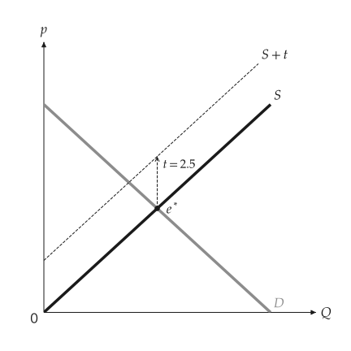
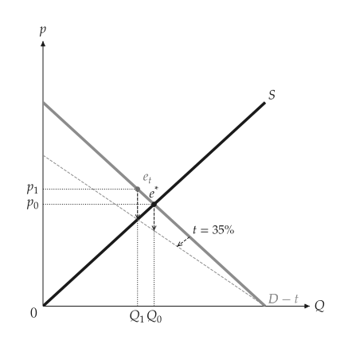
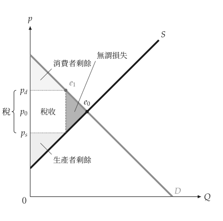
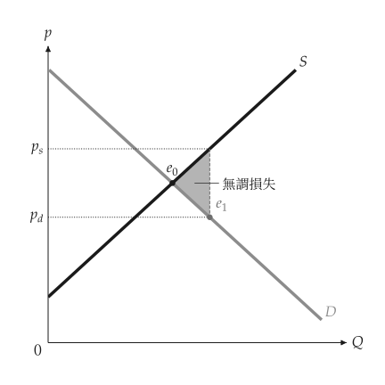

# 租稅與補貼

<span id="sec-taxes"></span>

租稅在買方支付的價格與賣方收到的價格之間形成楔差。無論向買方或賣方課徵，楔差、數量與兩個價格都相同 [Mankiw (2021)](../project/references.md#mankiw2021)。

## 情境

<!-- api: agora.principle_viz.guides_taxes_1 -->

一項租稅，位於 `principle_viz.policy.tax`。

## 求解

<!-- api: agora.principle_viz.guides_taxes_2 -->

稅的定義，來自 `principle_viz.policy.tax`。

<!-- api: agora.principle_viz.guides_taxes_3 -->

稅的法律歸宿，來自 `principle_viz.policy.tax`。

<!-- api: agora.principle_viz.guides_taxes_4 -->

課稅後的市場，回傳 `TaxEquilibriumResult`：`q_star`、`consumer_price`、`producer_price`、`tax_wedge`（兩價之差）與 `tax_revenue`（楔差乘以數量）。

```python
from principle_viz import solve_tax_equilibrium
from principle_viz.policy.tax import TaxOn, TaxScenario, TaxType

tax = TaxScenario(TaxType.PER_UNIT_TAX, 3.0, TaxOn.PRODUCER)
print(solve_tax_equilibrium(demand, supply, tax))
# TaxEquilibriumResult(q_star=2.5, consumer_price=7.5,
#                      producer_price=4.5, tax_wedge=3.0,
#                      tax_revenue=7.5)
```

`TaxOn.CONSUMER` 的結果相同。稅率為 $r$ 的從價稅使消費者價格等於生產者價格的 $(1 + r)$ 倍。

<!-- api: agora.principle_viz.guides_taxes_5 -->

並列課稅前後的市場：`baseline_equilibrium`、`post_tax`、變動量 `delta_q`、`delta_p_consumer`、`delta_p_producer`，以及各自的方向（`"left"`／`"right"`、`"up"`／`"down"`）。

<!-- api: agora.principle_viz.guides_taxes_6 -->

課稅曲線的幾何資訊：`base_curve`、`taxed_curve`、`curve_role`（`"supply"` 或 `"demand"`）與 `transform_kind`（`"shift"` 或 `"rotation"`）。`add_tax_transform()` 依此繪圖。

## 圖形

<!-- api: agora.principle_viz.guides_taxes_7 -->

畫出課稅後的曲線並命名為 $S + t$ 或 $D - t$，以虛線箭頭表示平移或旋轉，並標出未課稅的均衡（參見[向賣方課從量稅](taxes.md#fig-tax-producer)、[向買方課從價稅](taxes.md#fig-tax-consumer)）。

<span id="fig-tax-producer"></span>

<figure class="ev-fig" markdown>

{ .ev-figure-sm }

<div class="ev-downloads"><a class="ev-download" href="../../../assets/principle-viz/agora/taxes/taxes.py" download aria-label="下載生圖原始檔"><svg viewBox="0 0 24 24" aria-hidden="true"><path d="M12 4v11m0 0-4.5-4.5M12 15l4.5-4.5M5 20h14" fill="none" stroke="currentColor" stroke-width="2" stroke-linecap="round" stroke-linejoin="round"/></svg><span>下載生圖原始檔</span></a></div>

<figcaption markdown>向賣方課從量稅</figcaption>

</figure>

<span id="fig-tax-consumer"></span>

<figure class="ev-fig" markdown>

{ .ev-figure-sm }

<div class="ev-downloads"><a class="ev-download" href="../../../assets/principle-viz/agora/taxes/taxes.py" download aria-label="下載生圖原始檔"><svg viewBox="0 0 24 24" aria-hidden="true"><path d="M12 4v11m0 0-4.5-4.5M12 15l4.5-4.5M5 20h14" fill="none" stroke="currentColor" stroke-width="2" stroke-linecap="round" stroke-linejoin="round"/></svg><span>下載生圖原始檔</span></a></div>

<figcaption markdown>向買方課從價稅</figcaption>

</figure>

<!-- api: agora.principle_viz.guides_taxes_8 -->

標出 `compare_tax_scenario()` 結果的楔差：在價格軸上標 $p_d$（買方）、$p_0$（課稅前）與 $p_s$（賣方），並以 "Tax" 括號涵蓋 $p_s$ 到 $p_d$。

搭配[福利](welfare.md#sec-welfare)的福利區塊（參見[課稅下的剩餘與損失](taxes.md#fig-tax-welfare)）：

```python
from principle_viz import compare_tax_scenario
from principle_viz.welfare.surplus import (
    compare_surplus,
    outcome_from_equilibrium,
    outcome_from_tax,
)

eq = solve_equilibrium(demand, supply)
baseline = outcome_from_equilibrium(eq)
taxed = outcome_from_tax(
    solve_tax_equilibrium(demand, supply, tax)
)
delta = compare_surplus(demand, supply, baseline, taxed)
# 7.5 2.25
print(delta.policy.tax_revenue, delta.deadweight_loss)

fig = MarketFigure(
    x_max=12, y_max=12, title="Welfare Under a Tax"
)
fig.add_curves(demand, supply, q_max=10)
fig.add_welfare(delta.policy)
fig.add_tax_comparison(
    compare_tax_scenario(demand, supply, tax)
)
fig.finalize()
```

<span id="fig-tax-welfare"></span>

<figure class="ev-fig" markdown>

{ .ev-figure-sm }

<div class="ev-downloads"><a class="ev-download" href="../../../assets/principle-viz/agora/taxes/taxes.py" download aria-label="下載生圖原始檔"><svg viewBox="0 0 24 24" aria-hidden="true"><path d="M12 4v11m0 0-4.5-4.5M12 15l4.5-4.5M5 20h14" fill="none" stroke="currentColor" stroke-width="2" stroke-linecap="round" stroke-linejoin="round"/></svg><span>下載生圖原始檔</span></a></div>

<figcaption markdown>課稅下的剩餘與損失</figcaption>

</figure>

## 補貼

<!-- api: agora.principle_viz.guides_taxes_9 -->

每單位 `amount` 的補貼（不得為負），發給賣方（`SubsidyTo.PRODUCER`）或買方（`SubsidyTo.CONSUMER`），位於 `principle_viz.policy.subsidy`。

<!-- api: agora.principle_viz.guides_taxes_10 -->

補貼的受領者，來自 `principle_viz.policy.subsidy`。

<!-- api: agora.principle_viz.guides_taxes_11 -->

補貼後的市場（`q_star`、`consumer_price`、`producer_price`、`subsidy_wedge`、`government_expenditure`），以及與自由市場的比較（`baseline_equilibrium`、`post_subsidy`、`delta_q`、`delta_p_consumer`、`delta_p_producer`）。在[快速開始](../quickstart.md#sec-quickstart)的市場中補貼 2：數量 5，買方支付 5，賣方收到 7，政府支出 10。

<!-- api: agora.principle_viz.guides_taxes_12 -->

以標示稅收楔差的方式標出補貼楔差，加上 "Subsidy" 括號，並標示補貼成本。[從量補貼與無謂損失](taxes.md#fig-subsidy)以 `regions=("dwl",)` 只為無謂損失填色，並以 `visibility` 隱藏部分標籤（詳見[標籤與圖層](figures.md#sec-labels)）。

```python
from principle_viz import (
    SubsidyScenario,
    SubsidyTo,
    compare_subsidy_scenario,
)

demand = line_from_inverse(12.0, -1.0)
subsidy = SubsidyScenario(3.0, SubsidyTo.PRODUCER)
comparison = compare_subsidy_scenario(demand, supply, subsidy)
fig = MarketFigure(
    x_max=12,
    y_max=13,
    title="Per-Unit Subsidy",
    visibility={
        "market.subsidy.expenditure.label": False,
        "market.subsidy.wedge.label": False,
        "market.subsidy.wedge.mark.p_0": False,
        "market.subsidy.wedge.brace": False,
    },
)
```

<span id="fig-subsidy"></span>

<figure class="ev-fig" markdown>

{ .ev-figure-sm }

<div class="ev-downloads"><a class="ev-download" href="../../../assets/principle-viz/agora/taxes/taxes.py" download aria-label="下載生圖原始檔"><svg viewBox="0 0 24 24" aria-hidden="true"><path d="M12 4v11m0 0-4.5-4.5M12 15l4.5-4.5M5 20h14" fill="none" stroke="currentColor" stroke-width="2" stroke-linecap="round" stroke-linejoin="round"/></svg><span>下載生圖原始檔</span></a></div>

<figcaption markdown>從量補貼與無謂損失</figcaption>

</figure>
