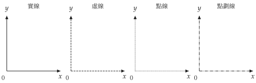
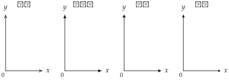

# Canvas 畫布

<span id="sec-canvas"></span>

`Canvas` 以 `matplotlib` 的 `Figure` 與 `Axes` 為基礎，提供無異曲線、預算線與均衡點等圖層。

## 建構函式

<!-- api: agora.utility_viz.guides_canvas_1 -->

建立畫布，並設定座標範圍、軸標籤、字型、線條樣式與主題。未明確傳入的視覺設定取自目前的 `Config` 與 `Theme`。

<span id="tab-x-label-pos"></span>

| 值 | 位置 |
| --- | --- |
| `"top"` | 箭頭上方 |
| `"right"` | 箭頭右側 |
| `"bottom"` | 箭頭下方 |

<span id="tab-y-label-pos"></span>

| 值 | 位置 |
| --- | --- |
| `"left"` | 箭頭左側 |
| `"top"` | 箭頭上方 |
| `"right"` | 箭頭右側 |

## 繪圖方法

`add_*` 方法在目前的畫布加入圖層，並回傳同一個 `Canvas`，因此可串接呼叫（詳見[串接呼叫](canvas.md#sec-chaining)）。

<!-- api: agora.utility_viz.guides_canvas_2 -->

繪製無異曲線。

```python
lvls = levels.around(eq.utility, n=5)
cvs.add_utility(
    model,
    levels=lvls,
    highlight_level=eq.utility,
    show_ic_labels=True,
    label_style="ordinal",
)
```

```python
from utility_viz import Canvas, Config, levels, solve
from utility_viz.models import CobbDouglas

# 本手冊圖形所用的設定
Config.load("manual.toml").use()

model = CobbDouglas(alpha=0.5, beta=0.5)
eq = solve(model, px=2.0, py=3.0, income=30.0)

# 斜體的 x 與 y
cvs = Canvas(x_max=20, y_max=15, x_label="$x$", y_label="$y$")
# 圍繞最適點的三條曲線
cvs.add_utility(model, levels=levels.around(eq.utility, n=3))
cvs.save("add_utility.png")
```

<span id="fig-add-utility"></span>

{ .ev-figure-sm }

三條無異曲線。 [下載繪製腳本](../../../assets/utility-viz/agora/canvas/add_utility.py){ .ev-download download="" }
{ .ev-caption }

<!-- api: agora.utility_viz.guides_canvas_3 -->

繪製預算線 $p_x x + p_y y = I$。

```python
from utility_viz import Canvas, Config

# 本手冊圖形所用的設定
Config.load("manual.toml").use()

# 斜體的 x 與 y
cvs = Canvas(x_max=20, y_max=15, x_label="$x$", y_label="$y$")
# 預算線與可行集合
cvs.add_budget(2.0, 3.0, 30.0, fill=True)
cvs.save("add_budget.png")
```

{ .ev-figure-sm }

預算線與陰影。 [下載繪製腳本](../../../assets/utility-viz/agora/canvas/add_budget.py){ .ev-download download="" }
{ .ev-caption }

<!-- api: agora.utility_viz.guides_canvas_4 -->

標記 `solve()` 回傳的最適消費組合。

```python
from utility_viz import Canvas, Config, levels, solve
from utility_viz.models import CobbDouglas

# 本手冊圖形所用的設定
Config.load("manual.toml").use()

model = CobbDouglas(alpha=0.5, beta=0.5)
eq = solve(model, px=2.0, py=3.0, income=30.0)

# 斜體的 x 與 y
cvs = Canvas(x_max=20, y_max=15, x_label="$x$", y_label="$y$")
cvs.add_utility(model, levels=levels.around(eq.utility, n=3))
cvs.add_budget(2.0, 3.0, 30.0, fill=True)
# 最適點與通往座標軸的虛線
cvs.add_equilibrium(eq)
cvs.save("add_equilibrium.png")
```

{ .ev-figure-sm }

均衡點與虛線。 [下載繪製腳本](../../../assets/utility-viz/agora/canvas/add_equilibrium.py){ .ev-download download="" }
{ .ev-caption }

<!-- api: agora.utility_viz.guides_canvas_5 -->

繪製通過原點、斜率為 `slope`（$\mathrm{d} y / \mathrm{d} x$）的射線，用於標記擴張路徑或固定比例。

```python
from utility_viz import Canvas, Config, levels, solve
from utility_viz.models import CobbDouglas

# 本手冊圖形所用的設定
Config.load("manual.toml").use()

model = CobbDouglas(alpha=0.5, beta=0.5)
eq = solve(model, px=2.0, py=3.0, income=30.0)

# 斜體的 x 與 y
cvs = Canvas(x_max=20, y_max=15, x_label="$x$", y_label="$y$")
cvs.add_utility(model, levels=levels.around(eq.utility, n=3))
cvs.add_budget(2.0, 3.0, 30.0)
cvs.add_equilibrium(eq)
# 通過原點與最適點的射線
cvs.add_ray(eq.y / eq.x)
cvs.save("add_ray.png")
```

{ .ev-figure-sm }

擴張路徑射線。 [下載繪製腳本](../../../assets/utility-viz/agora/canvas/add_ray.py){ .ev-download download="" }
{ .ev-caption }

<!-- api: agora.utility_viz.guides_canvas_6 -->

在指定座標標記點。

```python
from utility_viz import Canvas, Config, Label, levels, solve
from utility_viz.models import CobbDouglas

# 本手冊圖形所用的設定
Config.load("manual.toml").use()

model = CobbDouglas(alpha=0.5, beta=0.5)
eq = solve(model, px=2.0, py=3.0, income=30.0)

# 斜體的 x 與 y
cvs = Canvas(x_max=20, y_max=15, x_label="$x$", y_label="$y$")
# 一條無異曲線 u = 5
cvs.add_utility(model, levels=[5.0])
cvs.add_budget(2.0, 3.0, 30.0)
# 與預算線交於兩點
# 以 Label 放在點旁
cvs.add_point(
    3.17, 7.89, label=Label(text="A", position="top-right")
)
cvs.add_point(
    11.83, 2.11, label=Label(text="B", position="top-right")
)
cvs.save("add_point.png")
```

{ .ev-figure-sm }

一條無異曲線與預算線交於兩點 $A$ 與 $B$。 [下載繪製腳本](../../../assets/utility-viz/agora/canvas/add_point.py){ .ev-download download="" }
{ .ev-caption }

<!-- api: agora.utility_viz.guides_canvas_7 -->

`show()` 開啟互動視窗；`save()` 依副檔名匯出檔案（詳見[匯出](export.md#sec-export)），並釋放對應的 `matplotlib` 圖形，因此應最後呼叫。

```python
from utility_viz import Canvas, Config, levels, solve
from utility_viz.models import CobbDouglas

# 本手冊圖形所用的設定
Config.load("manual.toml").use()

model = CobbDouglas(alpha=0.5, beta=0.5)
eq = solve(model, px=2.0, py=3.0, income=30.0)

# 斜體的 x 與 y
cvs = Canvas(x_max=20, y_max=15, x_label="$x$", y_label="$y$")
cvs.add_utility(model, levels=levels.around(eq.utility, n=3))
cvs.add_budget(2.0, 3.0, 30.0, fill=True)
# 均衡點與擴張路徑
cvs.add_equilibrium(eq, show_ray=True)
cvs.save("show_save.png")
```

<span id="fig-show-save"></span>

{ .ev-figure-sm }

完整畫布。 [下載繪製腳本](../../../assets/utility-viz/agora/canvas/show_save.py){ .ev-download download="" }
{ .ev-caption }

## 樣式

<span id="sec-styles"></span>

`LineStyle` 定義線型，`ArrowStyle` 定義箭頭樣式，`Stroke` 統一設定線寬、線型、顏色與箭頭，可套用於座標軸、預算線、路徑與投影線。

### 線條樣式

<!-- api: agora.utility_viz.guides_canvas_8 -->

提供實線、虛線、點線與點畫線（參見[四種線條樣式。](canvas.md#fig-line-styles)）。座標軸接受列舉值或對應字串；其他線條透過 `Stroke(style=...)` 設定。
`LineStyle` 就是 MosaicKit 的 `DashStyle`，沿用舊名稱。

```python
import matplotlib.pyplot as plt

from utility_viz import Canvas, Config, LineStyle

# 本手冊圖形所用的設定
Config.load("manual.toml").use()

styles = [
    LineStyle.SOLID,
    LineStyle.DASHED,
    LineStyle.DOTTED,
    LineStyle.DASHDOT,
]
titles = ["實線", "虛線", "點線", "點劃線"]

fig, axes = plt.subplots(1, 4, figsize=(7.6, 2.0))
for ax, style, title in zip(axes, styles, titles):
    Canvas(
        title=title,
        x_label="$x$",
        y_label="$y$",
        x_line_style=style,
        y_line_style=style,
        # 使用有中文字形的字體
        font="PingFang TC",
        fig=fig,
        ax=ax,
    )

# 預留軸標籤的空間
fig.subplots_adjust(wspace=0.62)
fig.savefig("line_styles.png", dpi=160)
```

<span id="fig-line-styles"></span>

{ .ev-figure-sm }

四種線條樣式。 [下載繪製腳本](../../../assets/utility-viz/agora/canvas/line_styles.zh-TW.py){ .ev-download download="" }
{ .ev-caption }

### 箭頭樣式

<!-- api: agora.utility_viz.guides_canvas_9 -->

提供四種箭頭樣式（參見[四種箭頭樣式。](canvas.md#fig-arrow-styles)）。座標軸透過 `x_arrow_style`、`y_arrow_style` 設定；其他線條透過 `Stroke(arrow=...)` 設定。
`ArrowStyle` 是 MosaicKit 的；`SIMPLE` 即 `OPEN`，仍接受 `"->"` 與 `"-|>"`。

```python
import matplotlib.pyplot as plt

from utility_viz import ArrowStyle, Canvas, Config

# 本手冊圖形所用的設定
Config.load("manual.toml").use()

styles = [
    ArrowStyle.SIMPLE,
    ArrowStyle.TRIANGLE,
    ArrowStyle.FANCY,
    ArrowStyle.WEDGE,
]
titles = ["簡單", "三角形", "花式", "楔形"]

fig, axes = plt.subplots(1, 4, figsize=(7.6, 2.0))
for ax, style, title in zip(axes, styles, titles):
    Canvas(
        title=title,
        x_label="$x$",
        y_label="$y$",
        x_arrow_style=style,
        y_arrow_style=style,
        # 使用有中文字形的字體
        font="PingFang TC",
        fig=fig,
        ax=ax,
    )

# 預留軸標籤的空間
fig.subplots_adjust(wspace=0.62)
fig.savefig("arrow_styles.png", dpi=160)
```

<span id="fig-arrow-styles"></span>

{ .ev-figure-sm }

四種箭頭樣式。 [下載繪製腳本](../../../assets/utility-viz/agora/canvas/arrow_styles.zh-TW.py){ .ev-download download="" }
{ .ev-caption }

### Stroke

<!-- api: agora.utility_viz.guides_canvas_10 -->

設定線寬、線型、顏色、箭頭與透明度。未指定的欄位沿用目前主題。`opacity` 的有效範圍為 0 至 1。

### Axis

<!-- api: agora.utility_viz.guides_canvas_11 -->

集中設定單一座標軸的標籤、標籤位置與線條。`Canvas`、`Figure`、`DemandDiagram` 與 `EdgeworthBox` 均接受 `x_axis` 與 `y_axis`。若同時傳入簡寫參數，`Axis` 中已設定的欄位優先。

```python
from utility_viz import Axis, Canvas, Label, Stroke

cvs = Canvas(
    x_axis=Axis(
        label=Label(text="x_1", fontsize=16),
        label_position="bottom",
        stroke=Stroke(width=1.2),
    ),
    y_axis=Axis(label="x_2"),
)
```

### Marker 與 Label

<!-- api: agora.utility_viz.guides_canvas_12 -->

設定標記點的顏色、大小、形狀與透明度。`shape` 接受 `matplotlib` 的標記字串，例如 `"o"`、`"s"`、`"^"`、`"D"` 與 `"*"`。

<!-- api: agora.utility_viz.guides_canvas_13 -->

設定文字、位置、位移、顏色、字級、可見性與透明度。位置可為上、下、左、右或四個角落；`Label(visible=False)` 隱藏對應文字。

```python
from utility_viz import Label, Marker

cvs.add_equilibrium(
    eq,
    marker=Marker(shape="s", size=8),
    label=Label(position="bottom-left", offset=8),
)
cvs.add_point(
    12,
    2,
    marker=Marker(color="black", shape="D"),
    label=Label(text="A", position="left", fontsize=14),
)
```

### Fill

<!-- api: agora.utility_viz.guides_canvas_14 -->

設定陰影區域的顏色與透明度。`alpha` 是 `opacity` 的相容簡寫；同一次呼叫不得傳入不同的 `alpha` 與 `opacity`。

```python
from utility_viz import Fill

cvs.add_budget(
    2,
    3,
    30,
    fill=Fill(color="lightgrey", opacity=0.4),
)
```

## 串接呼叫

<span id="sec-chaining"></span>

`add_*` 方法支援串接呼叫，最後以 `save()` 匯出：

```python
Canvas(x_max=20, y_max=15).add_utility(
    model, levels=lvls
).add_budget(2.0, 3.0, 30.0, fill=True).add_equilibrium(
    eq, show_ray=True
).save(
    "figure.png"
)
```
