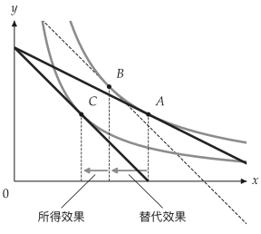

# 多面板圖與需求圖

<span id="sec-figures"></span>

## 多面板圖

<!-- api: agora.utility_viz.guides_consumer_1 -->

建立多面板圖，座標範圍與樣式參數與 `Canvas` 相同。使用 `fig[idx]` 取得面板，再呼叫 `add_utility()`、`add_budget()` 等繪圖方法。

```python
from utility_viz import Config, Figure, Layout, levels, solve
from utility_viz.models import CobbDouglas

# 載入圖形設定
Config.load("econ-viz.toml").use()

fig = Figure(
    Layout.SIDE_BY_SIDE,
    x_max=20,
    y_max=15,
    x_label="$x$",
    y_label="$y$",
)

# 價格上漲前後
cases = [
    (CobbDouglas(alpha=0.5, beta=0.5), 2.0, 3.0, 30.0),
    (CobbDouglas(alpha=0.3, beta=0.7), 4.0, 3.0, 30.0),
]
for idx, (model, px, py, income) in enumerate(cases):
    eq = solve(model, px=px, py=py, income=income)
    # 每個面板都是 Canvas
    panel = fig[idx]
    panel.add_utility(
        model, levels=levels.around(eq.utility, n=5)
    )
    panel.add_budget(px, py, income, fill=True)
    panel.add_equilibrium(eq, show_ray=True)
fig.save("side_by_side.png")
```

<figure class="ev-fig" markdown>

{ .ev-figure-lg }

<div class="ev-downloads"><a class="ev-download" href="../../../assets/utility-viz/agora/consumer/side_by_side.zh-TW.py" download aria-label="下載生圖原始檔"><svg viewBox="0 0 24 24" aria-hidden="true"><path d="M12 4v11m0 0-4.5-4.5M12 15l4.5-4.5M5 20h14" fill="none" stroke="currentColor" stroke-width="2" stroke-linecap="round" stroke-linejoin="round"/></svg><span>下載生圖原始檔</span></a></div>

<figcaption markdown>價格變動前後比較</figcaption>

</figure>

<!-- api: agora.utility_viz.guides_consumer_2 -->

內建版面有 `SINGLE`、`STACKED`、`SIDE_BY_SIDE`、`TOP_TWO_BOTTOM_ONE`、`TOP_ONE_BOTTOM_TWO`、`GRID_2X2` 和 `GRID_3X3`。

## 路徑

<!-- api: agora.utility_viz.guides_consumer_3 -->

`PricePath` 與 `IncomePath` 分別計算價格、所得變動時的最適消費組合。使用 `Canvas.add_path()` 繪製價格消費曲線（PCC）或所得消費曲線（ICC）；`PricePath` 也可用於需求圖。

<!-- api: agora.utility_viz.guides_consumer_4 -->

將 `PricePath` 或 `IncomePath` 加入畫布。[價格消費曲線](consumer.md#fig-price-path)中，Cobb-Douglas 模型在 $p_x$ 變動時，$y$ 的需求量不變，因此 PCC 為水平線。

```python
from utility_viz import (
    Canvas,
    Config,
    LinearBudget,
    PricePath,
    levels,
)
from utility_viz.models import CobbDouglas

# 載入圖形設定
Config.load("econ-viz.toml").use()

model = CobbDouglas(alpha=0.5, beta=0.5)
budget = LinearBudget(px=2.0, py=2.0, income=40.0)
path = PricePath(
    model,
    budget=budget,
    price="px",
    price_range=(0.8, 6.0),
    n=40,
)

# 圍繞中段最適點的曲線
eq = path.equilibria[len(path.equilibria) // 2]

cvs = Canvas(x_max=25, y_max=20, x_label="$x$", y_label="$y$")
cvs.add_utility(model, levels=levels.around(eq.utility, n=5))
# 價格消費曲線
cvs.add_path(path)
cvs.save("price_path.png")
```

<span id="fig-price-path"></span>

<figure class="ev-fig" markdown>

{ .ev-figure-sm }

<div class="ev-downloads"><a class="ev-download" href="../../../assets/utility-viz/agora/consumer/price_path.zh-TW.py" download aria-label="下載生圖原始檔"><svg viewBox="0 0 24 24" aria-hidden="true"><path d="M12 4v11m0 0-4.5-4.5M12 15l4.5-4.5M5 20h14" fill="none" stroke="currentColor" stroke-width="2" stroke-linecap="round" stroke-linejoin="round"/></svg><span>下載生圖原始檔</span></a></div>

<figcaption markdown>價格消費曲線</figcaption>

</figure>

## 需求圖

<!-- api: agora.utility_viz.guides_consumer_5 -->

依 `PricePath` 繪製兩個面板：上方為預算線與最適消費組合，下方為對應的 Marshall 需求曲線（參見[需求曲線最適點](consumer.md#fig-demand)）。目前只接受 `PricePath`，並分別處理平滑、拗折與角解。`show_pcc=True` 在上方面板顯示價格消費曲線。

```python
from utility_viz import DemandDiagram, LinearBudget, PricePath
from utility_viz.models import CobbDouglas

model = CobbDouglas(alpha=0.5, beta=0.5)
budget = LinearBudget(px=2.0, py=2.0, income=40.0)
path = PricePath(
    model,
    budget=budget,
    price="px",
    price_range=(0.8, 6.0),
    n=40,
)

fig = DemandDiagram(path, title="Demand: Cobb-Douglas")
fig.add_marshallian_panel(
    price_markers=[1.5, 4.0],
    show_pcc=False,
    show_demand_guides=True,
)
fig.save("demand_cobb_douglas.png")
```

下圖由 MosaicKit 圖層畫成，標籤可逐一手動擺放。

<span id="fig-demand"></span>

<figure class="ev-fig" markdown>

{ .ev-figure-lg }

<div class="ev-downloads"><a class="ev-download" href="../../../assets/utility-viz/agora/consumer/demand.zh-TW.py" download aria-label="下載生圖原始檔"><svg viewBox="0 0 24 24" aria-hidden="true"><path d="M12 4v11m0 0-4.5-4.5M12 15l4.5-4.5M5 20h14" fill="none" stroke="currentColor" stroke-width="2" stroke-linecap="round" stroke-linejoin="round"/></svg><span>下載生圖原始檔</span></a></div>

<figcaption markdown>需求曲線最適點</figcaption>

</figure>

## 價格效果分解

<!-- api: agora.utility_viz.guides_consumer_6 -->

將價格效果分解為替代效果與所得效果。Hicks 補償 [Hicks (1939)](../project/references.md#hicks1939) 維持原效用水準；Slutsky 補償 [Slutsky (1915)](../project/references.md#slutsky1915) 則使原消費組合在新價格下恰好可負擔。回傳值包含下列欄位：

<!-- api: agora.utility_viz.guides_consumer_7 -->

決定補償組合 B 的方式。

<!-- api: agora.utility_viz.guides_consumer_8 -->

在畫布上標示 A、B、C 三個消費組合、預算線、無異曲線與效果箭頭。Hicks 分解繪製通過 A 與 C 的曲線；Slutsky 分解另繪製通過 B 的曲線。

<!-- api: agora.utility_viz.guides_consumer_9 -->

設定替代效果或所得效果的顏色、橫軸下方箭頭高度、標籤及透明度。線條本身仍可由 `substitution_stroke` 或 `income_stroke` 覆寫。

<!-- api: agora.utility_viz.guides_consumer_10 -->

`"auto"` 選擇遮蔽圖形最少的內側角落；四個角落皆與圖形重疊時，圖例移到右側。也可指定 `"upper left"` 等內側角落，或 `"top"`、`"bottom"`、`"left"`、`"right"` 等外側位置。`Legend(visible=False)` 隱藏圖例。

```python
from utility_viz import (
    Canvas,
    DecompositionMethod,
    Effect,
    Label,
    Legend,
    decompose_price_effect,
)
from utility_viz.models import CobbDouglas

model = CobbDouglas(alpha=0.5, beta=0.5)
result = decompose_price_effect(
    model,
    px=(2.0, 4.0),
    py=3.0,
    income=60.0,
    method=DecompositionMethod.HICKS,
)

(
    Canvas(x_max=25, y_max=25, title="Hicks decomposition")
    .add_decomposition(
        result,
        show_arrows=True,
        label_effects=True,
        show_x_projections=True,
        substitution=Effect(label="SE"),
        income=Effect(label="IE", opacity=0.8),
        curve_label=Label(position="right"),
        legend=Legend(position="bottom"),
    )
    .save("hicks.png")
)
```

下圖同樣由 MosaicKit 圖層畫成，兩個效果的名稱標在座標軸下方。

<figure class="ev-fig" markdown>

{ .ev-figure-lg }

<div class="ev-downloads"><a class="ev-download" href="../../../assets/utility-viz/agora/consumer/hicks.zh-TW.py" download aria-label="下載生圖原始檔"><svg viewBox="0 0 24 24" aria-hidden="true"><path d="M12 4v11m0 0-4.5-4.5M12 15l4.5-4.5M5 20h14" fill="none" stroke="currentColor" stroke-width="2" stroke-linecap="round" stroke-linejoin="round"/></svg><span>下載生圖原始檔</span></a></div>

<figcaption markdown>Hicks 分解</figcaption>

</figure>

## Edgeworth 箱形圖

<!-- api: agora.utility_viz.guides_consumer_11 -->

建立兩人交換經濟的 Edgeworth 箱形圖 [Edgeworth (1881)](../project/references.md#edgeworth1881)。$A$ 的原點在左下，$B$ 的原點在右上。使用 `add_*` 方法加入稟賦、契約曲線、核、價格線與 Walras 均衡。

平滑偏好的契約曲線使用 `method="mrs"`；有拗折點、角解或自訂分段效用函數時，使用 `method="pareto"`。

```python
from utility_viz import EdgeworthBox
from utility_viz.models import CobbDouglas

box = EdgeworthBox(
    CobbDouglas(alpha=0.8, beta=0.2),
    CobbDouglas(alpha=0.2, beta=0.8),
    total_x=12.0,
    total_y=10.0,
    title="Asymmetric Cobb-Douglas",
)

(
    box.add_endowment(5.0, 4.0)
    .add_contract_curve(n=100, method="mrs")
    .add_core()
    .add_price_line(px=1.2, py=1.0)
    .add_walrasian_equilibrium(px=1.2, py=1.0)
    .show_legend(loc="center left", bbox_to_anchor=(1.02, 0.5))
    .save("edgeworth.png")
)
```

下圖同樣由 MosaicKit 圖層畫成，以教科書的圖為藍本，畫出兩人的無異曲線。

<figure class="ev-fig" markdown>

{ .ev-figure-lg }

<div class="ev-downloads"><a class="ev-download" href="../../../assets/utility-viz/agora/consumer/edgeworth.zh-TW.py" download aria-label="下載生圖原始檔"><svg viewBox="0 0 24 24" aria-hidden="true"><path d="M12 4v11m0 0-4.5-4.5M12 15l4.5-4.5M5 20h14" fill="none" stroke="currentColor" stroke-width="2" stroke-linecap="round" stroke-linejoin="round"/></svg><span>下載生圖原始檔</span></a></div>

<figcaption markdown>Edgeworth 箱形圖</figcaption>

</figure>
