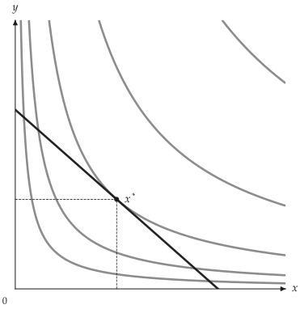
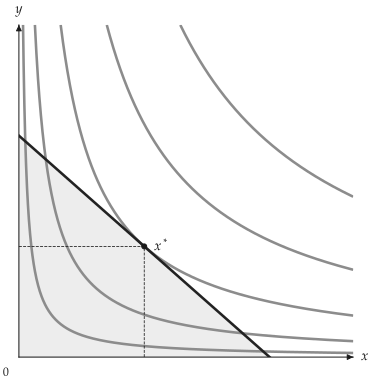

# 進階模型

<span id="sec-advanced"></span>

`CustomUtility` 定義二變數效用函數。`MultiGoodCD` 表示多商品 Cobb-Douglas；固定其他商品的數量後，可將模型投影為二維圖。

### 自訂效用函數

<!-- api: agora.utility_viz.models_advanced_1 -->

接受向量化的 Python 函數，回傳的模型可用於 `solve()` 與 `Canvas`。函數須接受兩個 `NumPy` 陣列，並回傳相同形狀的效用陣列。以下以對數效用為例：

$$
u(x, y) = ln x + ln y.
$$

```python
import numpy as np

from utility_viz import Canvas, Config, levels, solve
from utility_viz.models import CustomUtility

# 本手冊圖形所用的設定
Config.load("manual.toml").use()

# 任何可以處理陣列的 x y 函數都能當效用函數
model = CustomUtility(
    func=lambda x, y: np.log(x) + np.log(y), name="log+log"
)
eq = solve(model, px=2.0, py=3.0, income=30.0)

cvs = Canvas(x_max=20, y_max=15, x_label="$x$", y_label="$y$")
cvs.add_utility(model, levels=levels.around(eq.utility, n=5))
cvs.add_budget(2.0, 3.0, 30.0)
cvs.add_equilibrium(eq)
cvs.save("custom.png")
```

{ .ev-figure-sm }

### 多商品 Cobb-Douglas

<!-- api: agora.utility_viz.models_advanced_2 -->

`MultiGoodCD` 表示 $N$ 種商品的 Cobb-Douglas：

$$
u(x_1, ..., x_N) = product_{i=1}^N x_i^{\alpha_i}.
$$

使用 `freeze()` 固定 $x$、$y$ 以外的商品數量，回傳可用於二維 `Canvas` 的 `CustomUtility`。

```python
from utility_viz import Canvas, Config, levels, solve
from utility_viz.models import MultiGoodCD

# 本手冊圖形所用的設定
Config.load("manual.toml").use()

# 三種商品 x y z 固定 z = 10 畫出 (x, y) 平面
model = MultiGoodCD({"x": 0.3, "y": 0.3, "z": 0.4})
two_good_model = model.freeze(z=10.0)
eq = solve(two_good_model, px=2.0, py=3.0, income=30.0)

cvs = Canvas(x_max=20, y_max=15, x_label="$x$", y_label="$y$")
cvs.add_utility(
    two_good_model, levels=levels.around(eq.utility, n=5)
)
cvs.add_budget(2.0, 3.0, 30.0, fill=True)
cvs.add_equilibrium(eq)
cvs.save("multigood.png")
```

{ .ev-figure-sm }

### 與後端無關的場景

<span id="sec-scenes"></span>

`utility_viz.core.scenes` 產生與 `Canvas` 相同的經濟元件，但輸出為不可變的 `mosaickit` 圖層，而非直接繪製在 `matplotlib` 座標軸上。每個圖層都有固定的 id（`budget`、`budget.fill`、`equilibrium.drop`、`ic.2` 等）與以點分隔的主題角色（`utility.budget`、`utility.indifference.secondary` 等），因此場景可供檢查、修改，並交由任何 `mosaickit` 後端繪製。這是額外新增的進階 API，`Canvas` 與其他圖形不受影響。

<!-- api: agora.utility_viz.models_advanced_3 -->

分別回傳預算線 $p_x x + p_y y = I$、均衡消費組合，以及模型在 $[0, x_{\max}] \times [0, y_{\max}]$ 範圍內無異曲線的圖層 tuple。樣式來自主題角色，也可傳入部分欄位的 `Stroke`、`Marker` 與 `Fill` 覆寫。`indifference_layers` 回傳 `(layers, levels)`，並以 `bezierkit` 將曲線描成 Bézier 路徑，因此也能處理非單調與有折角的效用函數。

<!-- api: agora.utility_viz.models_advanced_4 -->

`UTILITY_THEME` 是含 `utility.*` 角色的 `mosaickit` 主題，配色與預設主題相同。`canvas_to_tikz(canvas)` 將場景匯出為 TikZ，曲線使用原生的 `.. controls ..` 語法。

```python
from mosaickit import Canvas, CanvasSpec, quadrant_axes

from utility_viz.core.scenes import (
    UTILITY_THEME,
    budget_layers,
    canvas_to_tikz,
    equilibrium_layers,
    indifference_layers,
)
from utility_viz.models import CobbDouglas, solve

model = CobbDouglas(alpha=0.5, beta=0.5)
eq = solve(model, px=2.0, py=3.0, income=30.0)
u = eq.utility
ic, _ = indifference_layers(
    model, [0.6 * u, u, 1.4 * u], 18, 12
)

spec = CanvasSpec(x_range=(0, 18), y_range=(0, 12))
canvas = (
    Canvas(spec, theme=UTILITY_THEME)
    .extend(quadrant_axes(18, 12))
    .extend(ic)
    .extend(budget_layers(2.0, 3.0, 30.0, fill=True))
    .extend(equilibrium_layers(eq))
)
canvas.save("scene.png")
tex = canvas_to_tikz(canvas)
```

TikZ 匯出支援路徑、填色、標記與文字圖層。描繪的效用函數在繪圖範圍內必須為有限值。
