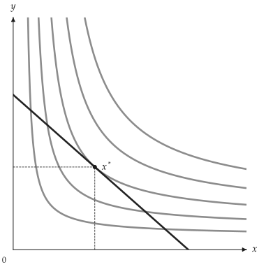
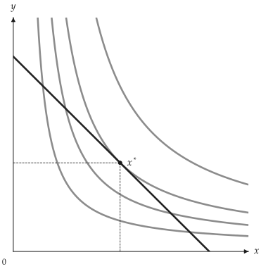
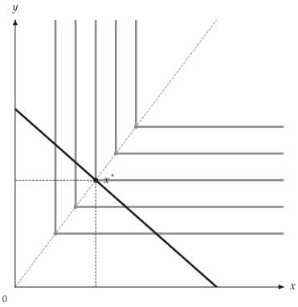
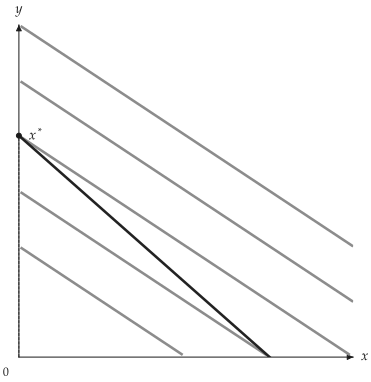
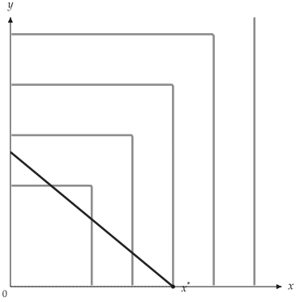
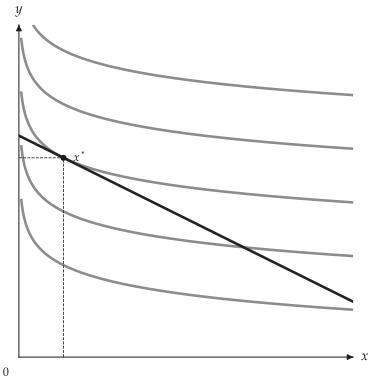
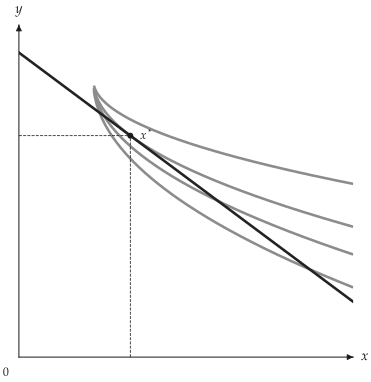
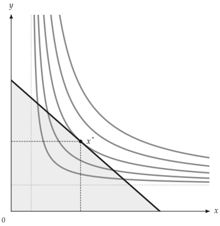
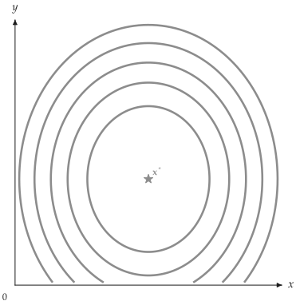

# 核心模型

<span id="sec-models"></span>

內建模型位於 `utility_viz.models`，可傳入 `solve()` 與 `Canvas.add_utility()`。本章依偏好特性分組，列出各模型的效用函數、參數、特有行為與圖形。

## 平滑偏好

Cobb-Douglas、CES 與 Translog 的無異曲線為平滑曲線；最適解取決於模型參數、價格與所得。

### Cobb-Douglas

<!-- api: agora.utility_viz.models_index_1 -->

Cobb-Douglas 效用函數 [Cobb (1928)](../project/references.md#cobb1928)：

$$
u(x, y) = x^\alpha y^\beta
$$

正指數決定兩種商品的相對權重，無異曲線以座標軸為漸近線。

### CES

<!-- api: agora.utility_viz.models_index_2 -->

CES [Arrow (1961)](../project/references.md#arrow1961) 透過 `rho` 調整商品間的替代彈性：

$$
u(x, y) = (\alpha x^\rho + \beta y^\rho)^{1 / \rho}.
$$

替代彈性為 $\sigma = 1 / (1 - \rho)$。極限形式分別為 Cobb-Douglas（$\rho \to 0$）、完全互補（$\rho \to -infinity$）與完全替代（$\rho \to 1$）。

```python
from utility_viz import Canvas, Config, levels, solve
from utility_viz.models import CES

# 圖形設定
Config.load("manual.toml").use()

model = CES(alpha=0.5, beta=0.5, rho=-0.5)
eq = solve(model, px=2.0, py=3.0, income=30.0)

cvs = Canvas(x_max=20, y_max=15, x_label="$x$", y_label="$y$")
cvs.add_utility(model, levels=levels.around(eq.utility, n=5))
cvs.add_budget(2.0, 3.0, 30.0)
cvs.add_equilibrium(eq)
cvs.save("ces.png")
```

<figure class="ev-fig" markdown>

{ .ev-figure-sm }

<div class="ev-downloads"><a class="ev-download" href="../../../assets/utility-viz/agora/models/ces.zh-TW.py" download aria-label="下載生圖原始檔"><svg viewBox="0 0 24 24" aria-hidden="true"><path d="M12 4v11m0 0-4.5-4.5M12 15l4.5-4.5M5 20h14" fill="none" stroke="currentColor" stroke-width="2" stroke-linecap="round" stroke-linejoin="round"/></svg><span>下載生圖原始檔</span></a></div>

<figcaption markdown>CES 曲線</figcaption>

</figure>

### Translog

<!-- api: agora.utility_viz.models_index_3 -->

Translog [Christensen (1975)](../project/references.md#christensen1975) 以對數的一次項、二次項與交叉項表示效用：

$$
\begin{aligned}ln u(x, y) = & \alpha_0 + \alpha_x ln x + \alpha_y ln y \\ & + 1/2 \beta_{x x} (ln x)^2 + 1/2 \beta_{y y} (ln y)^2 + \beta_{x y} ln x ln y.\end{aligned}
$$

二次項與交叉項控制曲率。所有 $\beta$ 係數為零時，退化為 Cobb-Douglas 型的對數線性形式。

```python
from utility_viz import Canvas, Config, levels, solve
from utility_viz.models import Translog

# 圖形設定
Config.load("manual.toml").use()

model = Translog(alpha_x=0.6, alpha_y=0.4, beta_xy=0.12)
eq = solve(model, px=2.0, py=3.0, income=30.0)

cvs = Canvas(x_max=18, y_max=12, x_label="$x$", y_label="$y$")
cvs.add_utility(model, levels=levels.around(eq.utility, n=4))
cvs.add_budget(2.0, 3.0, 30.0)
cvs.add_equilibrium(eq)
cvs.save("translog.png")
```

<figure class="ev-fig" markdown>

{ .ev-figure-sm }

<div class="ev-downloads"><a class="ev-download" href="../../../assets/utility-viz/agora/models/translog.zh-TW.py" download aria-label="下載生圖原始檔"><svg viewBox="0 0 24 24" aria-hidden="true"><path d="M12 4v11m0 0-4.5-4.5M12 15l4.5-4.5M5 20h14" fill="none" stroke="currentColor" stroke-width="2" stroke-linecap="round" stroke-linejoin="round"/></svg><span>下載生圖原始檔</span></a></div>

<figcaption markdown>Translog 範例</figcaption>

</figure>

## 拗折點與角解

無異曲線有拗折或為直線時，最適解可能位於拗折點或座標軸，不能僅以相切條件判定。

### 完全互補

<!-- api: agora.utility_viz.models_index_4 -->

完全互補效用函數：

$$
u(x, y) = \min\lbrace a x, b y\rbrace
$$

無異曲線呈 L 型。權重與價格為正時，最適點滿足固定比例 $a x = b y$。

轉角在圖片與 TikZ 輸出中都畫成精確的直角；以 `CustomUtility` 建立的分段 `min`/`max` 函數亦同。

```python
from utility_viz import Canvas, Config, levels, solve
from utility_viz.models import Leontief

# 圖形設定
Config.load("manual.toml").use()

model = Leontief(a=1.0, b=1.0)
eq = solve(model, px=2.0, py=3.0, income=30.0)

cvs = Canvas(x_max=20, y_max=15, x_label="$x$", y_label="$y$")
cvs.add_utility(
    model,
    levels=levels.around(eq.utility, n=5),
    show_rays=True,
    # 每個折點畫射線與標記
    show_kinks=True,
)
cvs.add_budget(2.0, 3.0, 30.0)
cvs.add_equilibrium(eq)
cvs.save("leontief.png")
```

<figure class="ev-fig" markdown>

{ .ev-figure-sm }

<div class="ev-downloads"><a class="ev-download" href="../../../assets/utility-viz/agora/models/leontief.zh-TW.py" download aria-label="下載生圖原始檔"><svg viewBox="0 0 24 24" aria-hidden="true"><path d="M12 4v11m0 0-4.5-4.5M12 15l4.5-4.5M5 20h14" fill="none" stroke="currentColor" stroke-width="2" stroke-linecap="round" stroke-linejoin="round"/></svg><span>下載生圖原始檔</span></a></div>

<figcaption markdown>完全互補射線</figcaption>

</figure>

### 完全替代

<!-- api: agora.utility_viz.models_index_5 -->

完全替代效用函數：

$$
u(x, y) = a x + b y.
$$

無異曲線為直線。每元邊際效用不同時，最適解為僅購買較高者的角解；兩者相等時，預算線上的消費組合皆為最適解。

```python
from utility_viz import Canvas, Config, levels, solve
from utility_viz.models import PerfectSubstitutes

# 圖形設定
Config.load("manual.toml").use()

model = PerfectSubstitutes(a=1.0, b=2.0)
eq = solve(model, px=2.0, py=3.0, income=30.0)

cvs = Canvas(x_max=20, y_max=15, x_label="$x$", y_label="$y$")
cvs.add_utility(model, levels=levels.around(eq.utility, n=5))
cvs.add_budget(2.0, 3.0, 30.0)
cvs.add_equilibrium(eq)
cvs.save("perfect_substitutes.png")
```

<figure class="ev-fig" markdown>

{ .ev-figure-sm }

<div class="ev-downloads"><a class="ev-download" href="../../../assets/utility-viz/agora/models/perfect_substitutes.zh-TW.py" download aria-label="下載生圖原始檔"><svg viewBox="0 0 24 24" aria-hidden="true"><path d="M12 4v11m0 0-4.5-4.5M12 15l4.5-4.5M5 20h14" fill="none" stroke="currentColor" stroke-width="2" stroke-linecap="round" stroke-linejoin="round"/></svg><span>下載生圖原始檔</span></a></div>

<figcaption markdown>完全替代角解</figcaption>

</figure>

### 最大值效用

<!-- api: agora.utility_viz.models_index_6 -->

以兩個加權數量的最大值定義效用：

$$
u(x, y) = \max\lbrace a x, b y\rbrace
$$

此偏好不具凸性。在正權重與正價格下，最適解位於效用較高的預算線軸截距。此模型以 `CustomUtility` 建立（詳見[進階模型](advanced.md#sec-advanced)）。

```python
import numpy as np

from utility_viz import Canvas, Config, levels, solve
from utility_viz.models import CustomUtility

# 圖形設定
Config.load("manual.toml").use()

model = CustomUtility(
    func=lambda x, y: np.maximum(x, y), name="maximum"
)
eq = solve(model, px=2.0, py=3.0, income=30.0)

cvs = Canvas(x_max=25, y_max=20, x_label="$x$", y_label="$y$")
cvs.add_utility(model, levels=levels.around(eq.utility, n=5))
cvs.add_budget(2.0, 3.0, 30.0)
cvs.add_equilibrium(eq)
cvs.save("maximum.png")
```

<figure class="ev-fig" markdown>

{ .ev-figure-sm }

<div class="ev-downloads"><a class="ev-download" href="../../../assets/utility-viz/agora/models/maximum.zh-TW.py" download aria-label="下載生圖原始檔"><svg viewBox="0 0 24 24" aria-hidden="true"><path d="M12 4v11m0 0-4.5-4.5M12 15l4.5-4.5M5 20h14" fill="none" stroke="currentColor" stroke-width="2" stroke-linecap="round" stroke-linejoin="round"/></svg><span>下載生圖原始檔</span></a></div>

<figcaption markdown>最大值效用</figcaption>

</figure>

## 所得與參考點

以下模型分別描述準線性偏好、最低消費需求與具有極樂點的飽和偏好。

### 準線性

<!-- api: agora.utility_viz.models_index_7 -->

準線性效用中，一種商品以線性項表示：

$$
u(x, y) = f(x) + y.
$$

在內部解範圍內，非線性商品的需求不受所得影響。`linear_in` 指定線性項對應的商品。

```python
import numpy as np

from utility_viz import Canvas, Config, levels, solve
from utility_viz.models import QuasiLinear

# 圖形設定
Config.load("manual.toml").use()

model = QuasiLinear(v_func=np.log, linear_in="y")
eq = solve(model, px=1.0, py=2.0, income=20.0)

cvs = Canvas(x_max=15, y_max=15, x_label="$x$", y_label="$y$")
cvs.add_utility(model, levels=levels.around(eq.utility, n=5))
cvs.add_budget(1.0, 2.0, 20.0)
cvs.add_equilibrium(eq)
cvs.save("quasi_linear.png")
```

<figure class="ev-fig" markdown>

{ .ev-figure-sm }

<div class="ev-downloads"><a class="ev-download" href="../../../assets/utility-viz/agora/models/quasi_linear.zh-TW.py" download aria-label="下載生圖原始檔"><svg viewBox="0 0 24 24" aria-hidden="true"><path d="M12 4v11m0 0-4.5-4.5M12 15l4.5-4.5M5 20h14" fill="none" stroke="currentColor" stroke-width="2" stroke-linecap="round" stroke-linejoin="round"/></svg><span>下載生圖原始檔</span></a></div>

<figcaption markdown>準線性偏好</figcaption>

</figure>

### Haagsma

<!-- api: agora.utility_viz.models_index_8 -->

[Haagsma (2012)](../project/references.md#haagsma2012) 效用函數為

$$
u(x, y) = \alpha_x ln(x - \gamma_x) - \alpha_y ln(\gamma_y - y).
$$

定義域為 $x > \gamma_x$ 且 $0 \le y < \gamma_y$，並要求 $0 < \alpha_x < \alpha_y$。商品 $x$ 的 Marshall 需求隨所得下降；當 $\gamma_y p_y < I < \gamma_y p_y + \gamma_x p_x$ 時，商品 $x$ 為季芬財。

所得達到 $\gamma_y p_y + \gamma_x p_x$ 時，效用在預算線上沒有有限最大值，模型會拋出 `InvalidParameterError`。

```python
from utility_viz import Canvas, Config, levels, solve
from utility_viz.models import Haagsma

# 圖形設定
Config.load("manual.toml").use()

model = Haagsma(gamma_y=10.0)
eq = solve(model, px=1.0, py=1.0, income=11.0)

cvs = Canvas(x_max=9, y_max=12, x_label="$x$", y_label="$y$")
cvs.add_utility(model, levels=levels.around(eq.utility, n=4))
cvs.add_budget(1.0, 1.0, 11.0)
cvs.add_equilibrium(eq)
cvs.save("haagsma.png")
```

<figure class="ev-fig" markdown>

{ .ev-figure-sm }

<div class="ev-downloads"><a class="ev-download" href="../../../assets/utility-viz/agora/models/haagsma.zh-TW.py" download aria-label="下載生圖原始檔"><svg viewBox="0 0 24 24" aria-hidden="true"><path d="M12 4v11m0 0-4.5-4.5M12 15l4.5-4.5M5 20h14" fill="none" stroke="currentColor" stroke-width="2" stroke-linecap="round" stroke-linejoin="round"/></svg><span>下載生圖原始檔</span></a></div>

<figcaption markdown>$\gamma_y = 10$ 的 Haagsma</figcaption>

</figure>

### Stone-Geary

<!-- api: agora.utility_viz.models_index_9 -->

Stone-Geary [Stone (1954)](../project/references.md#stone1954)[Geary (1950)](../project/references.md#geary1950) 在 Cobb-Douglas 中加入最低消費量：

$$
u(x, y) = (x - \overline{x})^\alpha (y - \overline{y})^\beta.
$$

滿足基本需求量 $\overline{x}$ 與 $\overline{y}$ 後，剩餘所得依權重分配。

```python
from utility_viz import Canvas, Config, levels, solve
from utility_viz.models import StoneGeary

# 圖形設定
Config.load("manual.toml").use()

model = StoneGeary(alpha=0.5, beta=0.5, bar_x=2.0, bar_y=2.0)
eq = solve(model, px=2.0, py=3.0, income=30.0)

cvs = Canvas(x_max=20, y_max=15, x_label="$x$", y_label="$y$")
cvs.add_utility(model, levels=levels.around(eq.utility, n=5))
cvs.add_budget(2.0, 3.0, 30.0, fill=True)
cvs.add_equilibrium(eq)
cvs.save("stone_geary.png")
```

<figure class="ev-fig" markdown>

{ .ev-figure-sm }

<div class="ev-downloads"><a class="ev-download" href="../../../assets/utility-viz/agora/models/stone_geary.zh-TW.py" download aria-label="下載生圖原始檔"><svg viewBox="0 0 24 24" aria-hidden="true"><path d="M12 4v11m0 0-4.5-4.5M12 15l4.5-4.5M5 20h14" fill="none" stroke="currentColor" stroke-width="2" stroke-linecap="round" stroke-linejoin="round"/></svg><span>下載生圖原始檔</span></a></div>

<figcaption markdown>Stone-Geary</figcaption>

</figure>

### 飽和偏好

<!-- api: agora.utility_viz.models_index_10 -->

飽和偏好以 $(x^*, y^*)$ 為效用最高的極樂點：

$$
u(x, y) = -a (x - x^*)^2 - b (y - y^*)^2.
$$

當 $a, b > 0$，偏離極樂點會使效用下降，無異曲線為封閉橢圓，偏好不具單調性。

```python
import numpy as np

from utility_viz import Canvas, Config, levels
from utility_viz.models import Satiation

# 圖形設定
Config.load("manual.toml").use()

model = Satiation(bliss_x=6.0, bliss_y=4.0)

# 曲線取自效用值網格
X, Y = np.meshgrid(
    np.linspace(0.1, 12.0, 300), np.linspace(0.1, 10.0, 300)
)

cvs = Canvas(x_max=12, y_max=10, x_label="$x$", y_label="$y$")
# u 的五個百分位數
cvs.add_utility(
    model, levels=levels.percentile(model(X, Y), n=5)
)
cvs.save("satiation.png")
```

<figure class="ev-fig" markdown>

{ .ev-figure-sm }

<div class="ev-downloads"><a class="ev-download" href="../../../assets/utility-viz/agora/models/satiation.zh-TW.py" download aria-label="下載生圖原始檔"><svg viewBox="0 0 24 24" aria-hidden="true"><path d="M12 4v11m0 0-4.5-4.5M12 15l4.5-4.5M5 20h14" fill="none" stroke="currentColor" stroke-width="2" stroke-linecap="round" stroke-linejoin="round"/></svg><span>下載生圖原始檔</span></a></div>

<figcaption markdown>極樂點飽和偏好</figcaption>

</figure>
